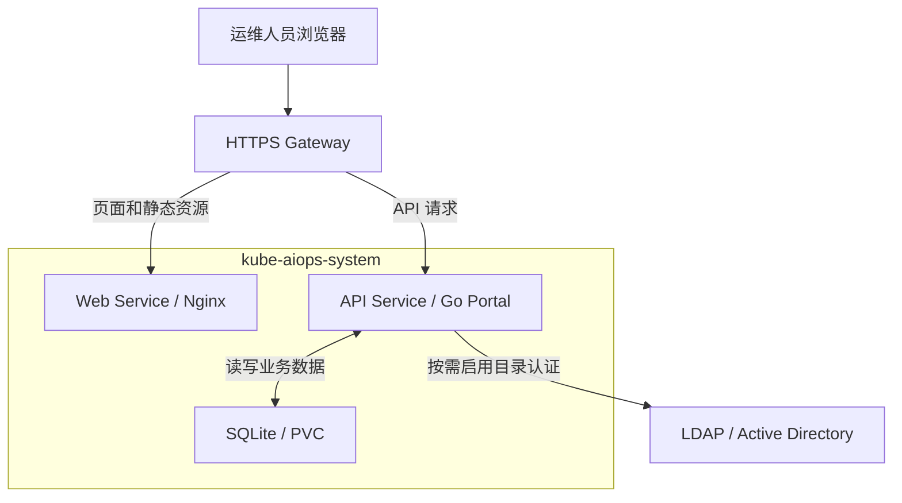
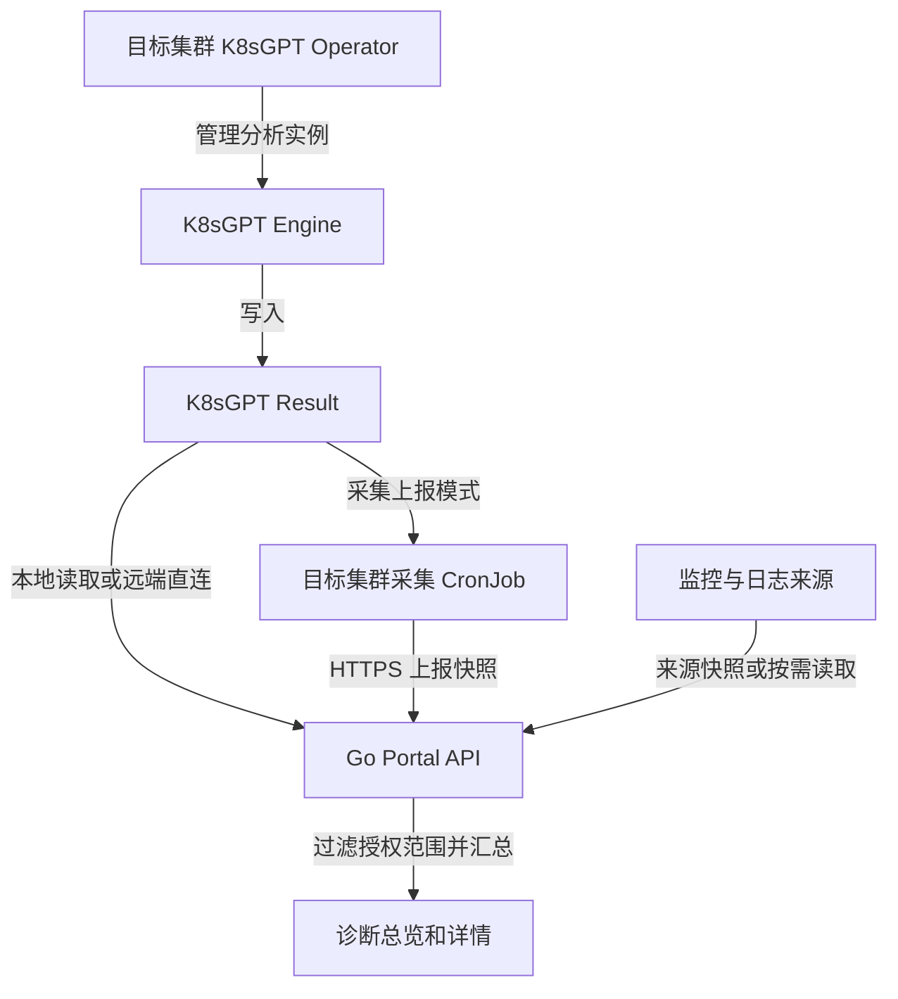

# kube-aiops

面向 Kubernetes 与主机监控的只读诊断平台。简体中文 Web Portal 汇总 K8sGPT Finding、故障事件、Zabbix 和 Alertmanager 告警，并支持在授权范围内通过 HolmesGPT 调查告警、复核诊断和使用已发布的运维知识。

## 当前功能与文档入口

| 模块 | 当前功能 | 文档与原型 |
| --- | --- | --- |
| 前端 UI | 简体中文 Portal、响应式导航、本地账号和 LDAP 登录 | [设计](docx/portal-ui/design.md) · [原型](docx/portal-ui/prototype.html) |
| 诊断控制台 | 诊断总览汇总 Finding、故障事件、Zabbix 和 Alertmanager。最近诊断分页默认 5 条，支持 10、15 条或自定义。保留原有诊断结果、趋势和统计，支持证据查看、AI 复核和告警深度调查。 | [设计](docx/diagnosis-console/design.md) · [原型](docx/diagnosis-console/prototype.html) |
| 运维知识库 | 文档检索与预览、全文与版本治理、AI 问答、导入和同步 | [设计](docx/operations-knowledge/design.md) · [原型](docx/operations-knowledge/prototype.html) |
| 资源管理 | 环境与业务线、Kubernetes 集群、命名空间归属、监控诊断及资产数据源。Zabbix、Prometheus、VictoriaLogs、Alertmanager 和 Grafana 可从「资源管理 → 数据源管理」接入。 | [设计](docx/resource-management/design.md) · [原型](docx/resource-management/prototype.html) |
| 系统管理 | 用户、用户组与角色、可批量勾选的接口权限和数据范围、LDAP/AD 配置、会话与审计 | [设计](docx/system-management/design.md) · [原型](docx/system-management/prototype.html) |

原型可从完整仓库中打开各模块的 `prototype.html`。需要分享单文件时，可在仓库根目录运行以下命令，导出五份可离线打开的交互 HTML。[原型打开方式和验收要求](docx/development-standard.md#打开与交付原型)

```bash
python3 scripts/package-prototypes.py /tmp/kube-aiops-prototypes
```

## 当前阶段

| 阶段 | 进展 | 能力 |
| --- | --- | --- |
| Phase 1.1 | 已完成 | K8sGPT Operator 和 Engine、受限 RBAC、安装与回滚 |
| Phase 1.2–1.3 | 已完成 | Go 只读 API、OpenAPI 契约、简体中文 Web Portal 和本地 Demo |
| Phase 1.4 | 已完成 | 身份认证与授权、结构化审计、响应脱敏和生产启动门禁 |
| Phase 2 | 已完成 | Kubernetes Events、Prometheus、VictoriaLogs、Alertmanager 四类证据关联 |
| Platform Portal | 已实现 | 多集群资源管理、运维知识库、LDAP 与接口权限配置、管理员组继承及操作审计 |
| Phase 3 | Holmes 首轮已合入，待客户环境联调 | 告警调查、Finding 复核、事件 RCA 和知识问答，持续完善证据轨迹与 Runbook |
| Phase 4–5 | 已规划 | 人工审批修复与受控自动修复 |

交付与验收记录见 [Phase 1.4](docx/phase-1.4-completion.md) 和 [Phase 2](docx/phase-2-completion.md)。后续目标见 [Phase 3–5 路线图](docx/phase-3-5-roadmap.md)。集群验证基线为 [Kubernetes v1.36.4](docx/kubernetes-v1.36-baseline.md)。

系统管理支持按诊断控制台、运维知识库、资源管理和系统管理浏览权限点。接口权限可逐项或按当前结果批量勾选，并绑定数据范围后保存。超级管理员可让 LDAP 员工通过用户组继承系统管理员。相关需求、原型及验收用例见 [权限目录](docx/system-management/00-prd.md#角色工作区与权限目录)。

## Web Portal Demo

```bash
make portal-demo
```

打开 <http://127.0.0.1:4173/#/findings>，查看两条中文样例诊断和四类关联证据。Demo 运行真实 Go API，通过本地 HTTPS 样例服务模拟集群和可观测性数据源，可独立于 Kubernetes 运行。远程访问可设置 `PORTAL_DEMO_HOST` 和 `PORTAL_DEMO_PORT`。运行 `make portal-demo-check` 可自动验收。依赖和演示步骤见 [Portal Demo](docx/portal-demo.md)。

## 安装与部署

`make install` 部署 K8sGPT Operator 和 Engine。Go API 与 Web Portal 按需独立部署。详见 [安装部署指南](docx/install-deployment.md)，其中包括在现有 Kubernetes 集群部署、内网镜像同步、可观测性配置和生产部署。Holmes 使用独立内部服务，通过 Portal API 的 Secret 绑定启用，完整步骤见 [部署 HolmesGPT](docx/install-deployment.md#部署-holmesgpt)。

管理多个集群时，从 **资源管理 → Kubernetes 集群管理 → 接入集群** 添加实例。[控制台接入步骤](docx/install-deployment.md#在控制台接入-kubernetes-集群)

### HolmesGPT 从哪里开始

1. 部署 Portal API 和 Web，并配置至少一个可用的告警数据源。
2. 按[部署 HolmesGPT](docx/install-deployment.md#部署-holmesgpt)创建模型 Secret、安装独立服务并检查模型响应。指南以 Chart `0.24.3` 为示例，命令直接使用示例名称。
3. 先绑定一条 Zabbix 告警的真实数据源 ID、环境和业务范围。为试点账号配置读取权限与 `diagnosis.health.investigate`，再从 **诊断控制台 → 诊断总览 → 告警详情 → AI 深度调查** 验收。
4. 按需追加 Alertmanager、Finding、故障事件或 Wiki 绑定。Finding 和故障事件 RCA 的既有诊断模型还需启用。Wiki 使用独立 Holmes 实例处理已授权的发布章节。

## 当前支持基线

```text
Kubernetes:       v1.36.4
kubectl:          v1.36.4
Go language:      1.26.0
Go toolchain:     1.26.5
K8sGPT Operator:  v0.2.29
K8sGPT Engine:    v0.4.41
```

统一版本源：

```text
config/platform-versions.env
```

K8sGPT Engine、Operator 等默认上游运行时镜像使用 `tag@sha256`
不可变引用；GitHub Actions 使用完整 commit SHA 固定。平台基线一致性由
`tests/platform-baseline-test.py` 强制校验。

## 安全边界

默认 K8sGPT Engine 的集群权限采用以下边界。Portal API 按身份和范围授权，部分可选功能使用独立凭据和单对象读取授权。

- 使用固定 `k8sgpt` ServiceAccount 承载 Engine 权限；
- 业务资源只允许 `get/list/watch`；
- Secret 读取禁止；
- `pods/log` 读取禁止；
- `create/update/patch/delete/deletecollection` 禁止；
- Mutation / Auto Remediation 禁用；
- Namespace egress 仅允许 DNS、HTTPS 和 Kubernetes API 端口；
- AI 分析默认启用匿名化；
- Result CR 作为 K8sGPT 与 Portal Backend 的结构化边界；
- Raw Result CR / Raw Kubernetes Object 不通过 Portal API 暴露。

Holmes 使用独立的工具配置与凭据。Portal API 先校验当前记录权限，再按绑定范围调用内部服务。Wiki 知识问答只传入已授权的发布章节。

## 架构拓扑

### 功能架构

Portal 首页导航由页面注册表维护，按账号权限展示五个业务入口。技术文档中的「前端 UI」对应各模块共用的登录页、导航和页面布局。[页面注册表](web/src/domain/page-registry.ts) · [模块文档入口](docx/development-standard.md#模块文档入口)

| 业务入口 | 页面和职责 |
| --- | --- |
| 诊断控制台 | 诊断总览统一展示 Finding、故障事件、Zabbix 和 Alertmanager，并提供筛选、趋势和分页。故障详情包含 AI 根因分析、关联证据和拓扑。原有诊断结果仍有独立入口，健康告警详情提供 AI 深度调查。 |
| 资源管理 | Kubernetes 集群管理、命名空间归属、环境与业务线目录、数据源管理。远端集群从控制台选择外部直连或采集上报。 |
| 运维知识库 | 知识检索、详情、AI 问答与知识治理，覆盖文档版本、发布及远端同步。 |
| AI 服务 | 管理员查看 Holmes 绑定、按环境筛选、检查服务就绪状态，也可从 AI 技能页进入已有调查工作流。 | [部署与配置](docx/install-deployment.md#部署-holmesgpt) |
| AI 服务 | 查看实际部署绑定与模型别名、测试 Holmes 就绪状态、进入已有调查工作流。 |
| 系统管理 | 本地账号和 LDAP/AD 认证配置、用户与用户组、角色和接口权限、密码及操作审计。 |

### 生产部署拓扑

生产示例使用同一 HTTPS 域名，Gateway 将页面请求和 API 请求分别发往两个 Service。Web 容器中的 Nginx 提供静态页面和前端路由，Go API 负责业务接口、鉴权和数据访问。[Web HTTPRoute](deploy/web/httproute.yaml) · [API HTTPRoute](deploy/api/httproute.yaml) · [生产部署](docx/install-deployment.md#生产部署)



SQLite 保存平台身份与审计、受管集群配置和上报数据、诊断事件与复核、数据源配置及 Wiki 文档与版本。中心 API 的业务服务与路由在同一应用中装配。[服务装配](api/internal/portal/main.go) · [存储结构](api/internal/identitystore/sqlite.go)

### 集群接入与诊断数据流



- K8sGPT Operator 管理目标集群的 Engine，Engine 调用其配置的模型并把分析结果写入集群。Go API 把 Result 转换成 Finding。[K8sGPT 部署](docx/install-deployment.md#2-安装-k8sgpt)
- 平台所在集群自动发现，远端实例在控制台接入。外部直连使用目标集群凭据读取 Kubernetes API，采集上报实例通过 `POST /api/v1/collector/snapshot` 送入快照。[集群接入](docx/install-deployment.md#在控制台接入-kubernetes-集群) · [采集 CronJob](deploy/collector/cronjob.yaml)
- Zabbix 和 Alertmanager 提供总览中的告警，Kubernetes Events、Prometheus、VictoriaLogs 和 Alertmanager 可提供关联证据，Grafana 提供关联仪表盘入口。[数据源配置](docx/install-deployment.md#配置可观测性来源)

### AI 请求与权限边界

可选的 HolmesGPT 独立部署为内部服务，只由 Go API 按来源和范围绑定调用。K8sGPT 继续负责集群诊断采集。浏览器经同源 API 发起调查或问答。[部署 HolmesGPT](docx/install-deployment.md#部署-holmesgpt) · [Holmes 客户端](api/internal/holmes/client.go)

| 入口 | 发给模型的数据 | Holmes 不可用时 |
| --- | --- | --- |
| Zabbix、Alertmanager 告警深度调查 | 校验数据源权限后读取对应告警快照，通过精确绑定发起同步调查 | 告警和统计可继续查看，调查显示未配置或调用失败 |
| Finding 复核与故障事件 RCA | 当前授权范围中的诊断和关联证据 | 有既有模型配置时走原有模型路径 |
| Wiki 问答 | 调用者有权查看的已发布章节，返回前校验引用 | 走既有问答模型路径 |

## 目录结构

目录与文件的组织要求见[代码规范](docx/coding-standards.md)。产品设计、PRD、开发任务、测试与交互原型从[五个模块文档入口](docx/development-standard.md#模块文档入口)查阅和更新。

```text
.
├── api/
│   ├── cmd/api/          # Go 入口
│   ├── internal/
│   │   ├── portal/       # 依赖装配与 HTTP 路由
│   │   ├── permissions/  # 身份、角色、权限和 LDAP 凭据
│   │   ├── diagnosis/    # 诊断复核与诊断知识发布
│   │   ├── holmes/       # Holmes API 和精确范围绑定
│   │   ├── wiki/         # 文档、问答、附件、同步与计划
│   │   └── …            # API 领域、数据源和共享组件
│   └── openapi.yaml
├── web/
│   └── src/              # Portal、功能页面和生成的 API 客户端
├── config/               # 版本基线和 Web 运行配置
├── deploy/               # 按组件分组的 Kubernetes YAML
│   ├── api/
│   ├── web/
│   ├── collector/
│   ├── k8sgpt/
│   └── examples/         # 可选部署清单
├── docx/                 # 架构、部署、产品设计与验收
│   ├── portal-ui/
│   ├── diagnosis-console/
│   ├── operations-knowledge/
│   ├── resource-management/
│   └── system-management/
├── scripts/
├── tests/
├── Dockerfile            # API 镜像的根目录构建入口
└── Makefile
```

从仓库根目录运行 `make api-build` 或 `make web-build`。直接构建容器镜像时，API 使用根目录的 `Dockerfile`，Web 使用 `web/Dockerfile`，两者都以根目录为构建上下文。

## 开发与验证

从仓库根目录执行。生产安装、私有镜像、身份与入口配置集中维护在[安装部署指南](docx/install-deployment.md)。

```bash
make platform-check
make preflight
make api-contract-check
make api-test
make web-check
make web-e2e
make portal-demo-check
```

GitHub Actions 验证平台版本、OpenAPI 和生成客户端、Go 与 Web 测试、容器和浏览器冒烟、RBAC 与 Secret 扫描。[CI 工作流](.github/workflows/ci.yml) · [安全设计](docx/security.md)

## 路线图

- Phase 3 · 已交付首轮同步调查和既有 AI 入口集成。接下来验证客户环境的模型、权限和真实数据源，并实施 SSE 工具轨迹、调查历史、健康告警结论留存、告警知识草稿及版本化 Runbook。
- Phase 4 · 人工审批修复
- Phase 5 · 受控自动修复

阶段目标、进入条件和验收标准见 [Phase 3–5 路线图](docx/phase-3-5-roadmap.md)。 Phase 3 的知识回写与诊断检索见 [LLM Wiki 集成设计](docx/operations-knowledge/design.md#llm-wiki-知识闭环与演进)。
