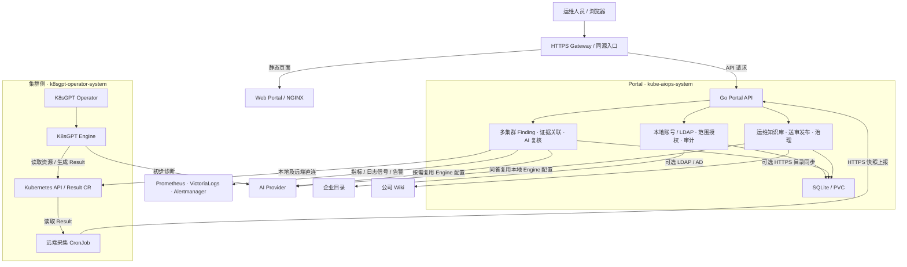

# kube-aiops

基于 K8sGPT 的 Kubernetes 诊断平台。简体中文 Portal 集中查看多集群 Finding 和关联证据，支持人工复核、运维知识发布与检索、资源管理，以及按范围授权和操作审计。

## 当前进度

| 交付 | 状态 | 能力 |
| --- | --- | --- |
| Phase 1.1–1.3 | 已完成 | K8sGPT 安装、升级和回滚，Go API、OpenAPI、中文 Portal 与本地 Demo |
| Phase 1.4 | 已完成 | 身份认证、授权、结构化审计、响应脱敏和生产启动门禁 |
| Phase 2 | 已完成 | Kubernetes Events、Prometheus、VictoriaLogs、Alertmanager 四类证据关联 |
| 资源管理与诊断复核 | 已集成 | 本地自动采集、外部集群直连和采集上报，环境与业务线管理，AI 证据复核与结论版本 |
| 运维知识库 P0/P1 | [#103](https://github.com/abchw517/kube-aiops/pull/103) 已合并 | 搜索、诊断草稿、送审发布、版本与撤回、带引用的问答和反馈，远端 Wiki 同步执行记录与重试 |
| 系统管理流程优化 | [#104](https://github.com/abchw517/kube-aiops/pull/104) 已合并 | 用户直授或经用户组继承角色，角色批量选择命名空间和预览，授权结果直达审计 |
| Phase 3–5 | 已规划 | RCA Agent 与 Runbook、人工审批修复、受控自动修复 |

交付记录见 [项目进度](docx/phase-status.md)。知识库的真实模型、公司 Wiki 和生产双人审核需在目标环境验收，步骤见 [生产试点验收](docx/install-deployment.md#运维知识库生产试点验收)。

## 架构拓扑



K8sGPT Result 经 API 转换为 Finding。证据查询按集群实例、命名空间、资源和时间窗执行。诊断复核结论与知识发布分别留存版本。知识发布经过人工确认。涉及生产、扩大授权范围或首次发布到多个目标时，由另一位有权管理员审核。详见 [架构设计](docx/architecture.md)。

## 快速开始

### 本地开发与演示

```bash
make portal-demo
```

打开 <http://127.0.0.1:4173/#/findings> 查看样例 Finding 与四类关联证据。Demo 使用真实 Go API 和模拟数据源，无需 Kubernetes。可使用 `PORTAL_DEMO_HOST`、`PORTAL_DEMO_PORT` 调整监听。单独运行 `make portal-demo-check` 可自动验收。知识库与系统管理的页面回归使用 `make web-e2e`，生产集成使用预发集群。详见 [开发指南](docx/development-standard.md#本地开发与验证)和 [Portal Demo](docx/portal-demo.md)。

### 现有 Kubernetes 集群

| 操作 | 入口 |
| --- | --- |
| 预检并安装 K8sGPT | `make platform-check`、`make preflight`、`make bootstrap-secret`、`make install`、`make verify` |
| 构建并部署 Portal | 从同一源码提交构建 API 和 Web，用镜像 digest 发布，配置 HTTPS 同源入口和 SQLite PVC |
| 配置数据源与模型 | 可选接入 Prometheus、VictoriaLogs、Alertmanager，配置 Engine 模型和诊断复核的模型端点 |
| 首次上线与升级 | 首次改密、角色与数据范围、LDAP/AD、存量 SQLite 备份、知识库试点与回滚 |

完整命令见 [安装与部署](docx/install-deployment.md)。内网节点可用 `K8SGPT_IMAGE_REGISTRY=harbor.example.com/public make install` 指定已同步的 Operator、RBAC Proxy 和 Engine 镜像仓库。安装器通过 Helm 原子发布、Lease 和快照管理升级与回滚。可用 `STRICT_RESULTS=true make verify` 验证当前实例的新鲜 Result。

运行 `make help` 查看项目命令。故障样例可用 `make demo` 部署，用 `make results` 查看并用 `make clean-demo` 清理。

## 支持基线

| 组件 | 仓库基线 |
| --- | --- |
| Kubernetes / kubectl | v1.36.4 |
| Go | 语言版本 1.26.0，工具链 1.26.5 |
| Node.js | 开发端 22+，容器构建基线 22.19.0 |
| K8sGPT Operator / Engine | v0.2.29 / v0.4.41 |
| Helm | Helm 3 |

版本配置见 [platform-versions.env](config/platform-versions.env) 和 [Kubernetes 基线](docx/kubernetes-v1.36-baseline.md)。上游默认运行时镜像使用 `tag@sha256` 引用。CI 校验版本、RBAC、API 契约和生成客户端，执行 Go、Web、Chromium E2E、容器与 Demo 冒烟测试。

## 目录结构

```text
.
├── api/
│   ├── cmd/api/                  # API 与采集命令入口
│   ├── internal/
│   │   ├── portal/               # 依赖装配、集群目录与会话路由
│   │   ├── diagnosis/            # Finding、关联证据与 AI 复核
│   │   ├── wiki/                 # 检索、草稿、发布、问答、反馈与同步
│   │   ├── permissions/          # 账号、LDAP、角色、授权与操作审计
│   │   ├── identitystore/        # SQLite 表结构与迁移
│   │   └── observability/        # 可观测性客户端共用逻辑
│   └── openapi.yaml              # 诊断查询 API 契约
├── web/
│   ├── src/api/                  # 生成的 TypeScript 客户端及封装
│   ├── src/views/                # diagnosis、wiki、permissions、resources、clusters
│   ├── demo/                     # Demo 模拟数据源
│   └── e2e/                      # Chromium 端到端测试
├── config/                       # 平台版本与 NGINX 配置
├── deploy/
│   ├── api/、web/                # Portal 工作负载、Service、HTTPRoute 与网络策略
│   ├── collector/、k8sgpt/       # 远端采集与 Engine 部署
│   └── examples/                # 身份存储、AI 复核权限和可观测性示例
├── docx/
│   ├── install-deployment.md    # 现有集群与生产发布
│   ├── development-standard.md  # 本地开发、验证和模块交付
│   ├── operations-knowledge/    # 知识库 PRD、接口和验收
│   └── system-management/       # 系统管理 PRD、原型和验收
├── scripts/                      # 主机依赖、部署校验和 Demo 脚本
├── tests/                        # 平台与发布安全回归
├── tools/openapi/                # 契约校验与客户端生成
├── Dockerfile                    # API 镜像，构建上下文为仓库根目录
└── Makefile
```

Web 镜像使用 `web/Dockerfile`，构建上下文同样为仓库根目录。旧流水线的路径调整见 [目录迁移](docx/install-deployment.md#从旧目录布局升级)。

## 权限与运行边界

- Kubernetes 业务对象由受限身份读取。Engine 使用固定 `k8sgpt` ServiceAccount，写入诊断 Result，关闭 Mutation 和 Auto Remediation。可选 AI 复核使用独立的 Engine 和 Secret 单对象读取授权。
- Portal 生产模式要求认证和授权。范围角色按环境、实例及命名空间授予诊断读取，预发布和生产还需明确业务线归属。
- Portal 的配置、诊断复核、知识治理和操作审计存入 API 使用的 SQLite。远端 Wiki 凭据在启用同步时使用独立密钥加密，供当前用户绑定使用。
- 模型返回诊断建议与知识引用。发布、撤回、资源目录维护等 Portal 操作由获授权账号发起并按现行策略记录审计。

详见 [安全设计](docx/security.md)和 [生产身份接入](docx/install-deployment.md#生产身份接入)。

## 模块与路线图

| 模块 | 文档 |
| --- | --- |
| 诊断控制台 | [PRD](docx/diagnosis-console/00-prd.md) · [Phase 2 验收](docx/phase-2-completion.md) |
| 运维知识库 | [PRD](docx/operations-knowledge/00-prd.md) · [接口与上线验收](docx/operations-knowledge/api-contract.md) |
| 资源管理 | [PRD](docx/resource-management/00-prd.md) · [多集群接入](docx/install-deployment.md#web-管理多环境集群接入) |
| 系统管理 | [PRD](docx/system-management/00-prd.md) · [权限设计](docx/system-management/platform-rbac-design.md) |
| 工程规范 | [开发指南](docx/development-standard.md) · [代码规范](docx/coding-standards.md) |
| 后续阶段 | [Phase 3–5 路线图](docx/phase-3-5-roadmap.md) |
