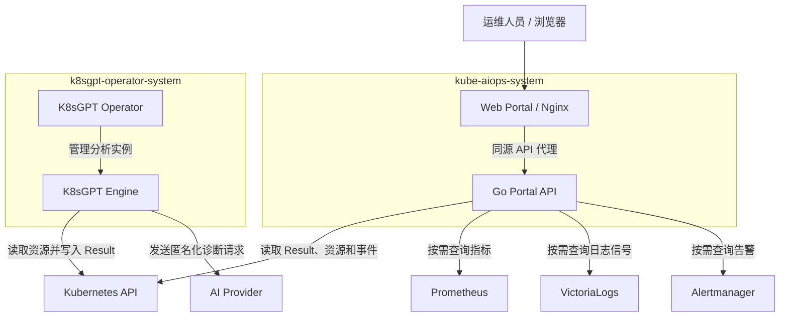

# kube-aiops

基于 K8sGPT 的 Kubernetes 只读诊断平台。简体中文 Web Portal 集中展示集群诊断结果，以及同一资源和时间窗口内的事件、指标、日志信号和告警。

## 当前阶段

| 阶段 | 进展 | 能力 |
| --- | --- | --- |
| Phase 1.1 | 已完成 | K8sGPT Operator 和 Engine、受限 RBAC、安装与回滚 |
| Phase 1.2–1.3 | 已完成 | Go 只读 API、OpenAPI 契约、简体中文 Web Portal 和本地 Demo |
| Phase 1.4 | 已完成 | 身份认证与授权、结构化审计、响应脱敏和生产启动门禁 |
| Phase 2 | 已完成 | Kubernetes Events、Prometheus、VictoriaLogs、Alertmanager 四类证据关联 |
| Phase 3–5 | 已规划 | RCA Agent 和 Runbook、人工审批修复、受控自动修复 |

交付与验收记录见 [Phase 1.4](docs/phase-1.4-completion.md) 和 [Phase 2](docs/phase-2-completion.md)。后续目标见 [Phase 3–5 路线图](docs/phase-3-5-roadmap.md)。集群验证基线为 [Kubernetes v1.36.4](docs/kubernetes-v1.36-baseline.md)。

## Web Portal Demo

```bash
make portal-demo
```

打开 <http://127.0.0.1:4173/#/findings>，查看两条中文样例诊断和四类关联证据。Demo 运行真实 Go API，通过本地 HTTPS 样例服务模拟集群和可观测性数据源，可独立于 Kubernetes 运行。远程访问可设置 `PORTAL_DEMO_HOST` 和 `PORTAL_DEMO_PORT`。运行 `make portal-demo-check` 可自动验收。依赖和演示步骤见 [Portal Demo](docs/portal-demo.md)。

## 安装与部署

`make install` 部署 K8sGPT Operator 和 Engine。Go API 与 Web Portal 按需独立部署。详见 [安装部署指南](docs/install-deployment.md)，其中包括在现有 Kubernetes 集群部署、内网镜像同步、可观测性配置和生产部署。

## 当前支持基线

```text
Kubernetes:       v1.36.4
kubectl:          v1.36.4
Go language:      1.26.0
Go toolchain:     1.26.5
K8sGPT Operator:  v0.2.29
K8sGPT Engine:    v0.4.37
```

统一版本源：

```text
config/platform-versions.env
```

K8sGPT Engine、Operator 等默认上游运行时镜像使用 `tag@sha256`
不可变引用；GitHub Actions 使用完整 commit SHA 固定。平台基线一致性由
`tests/platform-baseline-test.py` 强制校验。

## 安全边界

当前阶段继续保持只读 AIOps 边界：

- 使用固定 `k8sgpt` ServiceAccount 承载 Engine 权限；
- 业务资源只允许 `get/list/watch`；
- Secret 读取禁止；
- `pods/log` 读取禁止；
- `create/update/patch/delete/deletecollection` 禁止；
- Mutation / Auto Remediation 禁用；
- Namespace egress 仅允许 DNS、HTTPS 和 Kubernetes API 端口；
- AI 分析默认启用匿名化；
- Result CR 作为 K8sGPT 与 Portal Backend 的结构化边界；
- Raw Result CR / Raw Kubernetes Object 不通过 Portal API 暴露。

## 架构拓扑



Go API 将 K8sGPT Result 转换为 Finding。查看关联证据时，API 先按 Finding 实际资源范围授权，再对四类来源执行有时间窗和查询预算的读取。Prometheus、VictoriaLogs 和 Alertmanager 通过后端配置启用。生产启动要求接入受信任的身份认证和授权组件。更多细节见 [架构设计](docs/architecture.md) 和 [生产部署](docs/install-deployment.md#生产部署)。

## 目录结构

```text
.
├── api/
│   └── openapi.yaml
├── clients/
│   └── typescript/generated.ts
├── cmd/api/
├── config/
│   └── platform-versions.env
├── internal/
├── Makefile
├── preflight.sh
├── install.sh
├── verify.sh
├── uninstall.sh
├── Dockerfile
├── deploy/
│   ├── api/
│   └── k8sgpt/
├── web/
├── tests/
│   └── platform-baseline-test.py
├── docs/
│   ├── kubernetes-v1.36-baseline.md
│   ├── architecture.md
│   └── security.md
└── .github/workflows/
    └── ci.yml
```

# 快速开始

## 0. 平台基线与 Preflight

先验证版本配置、Kubernetes API 使用面、Go/K8sGPT/CI 是否一致：

```bash
make platform-check
```

再执行完整静态 Preflight：

```bash
make preflight
```

Preflight 包括：

- 所有 Shell 脚本 `bash -n`；
- ShellCheck；
- 所有 YAML/YML 语法解析；
- Kubernetes **v1.36** kubeconform Schema 校验；
- 高置信度 Secret/Token/Private Key 扫描；
- RBAC 静态安全检查；
- Python 语法检查；
- Kubernetes v1.36 平台版本一致性检查；
- Secret / Pod Logs / write verbs 等安全控制回归测试。

在目标集群确认当前 kubeconfig、API Server 版本、节点状态和 API discovery。

```bash
kubectl config current-context
kubectl version
kubectl get nodes
kubectl api-versions
```

## 1. 创建 AI Provider Secret

Secret 不提交到 Git：

```bash
export OPENAI_TOKEN='replace-me'
make bootstrap-secret
```

固定 Namespace：

```text
k8sgpt-operator-system
```

Phase 1.1/1.2 不支持通过参数任意覆盖 Namespace、Release、ServiceAccount、
Secret 或 K8sGPT CR 名称，避免身份与 RBAC 基线漂移。

## 2. 安装 K8sGPT

```bash
make install
```

节点访问上游镜像仓库超时时，可先将三张镜像同步到内网镜像仓库，再执行：

```bash
K8SGPT_IMAGE_REGISTRY=harbor.example.com/public make install
```

该前缀适用于 Operator、RBAC Proxy 和 Engine，安装器以 `仓库/镜像:基线版本` 拉取。同步命令与单镜像变量见 [使用内网镜像仓库](docs/install-deployment.md#使用内网镜像仓库)。

安装链路：

```text
检查 kubectl / helm / current-context
   ↓
检查 Namespace 与 AI Secret（不满足时不修改集群）
   ↓
获取 Kubernetes Lease 并记录升级前 revision / 资源快照
   ↓
使用 --atomic / --cleanup-on-fail 安装或升级 Operator
   ↓
Helm post-renderer 在资源进入 API Server 前收敛上游宽权限 RBAC
   ↓
Server-Side Apply 复验 RBAC 安全基线
   ↓
验证 Secret / Pod Log / Patch / Delete 权限均被拒绝
   ↓
部署 K8sGPT CR
   ↓
严格检查 Operator 与 K8sGPT Engine Ready
```

首次安装的后置步骤失败时会卸载本次 Release 并恢复安装前快照；已有 Release
发生 Helm 外后置失败时执行 `helm rollback` 并恢复 RBAC、ServiceAccount 和
K8sGPT CR 快照。Lease 覆盖安装/卸载全生命周期，heartbeat 续租并在变更点
执行 fencing 检查。回滚二次失败时保留 `0700` 取证目录和对象级恢复报告。

当前 K8sGPT 版本：

```text
K8sGPT Operator: v0.2.29
K8sGPT Engine:   v0.4.37
```

Operator 镜像：

```text
ghcr.io/k8sgpt-ai/k8sgpt-operator:v0.2.29@sha256:82d0adcce816182bbfbef9f1d535db93ab0901f08d45a3a9e572c6e795c5bfa8
```

Engine 镜像：

```text
ghcr.io/k8sgpt-ai/k8sgpt:v0.4.37@sha256:ebf0d1f5a8463190abdf1a9c84282cfbd9ce611e3dc1c490194b7aaf2676d088
```

本基线没有直接使用仅能确认源码 release、但无法独立确认语义 tag digest 的
更新 Engine tag。运行时镜像版本提升必须同时具备可信 digest 并通过完整
Kubernetes v1.36 E2E。

Operator 版本门禁：

```bash
OPERATOR_VERSION=0.2.29 make install
```

Legacy RBAC 首次迁移必须显式执行：

```bash
MIGRATE_LEGACY_OWNERSHIP=true make install
```

安装器会先检查 rules、`roleRef`、`subjects` 与所有权语义指纹，匹配后才迁移。

## 3. 安全与功能验收

```bash
make verify
```

核心验收：

- Kubernetes API 连通性；
- Helm Release 必须为 `deployed` 且 Chart 身份正确；
- K8sGPT / Result / Mutation CRD；
- ServiceAccount、ClusterRole/Binding、NetworkPolicy 与仓库 exact-set 基线一致；
- 业务资源 `get/list/watch`；
- Secret 读取必须为 `no`；
- Pod Log 读取必须为 `no`；
- create/update/patch/delete 必须为 `no`；
- `anonymized=true`；
- backend、分析周期、Secret 引用正确；
- Log Analyzer 未启用；
- Auto Remediation 未启用；
- Operator / Engine observedGeneration 收敛且完整 Ready；
- Result CR 查询错误不得降级为零结果。

严格 Result 模式：

```bash
STRICT_RESULTS=true make verify
```

## 4. 故障样例

```bash
make demo
```

覆盖：

```text
ImagePullBackOff
CrashLoopBackOff
PVC Pending
```

查看：

```bash
kubectl get pod,pvc -n k8sgpt-demo
make results
```

清理：

```bash
make clean-demo
```

## 5. 状态与卸载

```bash
make status
make uninstall
```

默认卸载策略：

```text
K8sGPT CR        删除
Helm Release     删除
Phase 1.1 RBAC   删除
AI Secret        保留
Namespace        保留
CRD              保留
```

可选：

```bash
PURGE_SECRET=true make uninstall
PURGE_SECRET=true PURGE_NAMESPACE=true make uninstall
PURGE_DEMO=true make uninstall
```

CRD 默认不自动删除，避免误伤其它实例或后续重新安装。

# 目标集群验收

按安装部署指南检查 Operator、Engine 和 Result，再验证 Portal 能读取目标集群的诊断。需要验证真实 Provider 时，在现有测试集群检查分析健康及本次新鲜 Result。完整命令见 [安装部署指南](docs/install-deployment.md#验证部署)。

# Phase 1.2 Portal Backend

Phase 1.2 已完成，提供只读 API：

```http
GET /healthz
GET /readyz
GET /api/v1/clusters
GET /api/v1/clusters/{cluster}/namespaces
GET /api/v1/clusters/{cluster}/resources/{kind}/{namespace}/{name}
GET /api/v1/findings
GET /api/v1/findings/summary
GET /api/v1/findings/{id}
GET /api/v1/findings/{id}/correlation
```

OpenAPI 3.1 是 Portal 外部契约基线：

```bash
make api-contract-validate
make api-client-generate
make api-client-drift-check
make api-contract-check
```

CI 会检查：

- Server route ↔ OpenAPI route drift；
- Go DTO ↔ OpenAPI Schema drift；
- `omitempty` ↔ `required` drift；
- Severity enum drift；
- Sensitive/raw field guard；
- TypeScript generated client byte-for-byte drift。

Portal Backend 不使用 `client-go`，而使用受限 in-cluster HTTP client。当前 Kubernetes
built-in API 只依赖稳定的 `/api/v1` 和 `/apis/apps/v1`；K8sGPT Result 使用其自身
`core.k8sgpt.ai/v1alpha1` CRD API。平台一致性测试禁止已从 Kubernetes 删除的
built-in beta API 重新进入代码或 manifests。

# Go v1.36 对齐基线

当前 `go.mod`：

```go
module github.com/abchw517/kube-aiops

go 1.26.0

toolchain go1.26.5
```

Docker builder：

```text
golang:1.26.5-alpine3.23
```

该工具链与 Kubernetes `release-1.36` 的 Go toolchain 基线对齐。Go 升级仍必须通过：

```text
gofmt
vet
test
build
Docker smoke
```

# GitHub Actions CI

工作流：`.github/workflows/ci.yml`。

Required Checks：

```text
Preflight / Lint / RBAC
Secret Scan
```

其中：

```text
Preflight / Lint / RBAC
├── bash -n / ShellCheck
├── YAML lint
├── Kubernetes v1.36 kubeconform
├── Platform baseline consistency
├── OpenAPI Contract Gate
├── Go fmt / vet / test / build
├── Web 静态检查、单测和 Chromium E2E
├── API / Web 容器冒烟测试
├── Portal Demo 冒烟测试
└── project preflight

Secret Scan
└── Gitleaks full history
```

安全设计：

- Workflow 默认仅 `contents: read`；
- 第三方 GitHub Actions 固定到完整 commit SHA；
- K8sGPT 默认上游运行时镜像固定 sha256 digest；
- Checkout 完整历史用于 Gitleaks；
- AI Secret 通过 stdin 创建，不进入 `kubectl` argv；
- RBAC 出现 `*`、Secret、Pod Logs、危险写 verbs、外部 RoleRef 或宽泛 Group 时 CI 失败；
- 不通过 allow-failure 或放宽 Ruleset 绕过平台升级失败。

`main` Ruleset 应要求：

```text
Preflight / Lint / RBAC
Secret Scan
```

# RBAC Hardening

Operator `v0.2.29` 显式关闭 dynamicRBAC：

```yaml
dynamicRBAC:
  enabled: false
```

固定身份：

```text
ServiceAccount:     k8sgpt
ClusterRole:        k8sgpt-clusterrole
ClusterRoleBinding: k8sgpt-clusterrole-binding
```

Helm post-renderer 在对象进入 API Server 前替换上游静态宽权限，安装后再通过
Server-Side Apply 与 `kubectl auth can-i` 验证。Engine Role 移除：

```text
secrets
pods/log
create
update
patch
delete
deletecollection
```

ClusterRole / ClusterRoleBinding 必须同时具备精确所有权标识：

```text
kube-aiops.io/owner=phase-1.1
app.kubernetes.io/part-of=kube-aiops
app.kubernetes.io/instance=k8sgpt-operator
```

# Makefile 常用命令

```bash
make help
make platform-check
make preflight
make bootstrap-secret
make install
make verify
make demo
make clean-demo
make status
make results
make uninstall
make api-contract-check
make portal-demo
make portal-demo-check
```

# 安全原则

```text
Detect      -> Allowed
Explain     -> Allowed
Recommend   -> Allowed
Result CR   -> Allowed

Secret Read -> Denied
Pod Logs    -> Denied
Patch       -> Denied
Update      -> Denied
Delete      -> Denied
Mutation    -> Disabled
Remediation -> Disabled
```

详细设计：

- `docs/kubernetes-v1.36-baseline.md`
- `docs/architecture.md`
- `docs/security.md`
- `docs/phase-1.1-acceptance.md`
- `docs/phase-1.1-hardening.md`
- `docx/phase-1.2-completion.md`

## 路线图

- Phase 3 · RCA Agent 与 Runbook
- Phase 4 · 人工审批修复
- Phase 5 · 受控自动修复

阶段目标、进入条件和验收标准见 [Phase 3–5 路线图](docs/phase-3-5-roadmap.md)。
