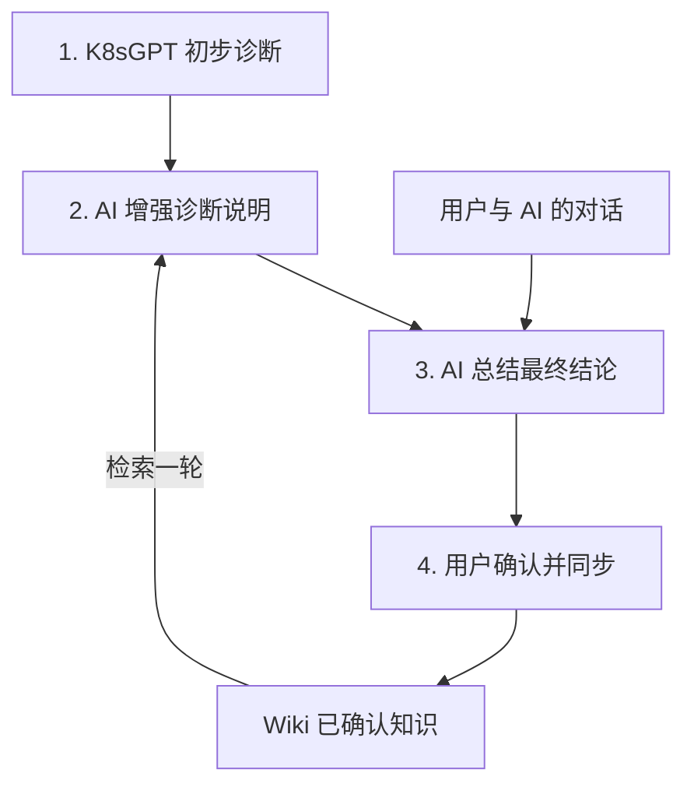

# LLM Wiki 知识回写与诊断检索设计

本设计属于 Phase 3。当前 `main` 已接入多环境、多集群与 AI 复核历史，AI 多轮对话由 PR #73 单独交付。本文定义待开发的接口和行为。当前项目没有现成的 Wiki 服务或接口。首期由 kube-aiops 提供内嵌的 Wiki 模块、数据存储和 API。部署从空知识库开始，发布首个确认结论后产生第一条知识。

## 诊断和知识的四步闭环

| 步骤 | 输入与处理 | 输出 |
| --- | --- | --- |
| 1. 初步诊断 | K8sGPT Engine 分析集群故障并生成 Result，Portal API 将其映射为 Finding。 | K8sGPT 初步诊断说明与故障现象，作为后续分析的基线。 |
| 2. 增强诊断 | Portal API 先按 Finding 范围检索一次 Wiki，再由 AI 结合初步说明、命中的已确认知识和可用现场证据进一步分析。 | 增强诊断说明，包含现场证据、Wiki 引用以及待验证事项。 |
| 3. 最终结论 | 以第 2 步生成的增强说明为基线，用户通过一轮或多轮 AI 对话补充信息、质疑和观察结果。点击总结后，AI 结合增强说明和当前对话生成结论。 | 待用户确认的最终诊断结论，包含根因判断、证据与验证建议。 |
| 4. 确认并同步 | 有发布权限的用户预览并确认指定版本的最终结论。API 保存结论，并由后台同步知识条目。 | 由故障现象和已确认结论组成的 Wiki 知识条目，索引生效后可用于后续诊断。 |

每次人工确认都对应一次版本化的知识同步。一个独立故障对应一个知识条目，由集群实例标识和稳定的 Finding 身份确定。用户确认订正时沿用知识编号、发布新版本。相似故障在检索时关联，各自保留现场证据和确认记录。

## 接入位置与最小改动

- 保留 K8sGPT Operator、Engine 和 Result CR。Portal API 在现有 Finding 映射与证据关联之后增加诊断说明生成服务，从 Wiki 检索结果、K8sGPT 原始说明以及现有 Kubernetes 事件和观测证据构造模型输入。
- 当前 `cmd/api/finding_review.go` 使用 SQLite 的 `finding_reviews` 保存复核结论。沿用已有结论历史，新增草稿、人工确认元数据和同步任务表。接入 #73 后，`总结并更新结论` 调整为生成草稿，用户预览后使用 `确认并发布知识`。
- 保持详情查询可用。首次读取时返回原始 Finding 及增强说明状态，后台生成完成后再展示增强说明。列表、统计和健康检查沿用现有路径。页面优先展示已确认的最终结论，并提供初步诊断和增强说明供回看。后台生成不能覆盖已确认结论。
- Wiki 模块在 Portal API 进程内运行。诊断服务和发布任务通过 Go 接口调用模块，浏览器使用现有同源 API 和身份授权查看结论、知识引用及同步状态。现有 Engine 模型连接继续复用。
- Portal 是首期增强说明的出口。如果消费方直接读取 `kubectl get results` 或其它 Result CR 客户端，仍看到 Engine 生成的原始诊断。若这些消费者也需要检索增强结果，可复用 Portal API 的说明接口，或在后续评估能否在 Engine 调用模型前加入检索钩子。

## 空库初始化与持久化

| 场景 | 程序行为 |
| --- | --- |
| 首次启动 | 在现有 API 持久卷上的 SQLite 数据库中，以事务执行版本化迁移，创建知识条目、版本、检索索引及同步任务相关表。注册 Wiki 所需的 Portal API 路由并启动同步工作进程。空库处于可用状态，检索返回零条。 |
| 升级或重启 | 同一数据库的迁移可重复执行。保留历史复核、已发布知识和待处理任务，重启后继续领取任务。既有复核历史经人工确认后才能产生知识。 |
| Wiki 迁移失败 | 降级 Wiki 发布及检索，记录明确的故障原因。现有数据库和身份组件可用时，保留 Portal 初步诊断及原有复核。共用 SQLite 无法打开时遵循现有 API 启动门禁，K8sGPT Engine 仍独立生成 Result。恢复存储并重新初始化后继续同步。 |

首期使用 SQLite 内的作用域筛选、故障签名和关键词索引，索引随条目版本在同一事务内更新。部署沿用 API SQLite 的 PVC、备份和恢复流程。当前本地 SQLite 部署保持单写入实例。

## Wiki 模块接口与 Portal API

下表中的 Wiki 模块接口由程序实现，供诊断与同步服务进程内调用。Portal API 的 HTTP 路由在启动时注册。

| 接口 | 请求与返回约定 |
| --- | --- |
| Wiki 模块 `Search(ctx, query)` | 接收服务端构造的 `scope`、故障签名、资源种类及错误关键词。返回最多五条已确认且生效的引用，每条包含 `knowledgeId`、`revision`、标题、脱敏摘要、适用范围和引用链接。 |
| Wiki 模块 `UpsertRevision(ctx, entry)` | 接收脱敏条目和内容哈希。相同编号、版本与哈希重送时返回同一对象，版本相同但哈希不同返回冲突错误。旧版本重试不能覆盖新版。返回写入状态、当前索引版本与可用链接。 |
| Wiki 模块 `GetRevisionStatus(ctx, id, revision)` | 返回该版本的写入与索引状态。供任务恢复时核对版本和索引是否已生效。 |
| Portal `GET /api/v1/wiki/knowledge/{knowledgeId}/revisions/{revision}` | 供诊断引用链接使用，返回经授权的知识版本。撤回内容退出检索，历史保留供有权限的审计操作。 |
| Portal `GET /api/v1/findings/{id}/diagnostic-explanation` | 按 Finding 的现有资源授权分字段返回 K8sGPT 初步诊断、增强说明、已确认的最终结论，以及 Wiki 引用和检索状态。多集群目标沿用现有集群选择方式。 |
| Portal `POST /api/v1/findings/{id}/knowledge-publications` | 接收 `draftId`、`expectedRevision` 和用户选定的发布范围。确认成功返回 `202`、结论版本和同步任务编号。已确认的同一草稿重试返回原任务，并发旧版本返回 `409`。 |
| Portal `GET /api/v1/findings/{id}/knowledge-publications/{publicationId}` | 返回当前同步状态、Wiki 编号及版本、最后更新时间和可公开的错误分类。服务端核对任务与 Finding 的归属关系。 |

上线前更新 OpenAPI 与生成客户端。需要新增按资源作用域授予的知识发布能力，知识发布和增强说明读取沿用项目的认证、授权和审计体系。

## 运维知识库页面与 AI 问答

- 左侧导航在「系统管理」下方新增同级入口「运维知识库」。进入后主区显示分页文档列表，同时默认展开可关闭的「AI 知识问答」对话框。关闭后可从页面重新打开，保持当前列表筛选。
- 列表支持按环境、业务线、类型组合筛选，并展示标题、环境、业务线、类型与更新时间。只展示当前生效且用户可读的文档版本。筛选选项、总数和详情也按用户权限计算，清空条件后查看全部授权文档。
- 文档增加 `documentType`。首期由故障确认流程产生的条目归为「故障复盘」，类型字典预留其他文档来源。没有类型的旧条目按「故障复盘」读取。
- 问答支持追问，默认继承环境、业务线和类型筛选。后端每轮重新校验权限并检索内置 Wiki，将命中的脱敏片段与有界对话上下文交给现有模型。模型返回回答和文档版本引用，后端校验引用后才显示可点击链接。切换筛选开启新会话，避免旧范围内容进入新上下文。
- 无可用证据时提示「未找到可支持回答的知识」，同时区分检索或模型出错。问答仅使用当前权限内的 Wiki 内容，回答和对话不会成为诊断结论或知识条目。

| 页面 API | 请求与返回约定 |
| --- | --- |
| `GET /api/v1/wiki/knowledge` | 支持 `environment`、`business`、`documentType` 和分页参数，返回授权范围内的文档摘要和可用筛选项。 |
| `POST /api/v1/wiki/ask` | 接收问题、筛选和可选会话标识。服务端校验会话归属及当前权限，返回回答、文档编号与版本引用和证据状态。 |

## 知识录入、文档导入与远端目录同步

| 入口 | 操作与结果 |
| --- | --- |
| 手工录入 | 在运维知识库选择「新增知识」，填写正文并选择授权范围。程序提取标题、摘要、章节和类型，生成可编辑预览，用户确认后保存并索引。 |
| 文档导入 | 选择「导入文档」批量上传。逐文件解析、转换并显示预览或失败原因，用户可确认发布成功转换的文档。 |
| 远端目录同步 | 平台管理员配置公司自建 Wiki 的目录 URL、读取方式、目标作用域和同步频率。支持立即同步及定时增量同步。从该目录枚举页面并读取正文，逐页转换，通过校验后自动保存到内置 Wiki 并更新索引。失败项逐条记录，可重试。 |

首期上传支持 Markdown、纯文本和 DOCX。远端同步以公司 Wiki 的目录 URL 为入口。连接器将目录 URL 解析为目录或页面树标识，优先通过源系统的只读 API 分页枚举页面和读取正文。源系统只提供网页时，由适配器解析已知的目录结构和正文区域。同步支持指定目录及其子目录，用户可配置是否包含子目录。源 Wiki 产品和认证方式待对接实测，连接器按其目录、正文和权限协议实现。

管理员保存来源前可测试连接，预览可读取的页面和目标作用域。后端校验来源域名、重定向及目录归属，仅使用配置的只读凭据引用。对基于页面树的 Wiki，以父子关系核验归属，允许正文 URL 与目录 URL 路径结构不同。正文中的普通链接不作为同步目标。源权限无法可靠映射时，仅同步已明确批准复制到目标作用域的目录；访问拒绝的页面记为失败项。

三种入口使用同一转换流程。程序从文件或文本提取正文，统一为 Markdown，生成结构化元数据，包括标题、摘要、类型、标签、环境、业务线及来源。类型包括故障复盘、排障手册、操作规程和常见问题。可由 AI 建议分类、组织内容，保留原文事实、步骤、命令文本与引用。作用域由已授权的用户或同步配置指定。保存前校验必填字段、脱敏并移除活动内容；解析失败、缺少必填项或超限时记录原因，等待修正后重试。

上传使用来源范围和内容哈希识别重复文件。远端记录来源标识、稳定页面 ID（缺少时使用规范化页面 URL）、原文链接和上游版本。内容未变化时跳过，变更时沿用知识编号并增加版本。仅在目录完整枚举成功且确认远端页面已移除时标记来源缺失，保留现有发布版本，由管理人员决定是否撤回。单页读取或解析失败不影响其他文档，重启后继续处理失败或未完成的条目。已发布且授权可见的导入知识可用于文档列表、AI 问答及诊断增强。

| Portal API | 用途 |
| --- | --- |
| `POST /api/v1/wiki/imports` | 提交手工正文或上传文件，生成转换任务和预览。 |
| `GET /api/v1/wiki/imports/{id}`、`POST /api/v1/wiki/imports/{id}/publish` | 查看任务结果和逐文档错误，发布经用户确认的已校验条目。 |
| `GET/POST /api/v1/wiki/sources`、`PATCH /api/v1/wiki/sources/{id}` | 查询及维护远端来源、目标作用域与同步计划，管理权限独立授予。 |
| `POST /api/v1/wiki/sources/{id}/check` | 测试目录 URL、只读访问和页面枚举，返回预览及来源状态。 |
| `POST /api/v1/wiki/sources/{id}/sync`、`GET /api/v1/wiki/sync-runs/{id}` | 启动同步、查询进度和逐文档结果。 |

## 知识条目

| 字段 | 内容 |
| --- | --- |
| `knowledgeId`、`revision` | 稳定条目编号和单调递增版本。编号根据来源系统、集群实例和稳定 Finding 键生成。 |
| `scope` | 授权域、环境、业务、集群实例及命名空间。首期仅发布到故障原作用域，页面预览并要求确认。 |
| `title`、`symptoms`、`signature` | 可复用标题、故障表现、资源种类、错误码和归一化错误模式。 |
| `conclusion`、`evidence` | 人工确认的结论，以及可追溯的证据摘要和来源引用。历史案例与现场证据分别标明。 |
| `verification`、`limitations` | 可复验的步骤和结果，以及尚未验证的条件和适用限制。 |
| `sourceFinding`、`confirmedAt`、`contentHash` | 来源定位、确认时间和幂等校验值。确认者标识留在 Portal 审计记录。 |

候选知识内容由 AI 总结，用户确认前可编辑。入库前再次经过后端结构校验、敏感内容脱敏和长度检查。对话全文、原始日志、凭据和个人敏感信息不随条目发布。引用链接由受控服务生成。

## 一轮检索如何参与诊断

1. 查询前校验用户对 Finding 的读取权限。服务端从已授权 Finding 提取作用域，以资源种类、故障签名和脱敏关键词构造查询。Wiki 按作用域过滤，Portal 再校验返回条目的可见性。生产、测试以及不同业务的数据默认按原作用域隔离。
2. 查询一次 Wiki，首期默认 2 秒超时和最多 5 条候选。缓存按授权作用域及 Finding 内容指纹隔离，同一指纹的并发详情请求可复用生成任务。故障现象变化或用户授权重新分析时触发新一轮检索，索引有新版本时通过短 TTL 更新未确认说明。
3. 将 Wiki 候选作为历史案例提供给模型，同步输入有预算限制的现场关联证据。输出分列现场证据、历史引用和待验证事项。服务端校验模型引用只能来自本轮返回的条目及版本，历史案例不能单独确立本次故障的根因。
4. Wiki 无匹配、超时或不可用时，以 K8sGPT 原始说明和可用现场证据继续，分别显示 `无匹配` 或 `检索不可用`。模型调用失败时显示原始说明。Wiki 降级时，使用第 2 步可用的最佳说明作为对话基线，并在页面标记降级状态。进入对话时绑定该说明的版本和引用快照。总结时使用绑定的说明和本轮对话信息；明确请求重新分析时才生成新的增强说明。

Wiki 内容、证据与对话均按不可信数据处理。模型没有 Wiki 写入权限，Wiki HTTP 路由复用 Portal 的会话、资源授权及 HTTPS 入口。Portal 日志记录查询耗时、命中数量和状态，不记录原始消息或凭据。

## 确认、同步和恢复

SQLite 同一事务内检查 `expectedRevision`、保存已确认结论及知识快照、插入 outbox 同步任务。事务提交后页面立即显示已确认结论和 `待同步`。后台任务通过带过期时间的租约领取，提交 Wiki 时使用确定性的编号和版本。Wiki 可检索后标记 `已同步`。同步失败采用指数退避，达到重试上限后显示 `待处理`，由有权限的用户重新排队。服务重启或 Wiki 写入成功但响应丢失时，任务可按原版本继续，避免重复条目。失败期间已确认结论仍可在 Portal 查看。

订正发布产生新版本，Wiki 检索只返回最新生效版本。误发布时通过受审计的撤回操作从检索中移除该知识，Portal 保留结论历史与审计记录。撤回及索引刷新需要端到端验收后开放生产发布。

## 交付与验收

| 顺序 | 交付 | 验收 |
| --- | --- | --- |
| 1 | Wiki 初始化与检索、范围校验、诊断说明与引用 | 命中时先查询再生成，跨环境、跨业务和跨命名空间的样例均不泄露。无匹配、超时和模型失败可降级。 |
| 2 | 对话草稿、人工确认、outbox 和页面状态 | 验证最终结论使用会话绑定的增强说明和完整对话。仅人工确认动作入队。重复点击、并发提交、重启、响应丢失和乱序重试最终只形成一个生效版本。 |
| 3 | 内嵌 Wiki 与真实集群闭环 | 在测试集群复核并发布一条故障知识，再用同范围的相似故障生成包含该版本引用的说明。确认更正、撤回和索引可见性。 |

开发从空库部署验证起步，覆盖首次启动、升级、重启、备份恢复和索引可见性。

## 实施资料

- [需求文档](llm-wiki-requirements.md)
- [任务拆分](llm-wiki-tasks.md)
- [测试用例](llm-wiki-test-cases.md)
