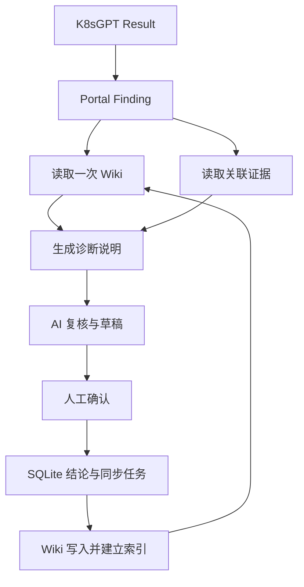

# LLM Wiki 知识回写与诊断检索设计

本设计属于 Phase 3。当前 `main` 已接入多环境、多集群与 AI 复核历史，AI 多轮对话由 PR #73 单独交付。本文定义待开发的接口和行为。知识库通过服务端适配器接入，具体 Wiki 产品、索引和 Markdown 存储实现由适配器封装。

## 诊断和知识的生命周期

| 步骤 | 触发条件 | 页面或系统结果 |
| --- | --- | --- |
| 原始诊断 | K8sGPT 生成 Result，Portal API 转换成 Finding | 保留原始故障现象和诊断来源 |
| 知识检索与说明 | Finding 详情首次生成增强说明，或授权用户主动重新分析 | 按当前诊断范围查询一轮 Wiki，结合原始诊断与可用运行时证据生成说明，展示引用 |
| AI 复核 | 用户补充证据并发起一轮或多轮对话 | AI 可以追问，最后生成可预览的结论草稿 |
| 人工确认 | 有发布权限的用户确认指定草稿版本和发布范围 | 同事务保存已确认结论、生成脱敏知识条目，并创建同步任务 |
| 知识发布 | 后台任务完成 Wiki 写入且版本可检索 | 页面显示「已同步」、知识编号、版本和跳转入口 |
| 订正 | 用户确认同一故障的新版结论 | 沿用原知识编号，发布新版并替换检索索引中的生效版本 |

每个独立故障的首份确认结论生成一个知识条目。由集群实例标识和稳定的 Finding 身份确定条目归属。同一故障的后续修订进入该条目的版本历史。相似故障可在检索阶段关联，首期保留各自的证据和确认记录。

## 接入位置与最小改动

- 保留 K8sGPT Operator、Engine 和 Result CR。Portal API 在现有 Finding 映射与证据关联之后增加诊断说明生成服务，从 Wiki 检索结果、K8sGPT 原始说明以及现有 Kubernetes 事件和观测证据构造模型输入。
- 当前 `cmd/api/finding_review.go` 使用 SQLite 的 `finding_reviews` 保存复核结论。沿用已有结论历史，新增草稿、人工确认元数据和同步任务表。接入 #73 后，`总结并更新结论` 调整为生成草稿，用户预览后使用 `确认并发布知识`。
- 保持详情查询可用。首次读取时返回原始 Finding 及增强说明状态，后台生成完成后再展示增强说明。列表、统计和健康检查沿用现有路径。经人工确认的结论优先展示，后台生成不能覆盖它。
- Wiki 只读与写入均经 Portal API 的服务端适配器。现有 Engine 模型连接继续复用，Wiki API 的凭据独立管理，Portal 浏览器通过同源 API 读取结论与同步状态。
- Portal 是首期增强说明的出口。如果消费方直接读取 `kubectl get results` 或其它 Result CR 客户端，仍看到 Engine 生成的原始诊断。若这些消费者也需要检索增强结果，可复用 Portal API 的说明接口，或在后续评估能否在 Engine 调用模型前加入检索钩子。

## Wiki 与 Portal 接口

以下为拟议接口，Wiki 端的接口可由独立桥接服务实现。

| 接口 | 请求与返回约定 |
| --- | --- |
| Wiki `POST /v1/knowledge/search` | 接收服务端构造的 `scope`、故障签名、资源种类及错误关键词。返回最多五条已确认且生效的引用，每条包含 `knowledgeId`、`revision`、标题、脱敏摘要、适用范围和引用链接。 |
| Wiki `PUT /v1/knowledge/incidents/{knowledgeId}/revisions/{revision}` | 接收脱敏条目和内容哈希。相同编号、版本与哈希重送时返回同一对象，版本相同但哈希不同返回 `409`。旧版本重试不能覆盖新版。返回写入状态、当前索引版本与可用链接。 |
| Wiki `GET /v1/knowledge/incidents/{knowledgeId}/revisions/{revision}` | 返回该版本的写入与索引状态。异步索引时供任务轮询，直到可检索或明确失败。 |
| Portal `GET /api/v1/findings/{id}/diagnostic-explanation` | 按 Finding 的现有资源授权返回原始说明、当前增强说明或人工确认的结论、Wiki 引用和检索状态。多集群目标沿用现有集群选择方式。 |
| Portal `POST /api/v1/findings/{id}/knowledge-publications` | 接收 `draftId`、`expectedRevision` 和用户选定的发布范围。确认成功返回 `202`、结论版本和同步任务编号。已确认的同一草稿重试返回原任务，并发旧版本返回 `409`。 |
| Portal `GET /api/v1/findings/{id}/knowledge-publications/{publicationId}` | 返回当前同步状态、Wiki 编号及版本、最后更新时间和可公开的错误分类。服务端核对任务与 Finding 的归属关系。 |

上线前更新 OpenAPI 与生成客户端。需要新增按资源作用域授予的知识发布能力，知识发布和增强说明读取沿用项目的认证、授权和审计体系。

## 知识条目

| 字段 | 内容 |
| --- | --- |
| `knowledgeId`、`revision` | 稳定条目编号和单调递增版本。编号根据来源系统、集群实例和稳定 Finding 键生成。 |
| `scope` | 授权域、环境、业务、集群实例及命名空间。首期仅发布到故障原作用域，页面预览并要求确认。 |
| `title`、`symptoms`、`signature` | 可复用标题、故障表现、资源种类、错误码和归一化错误模式。 |
| `conclusion`、`evidence` | 人工确认的结论，以及可追溯的证据摘要和来源引用。历史案例与现场证据分别标明。 |
| `verification`、`limitations` | 可复验的步骤和结果，以及尚未验证的条件和适用限制。 |
| `sourceFinding`、`confirmedAt`、`contentHash` | 来源定位、确认时间和幂等校验值。确认者标识留在 Portal 审计记录。 |

候选知识内容由 AI 总结，用户确认前可编辑。入库前再次经过后端结构校验、敏感内容脱敏和长度检查。对话全文、原始日志、凭据和个人敏感信息不随条目发布。引用链接由受控服务生成。

## 一轮检索如何参与诊断

1. 查询前校验用户对 Finding 的读取权限。服务端从已授权 Finding 提取作用域，以资源种类、故障签名和脱敏关键词构造查询。Wiki 按作用域过滤，Portal 再校验返回条目的可见性。生产、测试以及不同业务的数据默认按原作用域隔离。
2. 查询一次 Wiki，首期默认 2 秒超时和最多 5 条候选。缓存按授权作用域及 Finding 内容指纹隔离，同一指纹的并发详情请求可复用生成任务。故障现象变化或用户授权重新分析时触发新一轮检索，索引有新版本时通过短 TTL 更新未确认说明。
3. 将 Wiki 候选作为历史案例提供给模型，同步输入有预算限制的现场关联证据。输出分列现场证据、历史引用和待验证事项。服务端校验模型引用只能来自本轮返回的条目及版本，历史案例不能单独确立本次故障的根因。
4. Wiki 无匹配、超时或不可用时，以 K8sGPT 原始说明和可用现场证据继续，分别显示 `无匹配` 或 `检索不可用`。模型调用失败时显示原始说明。对话复核可复用当前说明的检索快照，明确请求重新分析时再发起一轮读取。

Wiki 内容、证据与对话均按不可信数据处理。模型没有 Wiki 写入权限，Wiki 地址来自服务端配置，传输启用 TLS。Portal 日志记录查询耗时、命中数量和状态，不记录原始消息或凭据。

## 确认、同步和恢复

SQLite 同一事务内检查 `expectedRevision`、保存已确认结论及知识快照、插入 outbox 同步任务。事务提交后页面立即显示已确认结论和 `待同步`。后台任务通过带过期时间的租约领取，提交 Wiki 时使用确定性的编号和版本。Wiki 可检索后标记 `已同步`。同步失败采用指数退避，达到重试上限后显示 `待处理`，由有权限的用户重新排队。服务重启或 Wiki 写入成功但响应丢失时，任务可按原版本继续，避免重复条目。失败期间已确认结论仍可在 Portal 查看。

订正发布产生新版本，Wiki 检索只返回最新生效版本。误发布时通过受审计的撤回操作从检索中移除该知识，Portal 保留结论历史与审计记录。撤回及索引刷新需要端到端验收后开放生产发布。

## 交付与验收

| 顺序 | 交付 | 验收 |
| --- | --- | --- |
| 1 | Wiki 适配器、范围校验、诊断说明与引用 | 命中时先查询再生成，跨环境、跨业务和跨命名空间的样例均不泄露。无匹配、超时和模型失败可降级。 |
| 2 | 对话草稿、人工确认、outbox 和页面状态 | 仅确认动作入队。重复点击、并发提交、重启、响应丢失和乱序重试最终只形成一个生效版本。 |
| 3 | 测试 Wiki 与真实集群闭环 | 在测试集群复核并发布一条故障知识，再用同范围的相似故障生成包含该版本引用的说明。确认更正、撤回和索引可见性。 |

接入的 Wiki 产品未指定。实施时需用目标服务确认身份与作用域映射、索引可见性协议和撤回能力，再补具体部署配置。
