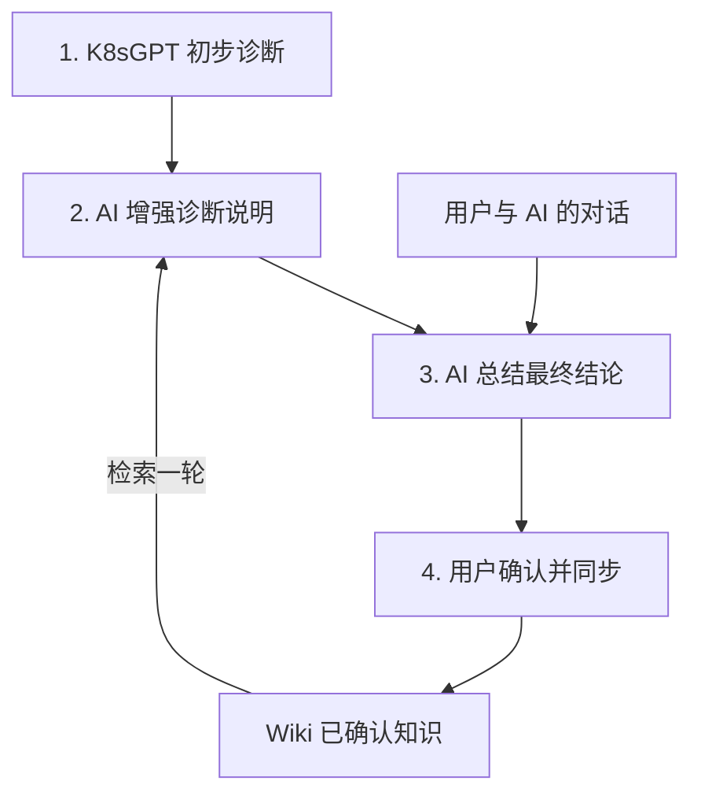

# 运维知识库 · 设计方案

[PRD](00-prd.md) · [页面拆解](01-pages.md) · [功能拆解](02-features.md) · [用户故事](03-user-stories.md) · [开发任务](04-development-tasks.md) · [测试用例](05-unit-test-cases.md) · [交互原型](prototype.html) · [文档维护规则](../development-standard.md)

覆盖知识检索、预览、全文、诊断关联、草稿、审核发布、版本、问答、反馈、导入与同步。当前检索交互以本文件开头的「知识检索与快速预览」为准。

## 知识检索与快速预览

[检索、预览和全文原型](../diagnosis-console/recent-diagnostics.html#/wiki)

搜索框优先，左侧提供环境、业务线、资源类型和知识类型。结果突出标题、命中原因、适用范围、责任团队、版本、发布时间和复核提醒。窄屏折叠筛选，结果使用圆角容器和克制的色彩。关键词和筛选支持逐项移除。点击标题阅读全文，点击「快速查看」在右侧展示适用条件、先查什么和恢复判断。老文档缺少结构化字段时显示正文摘录。

排序通过检索接口在分页前执行。默认保留相关度和复核状态规则。「最近更新」按版本发布时间倒序。全文返回保留关键词、筛选、排序和页位置。预览读取与全文相同的受控版本接口；保留知识治理、问答、导入、同步、历史版本、反馈和关联诊断入口。

## 知识库接口、上线与验收

[PRD](00-prd.md#文档治理与诊断联动) · [开发任务](04-development-tasks.md#文档治理与诊断联动) · [测试用例](05-unit-test-cases.md#文档治理与诊断联动)

管理及 Wiki 接口沿用 Portal 会话。所有写请求遵循现有同源检查和范围授权。诊断证据公开 API 继续由仓库 OpenAPI gate 校验。以下接口由 Wiki 会话路由注册。

| 接口 | 请求与返回 |
| --- | --- |
| `GET /api/v1/wiki/knowledge` | `q`、环境、业务线、资源类型、知识类型、`page` 或 `cursor`。返回有权生效条目、匹配原因、总数、可见筛选项和下一页游标。 |
| `GET /api/v1/wiki/knowledge/{id}[/revisions/{revision}]` | 缺省读生效版；显式版本返回允许访问的快照。关联诊断及范围按当前用户权限投影。普通入口使用相同响应表示不存在、已撤回和不可见。 |
| `GET/POST /api/v1/wiki/candidates` | 查询范围内候选；用 `document` 创建草稿。修订另传 `knowledgeId`、`baseRevision`。返回候选 ID、基础版本、当前候选版本和状态。 |
| `GET/POST /api/v1/wiki/candidates/{id}` | 查询或提交 `action`、`version`、可选 `document`、`reason`。支持保存、脱敏预览、送审、驳回、放弃和发布。发布用候选 ID 和期望版本防重。 |
| `GET /api/v1/wiki/governance` | 返回操作者可治理的生效、待复核和撤回条目。 |
| `GET/POST /api/v1/wiki/knowledge/{id}/governance` | 读取治理视图；用 `action`、`revision` 执行撤回或完成复核。复核需提供新日期，可同时维护责任团队。 |
| `GET/POST /api/v1/wiki/finding?id=…&cluster=…` | 返回 Finding 的匹配知识、已关联手册和范围状态。用已保存的 `reviewRevision` 创建草稿，或用 `knowledgeId`、`wikiRevision` 指定要关联的手册。 |
| `DELETE /api/v1/wiki/sources/{id}` | 停用来源，通过状态屏蔽分发和后续同步，保留关联及版本。 |
| 旧直接发布请求 | 返回 HTTP 409 和 `WIKI_DRAFT_REQUIRED`，通过候选入口完成后续送审。 |

### 升级与验证

- 在变更窗口前备份 SQLite，使用升级副本先跑开库迁移和旧链接回归。新增候选、发布状态、关联等表与旧数据分开。已有条目保留原 ID 与授权范围，缺少复核记录的历史条目在浏览中可读，在模型与诊断推荐中排除。
- 发布和撤回在一个事务提交版本或状态及成功审计；失败后重查候选版本或生效状态，再重试。停用远端来源后检查相关条目的普通直链、问答与同步。
- 生产试点还需使用真实资源目录、两位生产审核人、已脱敏的存量数据库和真实 Wiki 来源完成验收。回退前核对新建版本、撤回和审计变更，防止旧服务重新分发已撤回知识。

### 本地验证记录

- Go 全量测试、OpenAPI 与生成客户端检查、前端 lint／类型检查／单测／构建及 Chromium 端到端测试通过。
- API 集成覆盖生产双人审核、幂等发布、Finding 复核版本绑定、知识关联去重、共享手册的目标投影和撤回。浏览器覆盖从诊断创建草稿、送审、查找文档和故障复核回归。
- 三类试点模拟故障各 5 条固定查询均命中首位。1 万条合成文档、100 次暖态检索，Intel Xeon Platinum 8573C 上检索核心 p95 为 169.6 ms。检索采用 SQLite 读取及应用层匹配排序。该结果使用本地授权与数据夹具，线上性能以真实目录及权限联调结果为准。

### P1 接口

| 接口 | 请求与返回 |
| --- | --- |
| `POST /api/v1/wiki/ask` | 沿用 `question`、`prior` 和知识类型、环境、业务线筛选，支持 `resourceType`。返回 `answer` 及经校验的 `citations`，包含条目 ID、标题、版本和章节。前端使用 `#/wiki/{id}?revision=1&section=checks` 定位版本章节。缺少可信引用时返回证据不足；生成期间权限或版本变化返回 409，模型超时返回 504。 |
| `GET/POST /api/v1/wiki/knowledge/{id}/feedback` | 发布权限持有人可查看有权版本的反馈；有权阅读该版本的用户可提交 `revision`、可选 `section`、`kind`（`helpful` 或 `outdated`）及脱敏 `note`。成功返回 204。 |
| `POST /api/v1/wiki/sources/{id}/sync` | 沿用汇总计数，另返回 `runId`。同一来源运行中再次触发返回 409。 |
| `GET /api/v1/wiki/sources/{id}/runs` | 返回最近 30 次执行的 `items` 及最近整源成功时间 `lastSucceeded`。 |
| `GET /api/v1/wiki/sources/{id}/runs/{run}` | 支持 `page` 和 `failed=true`，每页 50 项。返回任务状态、逐页结果及下一页标记。 |
| `POST /api/v1/wiki/sources/{id}/runs/{run}/retry` | 空对象重试整源，`pageId` 只允许原任务的失败页。每次重试重新检查身份、来源范围与当前凭据，生成独立执行记录。 |

新增 SQLite 表保留已发布文档与现有来源配置。同步任务只保存任务元数据、各页 ID、状态和可公开原因。候选或缺失标记与对应明细在同一事务落库。进程退出后，过期中的记录可重新触发。生产模型及内网远端 Wiki 使用正式试点环境联调。

## LLM Wiki 知识闭环与演进

这一节保留知识闭环的分期设计与历史验收。生产检索只引用生效的已授权知识。诊断复核先保存，知识发布走候选草稿、审核和独立发布。尚未交付的自动增强、索引与同步规则按规划评审。

运维知识库下一轮迭代以 [v1.0 评审稿及其拆解](00-prd.md#文档治理与诊断联动) 为评审依据。本文件保留 Phase 3 的设计及已交付接口背景。

本设计属于 Phase 3。当前 `main` 已接入多环境、多集群与 AI 复核历史，AI 多轮对话由 PR #73 单独交付。本文定义待开发的接口和行为。当前项目没有现成的 Wiki 服务或接口。首期由 kube-aiops 提供内嵌的 Wiki 模块、数据存储和 API。部署从空知识库开始，发布首个确认结论后产生第一条知识。

### 诊断和知识的四步闭环

| 步骤 | 输入与处理 | 输出 |
| --- | --- | --- |
| 1. 初步诊断 | K8sGPT Engine 分析集群故障并生成 Result，Portal API 将其映射为 Finding。 | K8sGPT 初步诊断说明与故障现象，作为后续分析的基线。 |
| 2. 增强诊断 | Portal API 先按 Finding 范围检索一次 Wiki，再由 AI 结合初步说明、命中的已确认知识和可用现场证据进一步分析。 | 增强诊断说明，包含现场证据、Wiki 引用以及待验证事项。 |
| 3. 最终结论 | 以第 2 步生成的增强说明为基线，用户通过一轮或多轮 AI 对话补充信息、质疑和观察结果。点击总结后，AI 结合增强说明和当前对话生成结论。 | 待用户确认的最终诊断结论，包含根因判断、证据与验证建议。 |
| 4. 确认并同步 | 有发布权限的用户预览并确认指定版本的最终结论。API 保存结论，并由后台同步知识条目。 | 由故障现象和已确认结论组成的 Wiki 知识条目，索引生效后可用于后续诊断。 |

每次人工确认都对应一次版本化的知识同步。一个独立故障对应一个知识条目，由集群实例标识和稳定的 Finding 身份确定。用户确认订正时沿用知识编号、发布新版本。相似故障在检索时关联，各自保留现场证据和确认记录。

### 接入位置与最小改动

- 保留 K8sGPT Operator、Engine 和 Result CR。Portal API 在现有 Finding 映射与证据关联之后增加诊断说明生成服务，从 Wiki 检索结果、K8sGPT 原始说明以及现有 Kubernetes 事件和观测证据构造模型输入。
- 当前 `api/internal/diagnosis/finding_review.go` 使用 SQLite 的 `finding_reviews` 保存复核结论。诊断详情使用「AI 复核」在页内呈现结构化结果。保存创建诊断结论版本，知识发布独立读取已保存版本并要求预览确认。参见[诊断控制台 PRD](../diagnosis-console/00-prd.md#诊断详情内的证据复核)。
- 保持详情查询可用。首次读取时返回原始 Finding 及增强说明状态，后台生成完成后再展示增强说明。列表、统计和健康检查沿用现有路径。页面优先展示已确认的最终结论，并提供初步诊断和增强说明供回看。后台生成不能覆盖已确认结论。
- Wiki 模块在 Portal API 进程内运行。诊断服务和发布任务通过 Go 接口调用模块，浏览器使用现有同源 API 和身份授权查看结论、知识引用及同步状态。现有 Engine 模型连接继续复用。
- Portal 是首期增强说明的出口。如果消费方直接读取 `kubectl get results` 或其它 Result CR 客户端，仍看到 Engine 生成的原始诊断。若这些消费者也需要检索增强结果，可复用 Portal API 的说明接口，或在后续评估能否在 Engine 调用模型前加入检索钩子。

### 空库初始化与持久化

| 场景 | 程序行为 |
| --- | --- |
| 首次启动 | 在现有 API 持久卷上的 SQLite 数据库中，以事务执行版本化迁移，创建知识条目、版本、检索索引及同步任务相关表。注册 Wiki 所需的 Portal API 路由并启动同步工作进程。空库处于可用状态，检索返回零条。 |
| 升级或重启 | 同一数据库的迁移可重复执行。保留历史复核、已发布知识和待处理任务，重启后继续领取任务。既有复核历史经人工确认后才能产生知识。 |
| Wiki 迁移失败 | 降级 Wiki 发布及检索，记录明确的故障原因。现有数据库和身份组件可用时，保留 Portal 初步诊断及原有复核。共用 SQLite 无法打开时遵循现有 API 启动门禁，K8sGPT Engine 仍独立生成 Result。恢复存储并重新初始化后继续同步。 |

首期使用 SQLite 内的作用域筛选、故障签名和关键词索引，索引随条目版本在同一事务内更新。部署沿用 API SQLite 的 PVC、备份和恢复流程。当前本地 SQLite 部署保持单写入实例。

### Wiki 模块接口与 Portal API

下表中的 Wiki 模块接口由程序实现，供诊断与同步服务进程内调用。Portal API 的 HTTP 路由在启动时注册。

| 接口 | 请求与返回约定 |
| --- | --- |
| Wiki 模块 `Search(ctx, query)` | 接收服务端构造的 `scope`、故障签名、资源种类及错误关键词。返回最多五条已确认且生效的引用，每条包含 `knowledgeId`、`revision`、标题、脱敏摘要、适用范围和引用链接。 |
| Wiki 模块 `UpsertRevision(ctx, entry)` | 接收脱敏条目和内容哈希。相同编号、版本与哈希重送时返回同一对象，版本相同但哈希不同返回冲突错误。旧版本重试不能覆盖新版。返回写入状态、当前索引版本与可用链接。 |
| Wiki 模块 `GetRevisionStatus(ctx, id, revision)` | 返回该版本的写入与索引状态。供任务恢复时核对版本和索引是否已生效。 |
| Portal `GET /api/v1/wiki/knowledge/{knowledgeId}/revisions/{revision}` | 供诊断引用链接使用，返回经授权的知识版本。撤回内容退出检索，历史保留供有权限的审计操作。 |
| Portal `GET /api/v1/findings/{id}` | 保留原有 `details`，有复核时额外返回 `originalDetails` 和 `reviewRevision`。 |
| Portal `GET /api/v1/admin/finding-analysis` | 使用 `id`、`cluster` 定位诊断，返回原始说明、复核历史和该作用域的发布资格。 |
| Portal `POST /api/v1/admin/finding-analysis` | `assess` 返回结构化复核和可定位的来源。 `save` 保存指定基线版本上的人工结论。 `preview-publication` 返回版本对应的脱敏知识及预览编号。 `publish` 校验预览编号、复核版本及知识发布权限后提交。 |

诊断详情的新增返回字段列入 OpenAPI 与生成客户端。发布使用现有 `wiki:publish` 能力与命名空间范围。

### 运维知识库页面与 AI 问答

- 左侧导航在「系统管理」下方新增同级入口「运维知识库」。进入后主区显示分页文档列表。点击列表上方的「AI 知识问答」打开对话框，关闭后保留当前列表筛选。新增知识、批量导入和远端同步在列表下方的「知识管理」区按需展开。
- 列表支持按环境、业务线、类型组合筛选，并展示标题、环境、业务线、类型与更新时间。只展示当前生效且用户可读的文档版本。筛选选项、总数和详情也按用户权限计算，清空条件后查看全部授权文档。
- 文档增加 `documentType`。首期由故障确认流程产生的条目归为「故障复盘」，类型字典预留其他文档来源。没有类型的旧条目按「故障复盘」读取。
- 问答支持追问，默认继承环境、业务线和类型筛选。后端每轮重新校验权限并检索内置 Wiki，将命中的脱敏片段与有界对话上下文交给现有模型。模型返回回答和文档版本引用，后端校验引用后才显示可点击链接。切换筛选开启新会话，避免旧范围内容进入新上下文。
- 无可用证据时提示「未找到可支持回答的知识」，同时区分检索或模型出错。问答仅使用当前权限内的 Wiki 内容，回答和对话不会成为诊断结论或知识条目。

| 页面 API | 请求与返回约定 |
| --- | --- |
| `GET /api/v1/wiki/knowledge` | 支持 `environment`、`business`、`documentType` 和分页参数，返回授权范围内的文档摘要和可用筛选项。 |
| `POST /api/v1/wiki/ask` | 接收问题、筛选和可选会话标识。服务端校验会话归属及当前权限，返回回答、文档编号与版本引用和证据状态。 |

### 知识录入、文档导入与远端目录同步

| 入口 | 操作与结果 |
| --- | --- |
| 手工录入 | 在运维知识库选择「新增知识」，填写正文并选择授权范围。程序提取标题、摘要、章节和类型，生成可编辑预览，用户确认后保存并索引。 |
| 文档导入 | 选择「导入文档」批量上传。逐文件解析、转换并显示预览或失败原因，用户可确认发布成功转换的文档。 |
| 远端目录同步 | 平台管理员配置公司自建 Wiki 的目录 URL、登录账号、密码和目标作用域。页面提供「立即同步」按钮，也可开启定时同步并配置计划。从该目录枚举页面并读取正文，逐页转换，通过校验后自动保存到内置 Wiki 并更新索引。失败项逐条记录，可重试。 |

首期上传支持 Markdown、纯文本和 DOCX。远端同步以公司 Wiki 的目录 URL 为入口。连接器将目录 URL 解析为目录或页面树标识，优先通过源系统的只读 API 分页枚举页面和读取正文。源系统只提供网页时，由适配器解析已知的目录结构和正文区域。同步支持指定目录及其子目录，用户可配置是否包含子目录。连接器使用管理员提供的账号和密码登录，具体登录协议及目录接口随源 Wiki 产品适配。

管理员保存来源前可测试连接，预览可读取的页面和目标作用域。后端校验来源域名、重定向及目录归属，仅使用当前来源配置的只读账号。对基于页面树的 Wiki，以父子关系核验归属，允许正文 URL 与目录 URL 路径结构不同。正文中的普通链接不作为同步目标。源权限无法可靠映射时，仅同步已明确批准复制到目标作用域的目录；访问拒绝的页面记为失败项。

#### 远端来源配置与执行

| 配置或操作 | 行为 |
| --- | --- |
| 目录 URL、账号和密码 | 首次配置时输入目录 URL、个人远端 Wiki 账号和密码。通过连接测试后保存。用户下次登录 Portal 并选择同一同步来源时，页面自动显示本人绑定的远端账号与密码已配置状态，密码框留空。换账号或密码时重新测试，目录 URL 变更时原绑定需重新验证并录入密码。 |
| 凭据保存 | 服务端以 Portal 用户稳定标识（包含身份提供方）与同步来源 ID 为组合键保存绑定，密码加密后持久化，密钥由部署侧独立提供。当前用户只能查看、更新或解除自己的绑定。密码不下发浏览器，也不进入日志或任务载荷。远端凭据与 Portal 登录密码独立。 |
| 定时同步 | 默认关闭。启用后填写 Cron 表达式和时区，保存时校验并显示下次执行时间。计划绑定启用它的配置人及其远端凭据。API 重启后恢复调度，无需用户保持登录。执行前检查绑定仍有效以及该用户仍有源与目标权限。用户停用、失权或解除绑定时暂停计划并提示重新配置。关闭计划后仍可手动触发。 |
| 立即同步 | 点击后使用当前用户本人绑定的凭据创建增量任务。本人无绑定时提示输入并保存。页面显示任务状态和逐页结果。同一来源同一身份并发触发时复用现有任务，另一身份正在同步该来源时仅提示来源忙，避免任务或凭据串用。 |
| 登录失败 | 凭据失效、账号无权访问目录时标记来源认证或授权失败，页面提示检查配置。已有知识版本保留。更新密码并通过连接测试后可立即重试。 |

三种入口使用同一转换流程。程序从文件或文本提取正文，统一为 Markdown，生成结构化元数据，包括标题、摘要、类型、标签、环境、业务线及来源。类型包括故障复盘、排障手册、操作规程和常见问题。可由 AI 建议分类、组织内容，保留原文事实、步骤、命令文本与引用。作用域由已授权的用户或同步配置指定。保存前校验必填字段、脱敏并移除活动内容；解析失败、缺少必填项或超限时记录原因，等待修正后重试。

上传使用来源范围和内容哈希识别重复文件。远端记录来源标识、稳定页面 ID（缺少时使用规范化页面 URL）、原文链接和上游版本。内容未变化时跳过，变更时沿用知识编号并增加版本。仅在目录完整枚举成功且确认远端页面已移除时标记来源缺失，保留现有发布版本，由管理人员决定是否撤回。单页读取或解析失败不影响其他文档，重启后继续处理失败或未完成的条目。已发布且授权可见的导入知识可用于文档列表、AI 问答及诊断增强。

| Portal API | 用途 |
| --- | --- |
| `POST /api/v1/wiki/imports` | 提交手工正文或上传文件，生成转换任务和预览。 |
| `GET /api/v1/wiki/imports/{id}`、`POST /api/v1/wiki/imports/{id}/publish` | 查看任务结果和逐文档错误，发布经用户确认的已校验条目。 |
| `GET/POST /api/v1/wiki/sources`、`PATCH /api/v1/wiki/sources/{id}` | 查询及维护远端来源、目标作用域与同步开关、Cron、时区。读取和更新来源配置时均校验权限。 |
| `GET/PUT/DELETE /api/v1/wiki/sources/{id}/credential` | 查询当前用户绑定状态、测试后保存本人远端凭据或解除绑定。读取仅返回账号和密码是否已配置。 |
| `POST /api/v1/wiki/sources/{id}/check` | 测试目录 URL、只读访问和页面枚举，返回预览及来源状态。 |
| `POST /api/v1/wiki/sources/{id}/sync`、`GET /api/v1/wiki/sync-runs/{id}` | 手动启动同步或返回同源已有任务，查询进度和逐文档结果。 |

### 知识条目

| 字段 | 内容 |
| --- | --- |
| `knowledgeId`、`revision` | 稳定条目编号和单调递增版本。编号根据来源系统、集群实例和稳定 Finding 键生成。 |
| `scope` | 授权域、环境、业务、集群实例及命名空间。首期仅发布到故障原作用域，页面预览并要求确认。 |
| `title`、`symptoms`、`signature` | 可复用标题、故障表现、资源种类、错误码和归一化错误模式。 |
| `conclusion`、`evidence` | 人工确认的结论，以及可追溯的证据摘要和来源引用。历史案例与现场证据分别标明。 |
| `verification`、`limitations` | 可复验的步骤和结果，以及尚未验证的条件和适用限制。 |
| `sourceFinding`、`confirmedAt`、`contentHash` | 来源定位、确认时间和幂等校验值。确认者标识留在 Portal 审计记录。 |

候选知识内容由 AI 总结，用户确认前可编辑。入库前再次经过后端结构校验、敏感内容脱敏和长度检查。对话全文、原始日志、凭据和个人敏感信息不随条目发布。引用链接由受控服务生成。

### 一轮检索如何参与诊断

1. 查询前校验用户对 Finding 的读取权限。服务端从已授权 Finding 提取作用域，以资源种类、故障签名和脱敏关键词构造查询。Wiki 按作用域过滤，Portal 再校验返回条目的可见性。生产、测试以及不同业务的数据默认按原作用域隔离。
2. 查询一次 Wiki，首期默认 2 秒超时和最多 5 条候选。缓存按授权作用域及 Finding 内容指纹隔离，同一指纹的并发详情请求可复用生成任务。故障现象变化或用户授权重新分析时触发新一轮检索，索引有新版本时通过短 TTL 更新未确认说明。
3. 将 Wiki 候选作为历史案例提供给模型，同步输入有预算限制的现场关联证据。输出分列现场证据、历史引用和待验证事项。服务端校验模型引用只能来自本轮返回的条目及版本，历史案例不能单独确立本次故障的根因。
4. Wiki 无匹配、超时或不可用时，以 K8sGPT 原始说明和可用现场证据继续，分别显示 `无匹配` 或 `检索不可用`。模型调用失败时显示原始说明。Wiki 降级时，使用第 2 步可用的最佳说明作为对话基线，并在页面标记降级状态。进入对话时绑定该说明的版本和引用快照。总结时使用绑定的说明和本轮对话信息；明确请求重新分析时才生成新的增强说明。

Wiki 内容、证据与对话均按不可信数据处理。模型没有 Wiki 写入权限，Wiki HTTP 路由复用 Portal 的会话、资源授权及 HTTPS 入口。Portal 日志记录查询耗时、命中数量和状态，不记录原始消息或凭据。

### 确认、同步和恢复

SQLite 同一事务内检查 `expectedRevision`、保存已确认结论及知识快照、插入 outbox 同步任务。事务提交后页面立即显示已确认结论和 `待同步`。后台任务通过带过期时间的租约领取，提交 Wiki 时使用确定性的编号和版本。Wiki 可检索后标记 `已同步`。同步失败采用指数退避，达到重试上限后显示 `待处理`，由有权限的用户重新排队。服务重启或 Wiki 写入成功但响应丢失时，任务可按原版本继续，避免重复条目。失败期间已确认结论仍可在 Portal 查看。

订正发布产生新版本，Wiki 检索只返回最新生效版本。误发布时通过受审计的撤回操作从检索中移除该知识，Portal 保留结论历史与审计记录。撤回及索引刷新需要端到端验收后开放生产发布。

### 交付与验收

| 顺序 | 交付 | 验收 |
| --- | --- | --- |
| 1 | Wiki 初始化与检索、范围校验、诊断说明与引用 | 命中时先查询再生成，跨环境、跨业务和跨命名空间的样例均不泄露。无匹配、超时和模型失败可降级。 |
| 2 | 对话草稿、人工确认、outbox 和页面状态 | 验证最终结论使用会话绑定的增强说明和完整对话。仅人工确认动作入队。重复点击、并发提交、重启、响应丢失和乱序重试最终只形成一个生效版本。 |
| 3 | 内嵌 Wiki 与真实集群闭环 | 在测试集群复核并发布一条故障知识，再用同范围的相似故障生成包含该版本引用的说明。确认更正、撤回和索引可见性。 |

开发从空库部署验证起步，覆盖首次启动、升级、重启、备份恢复和索引可见性。

### 实施资料

- [需求文档](00-prd.md#llm-wiki-知识闭环与演进)
- [任务拆分](04-development-tasks.md#llm-wiki-知识闭环与演进)
- [测试用例](05-unit-test-cases.md#llm-wiki-知识闭环与演进)

### 凭据模块开发验证

凭据模块使用与现有身份服务相同的 SQLite 文件，启动时自动创建来源、用户凭据表。部署测试时，将由 `openssl rand -base64 32` 生成的独立密钥作为文件挂载到 Portal API，并设置 `WIKI_CREDENTIAL_ENCRYPTION_KEY_FILE` 指向该文件。数据库备份应配套保管对应密钥。

模块阶段可用以下接口验证。管理员使用 `PUT /api/v1/wiki/sources/{id}` 注册 HTTPS 目录 URL、集群及命名空间。来源地址和范围需要调整时使用新来源编号。将「知识库同步」权限授予对应资源范围的测试用户，再通过凭据接口绑定账号并验证重新登录后的状态。凭据持久化、账号隔离和远端连接已通过模拟 HTTPS Wiki 验证。

### 内置知识库页面开发验证

Portal「运维知识库」可手工录入，或选择一份 Markdown/TXT 文件后预览并确认发布。正文按纯文本展示并保留换行。知识列表支持组合筛选和分页。管理员可在角色中为指定集群和命名空间分配「知识库浏览」和「知识库发布」权限。

本阶段接入 `GET /api/v1/wiki/knowledge`、文档初版详情及 `POST /api/v1/wiki/imports`。录入请求以 `publish: false` 预览和脱敏，用户确认后提交 `publish: true` 保存。相同规范化内容和作用域重复发布时复用条目。批量 Markdown、TXT 和 DOCX 导入可逐项预览和确认发布，详情页支持版本订正。

### 完整功能分支的验证入口

「运维知识库」提供问答弹窗、批量附件预览、文档修订及远端 Wiki 同步。诊断详情通过「AI 分析」生成带 Wiki 引用的增强说明，随后从对话生成草稿。确认时在同一 SQLite 事务保存最终结论及故障复盘知识。

当前远端连接器读取 HTTPS 目录 JSON，使用配置人绑定的账号和密码执行 HTTP Basic 登录。响应形状为 `{"pages":[{"id":"page-1","title":"标题","body":"Markdown 正文"}],"next":"?page=2"}`。分页仅接受相同地址及目录路径。公司 Wiki 若使用其他目录结构或登录协议，需实现对应连接器并在测试目录验收。定时界面支持分钟间隔或五字段 Cron 与 IANA 时区，计划持久化。清空 Cron 并将间隔设为 0 可停用。后台定时支持可重新核验权限的本地用户，LDAP 后台身份校验仍待对接。当前远端同步报告保存、跳过和失败数量，完整枚举后标记源页面缺失，保留已发布条目。

## AI 知识文档与问答

知识检索页用现有文档列表和治理流程承接 AI 问答。问答只使用调用者授权范围内的已发布知识，按每条引用导航到指定文档版本及章节。诊断助手的知识模式复用同一问答接口及引用渲染。

[需求](00-prd.md#ai-知识文档与问答) · [页面](01-pages.md#ai-知识文档与问答) · [验收](05-unit-test-cases.md#ai-知识文档与问答)
