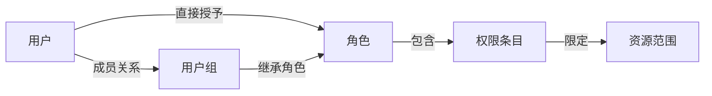

# kube-aiops 平台访问控制 PRD

系统管理交互以 [已确认的系统管理 PRD](../system-management/00-prd.md#31-已确认的交互调整) 为准。本文保留后续平台动作委派的评审范围。

| 项目 | 约定 |
| --- | --- |
| 版本 | v1.0 评审稿 |
| 基线 | `main@ca40d7f`，本地 [全局权限设计](../system-management/platform-rbac-design.md) |
| 用户 | 超级管理员、系统管理员、LDAP 值班人员、本地访客 |
| 目标 | 统一诊断、知识库、资源管理、系统管理及审计的权限判断 |
| 交付 | 独立的权限基础、兼容迁移、管理端改进，随后按范围试点开放知识读取 |

[页面](01-pages.md) · [交互原型](prototype.html) · [功能](02-features.md) · [用户故事](03-user-stories.md) · [开发任务](04-development-tasks.md) · [测试用例](05-unit-test-cases.md)

## 1. 问题与成功标准

现有角色的 `Scopes` 表示历史诊断范围。平台 LDAP 普通员工走诊断动作白名单，Wiki 有独立动作键，资源和系统管理存在管理员入口判断。需要将这些入口接入统一逻辑，让管理员能回答「这个人为什么能对这个对象做这项操作」，并在新增模块时复用相同授权语义。

- 升级后的旧账号、用户组、角色和既有允许范围保持等价，迁移报告对未确认项给出归因。
- 角色管理支持配置、预览和核对「动作 + 范围」。用户详情解释全部授权来源。
- 同一权限规则覆盖直接请求、列表、聚合、后台任务和模型上下文。授权变更不依赖用户刷新页面。
- 首轮验收至少覆盖六类身份场景：超级管理员、本地系统管理员、LDAP 系统管理员、LDAP 值班人员、本地访客和现有显式策略账号。

## 2. 范围与分期

| 阶段 | 交付承诺 | 边界 |
| --- | --- | --- |
| P0 等价迁移 | 权限目录、授权条目、后端统一裁决、角色及组管理、生效权限解释、兼容迁移和审计。 | 现有数据角色只获得其迁移前的历史诊断权限及选择器能力。已存在的显式策略独立保留原有边界。 |
| P1 Wiki 只读试点 | 向选定的 LDAP 平台组显式授予 Wiki 阅读，对已发布知识提供搜索、详情和诊断推荐。按命名空间授权。 | 默认不启用；确定试点组与目标后由管理员配置。问答、草稿、同步和生产发布沿用现有权限，阅读试点不附带这些动作。 |
| 后续独立评审 | 扩大证据读取、AI 复核及保存、知识维护和审核委派。 | 仍由现有管理员及明确有效的历史策略执行敏感操作。资源写入、系统管理和全局审计的委派另行评审。 |

保留现有本地和 LDAP 认证、管理员审批规则和业务流程。无租户层。LDAP 目录组不直接映射到平台组。内容适用性和 Kubernetes 集群内 RBAC 分别按各自规则判断。

## 3. 权限模型

- **用户**绑定可选的直接角色和多个平台用户组。**用户组**可绑定多个可继承角色。**角色**包含零或多条权限。用户和用户组不直接持有权限条目。
- 权限条目由 `capability、scopeKind、scopeId 或结构化锚点` 组成。目录定义模块、动作、允许的范围形状、可授予身份和阶段。使用资源目录中的稳定 ID 作为锚点，名称仅用于展示。
- 同一用户的直接角色和组角色取并集。并集以完整动作与范围为单位。多个命中路径全部保留。独立的动作和范围之间不做组合。
- 自定义角色可以为空，空角色不授予访问。LDAP 账号失去最后一个有效角色后的默认角色恢复规则沿用现行约定。角色是否为空与账号是否仍有关联角色分别处理。
- 删除有引用的组或角色返回冲突并列出有权查看的引用。内置角色始终不可删除或编辑。管理员角色只可直接授予。

## 4. 模块权限与资源范围

| 模块 | P0 裁决 | P1 或后续动作 |
| --- | --- | --- |
| 历史诊断 | 列表、详情和汇总用现有动作。研发、测试支持环境、实例、命名空间；预发布、生产必须指定实例、业务线与命名空间。集群级故障仅系统管理员。 | 保留已有粒度。 |
| 关联证据与 AI | 证据和资源投影仍需对应读能力及 Finding 读取。AI 复核和结论保存沿用当前管理员入口。 | 评审后可将 `findings:review` 与 `findings:conclusion:write` 分配给指定数据角色。 |
| 运维知识库 | 沿用当前 `wiki:read`、`wiki:publish`、`wiki:sync` 的现有主体和范围；诊断或候选工作流另查状态和版本。 | P1 仅开放明确实例及命名空间的 `wiki:read`。`wiki:ask`、`wiki:draft:write`、`wiki:link`、`wiki:withdraw` 为后续细分。 |
| 资源管理 | 连接、凭据、环境、业务线和命名空间归属写入保留管理员能力，以实际对象核验目标。选择器按有权读取的业务数据生成。 | 资源写入委派待评审。 |
| 账号与授权 | 普通管理员维护普通账号、组、角色和数据授权。管理其他管理员、授予或撤回管理员角色只由超级管理员操作。 | 不委派给数据角色。 |
| 审计与密码 | 全局审计由系统管理员查看；保留策略由超级管理员维护。本地账号自行改密按自身关系和既有规则执行，LDAP 在目录中改密。 | 保留现有策略。 |

- 生产和预发布只认可**当前有效**的命名空间与业务归属。共享命名空间的每条归属独立判定。移除一条后其路径立即失效，其他已授权的路径仍有效。新增归属不会自动生成新增授权。
- 范围从后端真实对象和资源目录解析。跨环境、实例不匹配、归属缺失时，普通数据权限按失败关闭处理。目录故障使用可重试错误，不能回退为宽范围。目录的人工修复入口仍按现有系统管理员权限使用。
- Wiki 共享阅读命中任意已批准可见目标即可。Finding 推荐还需对**当前目标**同时具备 Finding 和 Wiki 读权限，知识满足适用条件。修改多目标知识要对变更涉及的全部目标授权。生产发布及扩大共享范围须由另一位有权管理员审批。
- 列表、筛选项、计数、游标和汇总使用同一授权集合。版本直链、新旧 API、后台同步与 AI 上下文均执行权限和状态检查。模型返回前重验授权，撤权期间生成的受限回答不得下发。

## 5. 管理操作与失败处理

1. 管理员打开角色，选择权限和范围，预览新增与移除项、受影响用户及组。保存使用期望版本，生成审计批次。并发冲突保留编辑内容并提示重载；失效范围单独定位。
2. 用户详情显示角色来源和生效条目；模拟检查选择动作和实际对象，返回是否允许、全部命中路径或安全可公开的拒绝原因。模拟只读，不改变用户授权。
3. 批量授权逐项检查身份、角色可继承性和操作者权限，返回成功、跳过、失败。失败项保留原状态；重试同一有效关联时返回已存在。管理员账号状态和角色变更使用现有权限分级。
4. 数据角色修改、组成员变化和目录归属变动在下一次受保护请求生效；停用、改密和直接增减管理员角色继续按旧规则处理会话。保留现有失败变更不入操作审计的约定。记录成功变更和逐项批量结果。
5. API 最少区分未认证、无权进入功能、不存在或不可见对象、输入校验失败、版本冲突和依赖异常。不可见对象与不存在采用同等公开反馈，管理员模拟检查可获得更具体解释。

## 6. 迁移、上线与回退

- 增量迁移角色内容，保留用户、组、角色和内置角色 ID。旧 `Scopes` 一对多映射到当前实际诊断动作和必要选择器。对本地访客、LDAP、管理员及旧策略账号分别建基线，禁止跨授权通道合并身份或规则。
- 切换前备份 SQLite；在脱敏旧库跑迁移、回放代表性允许和拒绝样本，比对每个对象。可重复运行，迁移失败不切换。未识别的显式策略和范围进入差异报告，不自动扩大范围。
- 切换覆盖新旧接口、模型检索及后台任务。回退从已验证的兼容服务与备份开始，核对切换后新增的授权写入并有序回放。上线前由运维确认部署顺序、备份校验及演练结果。
- P1 先分配到少数 LDAP 组与明确的 Wiki 目标。验证搜索、版本直链、撤权和诊断推荐后逐组扩展。停止试点时撤销试点角色关联，检查当前会话与共享条目的可见范围。

## 7. 验收与评审

| 场景 | 验收断言 |
| --- | --- |
| 无动作范围串联 | 测试发布加生产读取时，生产发布始终拒绝。 |
| 并集与撤销 | 组和直接关联命中同一权限，移除一条仍可用，移除最后一条后下一请求拒绝。 |
| 管理身份保护 | 本地访客加入组、组关联管理员角色、普通管理员管理其他管理员均被拒绝；默认角色范围保持。 |
| 资源归属 | 生产命名空间可有多路业务授权；移除一条归属后仅对应路径失效。无权节点数据、筛选值和计数不出现。 |
| Wiki 试点 | LDAP 获授权后只读所选目标；分享、写入、问答和来源同步不会随 Wiki 读取自动开启。 |
| 迁移与回退 | 同一脱敏库迁移两次无重复；空角色、历史 ID、旧策略不扩权；复核有效差异和回退结果。 |

评审需确认 P0 现有行为基线及例外策略、P1 试点 LDAP 组和 Wiki 目标、生产管理员审批人。当前原型用固定账号与资源范围模拟典型路径。生产名单和真实数据用脱敏夹具验证后进入实施验收。
