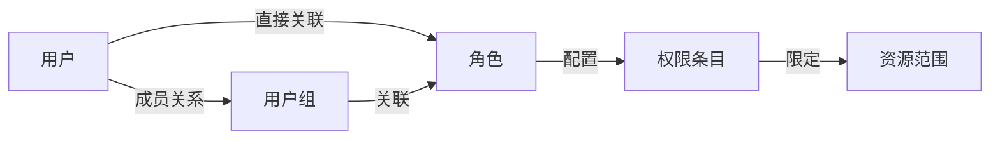

# kube-aiops 角色配置增量设计

| 项目 | 说明 |
| --- | --- |
| 版本 | v0.2 设计待确认 |
| 基线 | 当前「系统管理 → 权限配置」页面与平台全局权限方案 |
| 本轮交付 | 本设计和 [可点击 HTML 原型](role-configuration-prototype.html) |
| 后续 | 确认设计后再修订 PRD、开发文档和测试用例 |

## 1. 入口与功能边界

建议在「系统管理」中，于「权限配置」右侧增加同级的 **角色配置**。以截图中的导航为基线，顺序为「认证配置、用户管理、权限配置、角色配置、操作审计、修改密码」。角色配置负责定义角色；权限配置和用户管理继续负责现有授权关系。角色 ID、引用及已生效权限只有一份。

| 现有区域 | 保留的功能结构 | 本轮界面建议 |
| --- | --- | --- |
| 认证配置 | LDAP 配置、测试、保存和原有管理范围。沿用当前登录及目录账号处理流程。 | 复用现有入口。 |
| 用户管理 | 查找、筛选、查看详情、创建及维护适用账号、停用与启用、密码操作、删除及账号保护。 | 复用现有页面。生效权限详情可使用同一权限动作和范围名称，保留来源及入口。 |
| 用户授权 | 用户管理的单人及批量直接授予角色、移除角色、加入及移出用户组；权限配置维护组到角色的关系。 | 权限配置保留「角色／用户组」。角色列表提供权限摘要、引用和查看；编辑链接跳转到角色配置。用户组继续关联既有角色。 |
| 操作审计 | 保留原审计入口、筛选、分页、详情、失败口径和保留策略。 | 角色配置的创建、修改和删除作为既有角色操作进入原审计。沿用操作者、目标、结果和现有风险分级。 |
| 角色配置（新增） | 定义权限目录中可授予的动作及范围，查看角色引用。 | 集中创建、编辑和删除自定义角色；预置角色只读。 |

现有角色页的「新建角色」可继续作为跳转入口。旧角色编辑的直链根据同一角色 ID 打开新位置，返回后恢复原列表筛选。角色配置中的「查看引用」返回现有用户或用户组的授权视图，链接本身不修改任何授权。

## 2. 数据关系和授权语义

- 用户可有多个直接角色，也可属于多个平台用户组；用户组可关联多个可继承角色。LDAP 目录组仍由现有认证行为处理，继续由平台管理员维护平台用户组。
- **权限只配置在角色上。每项权限是完整的「动作 + 范围」。** 直接和继承角色的完整条目取并集，多条来源均可查看。一个角色的测试写权限与另一个角色的生产读权限不会组合为生产写权限。
- 预置「访客只读」继续提供研发、测试历史诊断。预置「系统管理员」继续由现有规则直接授予，禁止加入用户组、编辑或删除。本地账号类型、LDAP 默认角色和超级管理员保护沿用现行规则。
- 撤掉一条角色路径后，其他仍匹配的路径继续生效。角色内容保存沿用现有后端生效及会话语义。删除有引用的自定义角色先从现有用户授权或用户组页面解除引用。

## 3. 角色配置页

| 区域 | 设计 |
| --- | --- |
| 角色列表 | 显示名称、预置或自定义、权限条目、引用数和操作；搜索按角色名匹配。系统管理员显示「全局管理」，访客显示已有两项权限。 |
| 编辑面板 | 第一部分为角色名称。第二部分为权限清单，每条单独选择模块、动作和范围。点击「添加权限」后进入待保存清单，可移除。修改现有条目采用移除并添加。 |
| 范围选择 | 研发及测试的历史诊断可选整个环境、单实例或指定命名空间。预发布及生产只列出可用实例和实际归属，先选择业务线，再选择具体命名空间。变更上游后清空失效选项。 |
| 保存前预览 | 列出新增和移除的权限、直接引用及组引用数。引用数是关联数，界面明确其含义。取消不产生变更；保存失败保留输入；角色被并发更新时提示重新载入并核对。 |
| 只读及空态 | 预置角色可查看权限条目和引用，保存或删除入口不可用。无匹配时可清除筛选。暂未开放的能力显示在权限目录，编辑器只提供已开放动作。 |

## 4. 兼容平台能力的规则

| 能力 | 本轮设计边界 | 角色配置如何表达 |
| --- | --- | --- |
| 历史诊断 | 首次切换只做等价迁移，角色 ID、既有读范围及关联全数保留。 | 用一项「历史诊断查看 + 原有范围」表达每份旧范围。后台将该动作映射为现有列表、汇总、详情与必要选择器能力。 |
| 运维知识库 | 保留当前管理员和旧显式授权的能力。**Wiki 只读试点须由管理员明确开放给指定组**，默认关闭。 | 试点开放时可给自定义角色添加「Wiki 阅读 + 指定实例／命名空间」。生产或预发布仍校验业务归属。无需更改用户授权流程。 |
| Wiki 发布、同步及 AI 复核 | 沿用当前角色、管理条件及审核流程。后续委派单独评审。 | 可在权限目录读到能力说明。发布、来源同步及 AI 委派不放入首批可授予动作。Wiki 阅读不附带它们。 |
| 资源管理、系统管理和审计 | 管理权限继续按现行系统管理员或超级管理员边界执行。 | 在系统管理员角色详情解释现有能力；自定义角色编辑器不提供对应管理动作。 |

Wiki 资源范围表示平台授权；文档公布的可见目标及适用条件仍由 Wiki 决定。只有两处规则都满足，知识才可以返回或被推荐。生产归属变更后按真实目录再次判定。旧角色存在无法映射的范围，留在迁移差异报告供人工核对，禁止自动扩大权限。

## 5. 原型评审路径

1. 打开「权限配置」，查看截图对应的角色和用户组结构；点击「角色配置」确认新入口位置。
2. 在「角色配置」查看预置角色，编辑「生产值班观察」，为支付或云帆命名空间增加诊断权限，核对变更预览。
3. 在「权限配置 → 用户组」核对引用，在「用户管理」查看示例用户的直接角色、组角色和生效权限。
4. 打开「权限目录」查看 Wiki 试点、AI、资源管理与审计的开放边界。原型中的 Wiki 示例开关只模拟评审场景。

请确认新增同级页和现有权限配置的入口分工、生产范围交互及 Wiki 只读试点的展示方式。以确认结果为准编写正式需求和开发验收。
