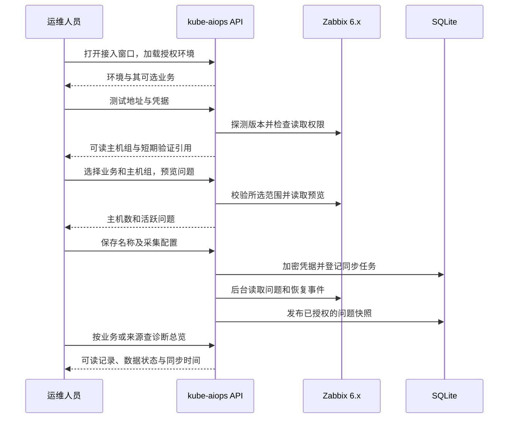

# 资源管理 · 设计方案

[PRD](00-prd.md) · [页面拆解](01-pages.md) · [功能拆解](02-features.md) · [用户故事](03-user-stories.md) · [开发任务](04-development-tasks.md) · [测试用例](05-unit-test-cases.md) · [交互原型](prototype.html) · [文档维护规则](../development-standard.md)

覆盖环境管理、业务线管理、Kubernetes 集群与命名空间，以及监控诊断和资产数据源。环境与业务线采用当前平台目录交互，集群与数据源采用当前工作区及专项编辑流程。

## 环境与业务线目录

入口沿用「资源管理 → 平台目录 → 环境管理／业务线管理」，与资源管理工作区使用同一套页面框架。实体只有名称与 ID，目录的关联信息以平台实际核查结果为准。

- [交互 HTML 原型](catalog.html)
- [PRD](00-prd.md#环境与业务线目录) · [页面拆解](01-pages.md#环境与业务线目录) · [功能拆解](02-features.md#环境与业务线目录) · [用户故事](03-user-stories.md#环境与业务线目录) · [开发任务](04-development-tasks.md#环境与业务线目录) · [测试用例](05-unit-test-cases.md#环境与业务线目录)

| 视角 | 设计决定 |
| --- | --- |
| 产品 | 将新增置于页首。列表通过名称或 ID 搜索，两个子页各自保存目录顺序、名称排序或 ID 排序。条目详情、复制 ID 和常用编辑直接进入，删除归入行内菜单。 |
| 前端 | 使用统一列表、右侧详情和固定操作栏弹窗。默认编辑名称，ID 在「修改 ID」后解锁。切换目录时恢复搜索和排序，关闭操作后优先回到原条目或搜索。 |
| 运维 | 展示变更对象及原 ID。写入带原 ID，保留既有历史别名行为。删除由服务端核查引用，逐项显示集群、命名空间归属和角色范围，并可复制清单。 |

### 接口与数据

- 沿用 `GET /api/v1/admin/environments` 和 `GET /api/v1/admin/business-lines`，响应仅包含当前目录的 `id`、`name`。
- 创建用 POST，更新用 PUT 并传 `originalId`，删除用 DELETE 传当前 `id`。保存后用服务端响应更新当前列表和仍打开的详情。
- 列表展示现有授权结果。两页入口分别由导航注册及读取权限控制，操作权限遵循现有管理员判定。加载和操作仍经过服务端授权。
- 用现有删除冲突返回值展示引用清单，无法识别的类型按关联引用展示。删除冲突、重复名称、历史 ID 冲突与加载故障分别呈现。
- 390px 窄屏保留名称、ID、复制和编辑入口，表单布局为单列。无匹配、空目录、加载失败与只读分别提供对应反馈。

## 集群与数据源工作区

范围为「资源管理 → 数据源管理」和「资源管理 → Kubernetes 集群管理」。基于两份可点击原型实现真实 Portal 页面，复用现有权限、诊断跳转、数据源连接器和集群维护接口。

- [数据源管理原型](data-sources.html)
- [Kubernetes 集群管理原型](clusters.html)
- [PRD](00-prd.md#集群与数据源工作区) · [页面拆解](01-pages.md#集群与数据源工作区) · [功能拆解](02-features.md#集群与数据源工作区) · [用户故事](03-user-stories.md#集群与数据源工作区) · [开发任务](04-development-tasks.md#集群与数据源工作区) · [测试用例](05-unit-test-cases.md#集群与数据源工作区)

### 设计决策

| 视角 | 数据源管理 | Kubernetes 集群管理 |
| --- | --- | --- |
| 产品 | 默认进入「监控与诊断」，云主机放在「资产数据源」。一个新增入口按当前页签提供类型选择 | 一个接入入口引导外部直连或采集上报。保留集群与命名空间视图及共享环境筛选 |
| 前端 | 对齐列表、工具栏、分组和右侧详情。以来源与记录 ID 组成行键，隔离不同连接器的同名和同 ID | 用列表代替额外目录树。详情包含查看命名空间与适用维护动作。编辑表单按概要、连接和观测内容分区 |
| 运维 | 分开显示测试、排队同步、成功快照与失败原因。部署配置独立显示；暂停项可查看 | 分开显示采集状态、节点状态、检查或上报时间。节点过期时标记最近可用样本和最近错误 |

### 数据和状态

- Zabbix、观测、资产三个列表分别加载和重试。当前页签按接口已返回的数据统计，加载失败的信息保留为提示。资产分页保留游标，搜索结果与摘要使用当前资产页口径。
- 归属使用环境 ID 比对，优先使用资源目录名称。资产和观测保留各自的业务、集群及命名空间字段。部署配置展示服务端返回标记。
- Zabbix 和 Alertmanager 同步请求进入后台任务队列，页面轮询以获取最近运行状态。Prometheus、VictoriaLogs 和 Grafana 使用接口记录的验证时间。单次请求失败可在当前页面查看错误；跨会话原因取决于服务端实际返回字段。
- 已有集群配置继续从接入目录读取。节点快照时间、最新读取尝试、上报时间和首次采集时间分别展示。集群摘要取当前环境、关键词和接入方式的范围，随后应用状态过滤。
- 使用现有单页入口、权限注册、资产版本前置条件和 API 载荷。新增类型中的 Zabbix 仅从监控与诊断进入，资产只提供 ECS 与 CVM。存量 Zabbix 资产仍可查看和维护。

### 交互约定

桌面使用表格，窄屏使用带字段标签的条目。详情在当前目录上展开，关闭后回到触发位置。写入表单在请求期间锁定提交并阻止关闭，提交成功后更新相关记录。表单出错时保留输入。高风险操作需明确目标，已录入的草稿关闭时确认。集群列表的筛选写入当前地址，保存、删除或重新打开链接后可恢复。

## 可观测数据源接入

连接器契约和部署配置见本节。列表布局与新增入口以集群与数据源工作区为准。

交付对象为「资源管理 → 数据源管理」。沿用截图里的 Zabbix 折叠区、右侧接入按钮和「连接 → 范围 → 预览 → 保存并启用」路径，新增 Prometheus、VictoriaLogs（VLS）、Alertmanager、Grafana。原型为独立 HTML，使用演示数据。

[可点击原型](observability-connection.html) · [PRD 和交付索引](00-prd.md#可观测数据源接入)

### 一、接入后在哪里使用

| 数据源 | 首期用途 | 在诊断里出现的位置 | 接入验证 |
| --- | --- | --- | --- |
| Prometheus | 读取指标与时序，复用现有 PromQL 诊断查询 | 故障和 K8sGPT 诊断详情的指标证据 | `/api/v1/query` 有界读取。选定范围后预览 `up`，后续由诊断详情的固定模板判断具体指标覆盖。 |
| VictoriaLogs | 读取有界 LogsQL 聚合，支持后续按权限扩展脱敏样本 | 诊断详情的日志证据 | `/select/logsql/stats_query_range` 预览最近一段时间的日志统计。可配置集群字段和租户信息。 |
| **Alertmanager** | 同步当前告警，保留来源和处置状态，供总览与关联证据使用 | 诊断总览增加 Alertmanager 来源。详情保留告警名称、实例、级别、首次触发和上游状态 | `GET /api/v2/alerts` 按已授权范围拉取，预览当前告警和可选的静默／抑制告警。 |
| Grafana | 发现授权的 Dashboard，保存 Dashboard UID，按诊断上下文生成跳转链接 | 诊断详情的「查看 Grafana 仪表盘」 | 使用只读 Service Account Token 查询可见仪表盘。兼容适配器可使用 `GET /api/search`，并按目标 Grafana 版本验证。 |
| Zabbix | 继续同步已选主机组的问题 | 诊断总览与问题详情 | 延用现有接入流程和权限。 |

指标预览验证访问和数据覆盖，`up` 返回空数组时显示「连接正常 · 范围内暂无序列」。日志预览同样区分空窗口与上游不可用。Grafana 跳转沿用用户自身会话和 Grafana 权限，首期链接传 `from` 和 `to`，按诊断首次发现前 30 分钟组装。Dashboard 变量映射留作后续扩展。Grafana 中指向 Prometheus 或 VictoriaLogs 的数据源仍由对应连接器提供证据。项目当前已经通过环境变量运行前三类证据适配器，页面接入将复用查询逻辑和限额。

### 二、页面与操作

| 区域 | 行为 |
| --- | --- |
| 数据源列表 | 按类型展示五个可折叠区块。标题显示连接数，右侧接入按钮始终可见。全局可按环境和状态筛选；保存后展开对应区块并显示新连接。资产数据源入口继续位于下方。 |
| 步骤一 · 连接 | 输入名称、环境、站点地址，选择认证方式。用户填写站点根地址或带反向代理前缀的基地址，平台拼接固定 API 路径。Grafana 使用 Service Account Token，其他 HTTP 接入按部署支持 Bearer、Basic 或免认证。 |
| 步骤二 · 范围 | 从授权目录选择业务和集群。集群独享端点显式绑定实例，共用端点要求配置并验证精确标签或字段等于某个值。VictoriaLogs 可附加固定租户，Grafana 授权后选择一个或多个 Dashboard。未建立明确映射的记录不会进入业务总览。 |
| 步骤三 · 预览 | 测试连接后可预览当前范围。提示权限不足、超时、证书不可信、标签不匹配。预览成功且样本为零时仍可启用，有覆盖提示的预览须明确确认或修正。 |
| 保存与维护 | 连接状态和采集状态分别显示。列表展示名称、环境／业务／实例、上次测试或成功同步时间。支持重测、编辑、轮换凭据、暂停、恢复。Alertmanager 同步后才更新总览。 |

普通路径使用一个弹窗完成。实现要求先选择环境、业务和集群，再发起连接测试，从第一次请求开始验证授权范围。连接和采集范围桌面并排，窄屏顺序显示。变更地址、凭据、范围映射或仪表盘选择后，重新验证受影响的连接或预览。测试从 API 服务所在网络发起，页面不会把浏览器可访问误报成 API 已可访问。

### 三、Alertmanager 首期方案

1. **轮询接入，先接当前告警。** 预览和同步使用只读 API v2，范围由已授权的平台环境、业务、集群和精确上游 matcher 共同确定。每 60 秒进行一次有界轮询，由后台 worker 执行。手动同步进入同一队列。静默和抑制按上游 suppressed 状态合并标注，未处理单独标记。默认总览只展示活动告警。列表保留上游状态与原始严重度。
2. **按告警实例去重。** 同一逻辑 Alertmanager 使用具备 HA 能力的 HTTPS 入口。对同一范围内的规范化标签计算指纹，以指纹加 `startsAt` 标识一次告警。组名只用于展示。使用 `severity` 到平台级别的显式映射，未命中的保留原值并显示未映射状态。重试或主备切换不会重复计入。
3. **保留轮询边界。** 成功轮询中不再出现的告警标记「已离开当前告警列表」，无需从列表消失推断恢复。同步失败保留最后成功快照并标注时间和过期，避免误报 0 或批量恢复。趋势按平台已经采到的有效首次触发时间统计。Alertmanager 来源可切换查看已离开列表的近期记录，快照保留窗口为 30 天，单连接上限 1000 条。来源间的诊断与告警总览保持各自的记录身份，详情使用既有关联证据。
4. **后续按需接 Webhook。** 若需要明确恢复时间或覆盖短时告警，再配置 Alertmanager Webhook receiver 和 `send_resolved: true`，依靠受信凭据、范围校验、幂等落库和乱序保护接收通知。Webhook 和轮询共享事件身份，管理页单独提示通知覆盖范围。静默、抑制、路由和分组频率会影响通知，成功接收 Webhook 也无法自动补齐配置前历史。

### 四、路由、状态和权限

| 主题 | 设计 |
| --- | --- |
| 数据源配置 | 主记录保存类型、名称、基地址、凭据引用、认证方式、启用状态和修订号。范围绑定另存环境／业务／实例、上游映射及可选租户。同步状态保存最近尝试、成功时间、覆盖或失败类别。首期保存前由 API 再次验证同一范围，浏览器表单仅在弹窗内保留输入凭据，关闭后清理。 |
| 凭据和网络 | 用户在页面录入凭据，服务端使用部署已有的密钥设施加密保存，详情接口只返回是否已配置。兼容旧文件凭据。连接目标须由平台预先允许，生产默认 HTTPS，私有 CA 由平台信任设施提供。平台按类型设置精确 HTTPS 基地址白名单，禁用出站代理和重定向。连接层核对解析后的 IP，拦截回环、链路本地和非单播地址。内部部署可继续用集群出站网络策略限制可信网段。私有 CA 通过 API 进程的系统信任库配置。凭据轮换、修改范围、启停均留审计。 |
| 权限与查询 | 复用数据源查看、维护、测试能力，并校验每个绑定的环境／业务／集群权限。使用白名单查询模板、有界时间窗、并发和响应大小限制。对共享上游先验证映射，返回结果仍做范围复核。记录、日志片段或完整标签按授权和脱敏规则呈现。 |
| 多连接选择 | 同一类型按当前诊断的环境／业务／集群解析一个启用的证据绑定。冲突时阻止启用或提示先解除旧绑定，避免跨范围回退。不同观测集群可配置独立连接，共享后端可配置多个明确绑定。 |
| 存量迁移 | 读取现有 `PROMETHEUS_*`、`VICTORIALOGS_*` 和 `ALERTMANAGER_*` 配置，作为只读的「部署配置」显示。已验证的同范围平台连接可显式接管；暂停平台连接后，诊断证据恢复该集群原有部署配置。启用连接的读取失败按诊断不可用处理。切换时校对查询结果与权限是否一致。 |
| 停用与过期 | 暂停后停止新查询／采集，并从默认实时视图移除。恢复后立即验证或同步。失败快照按授权和时效标识展示。初次同步进行中、已验证零结果和上游失败各有独立状态。 |

### 五、交付顺序和验收

| 阶段 | 验收 |
| --- | --- |
| P0 · 连接与证据 | 同一弹窗完成四类连接的测试、绑定、预览和保存。Prometheus 与 VictoriaLogs 复用诊断证据位置。Grafana 可选仪表盘并生成带时间的跳转链接。验证跨范围无访问及旧部署配置可继续查询。 |
| P1 · Alertmanager 总览 | 同一共享后端用不同 matcher 绑定多个集群。轮询失败保留已授权的旧快照并标记过期，空结果与失败状态可区分。试验重复轮询、静默抑制、HA、权限变化和首次入库时间。 |
| P2 · Alertmanager Webhook | 验收标准包含短时告警、明确恢复、重复通知、乱序、上游路由覆盖和超限处理。按需推进。 |

原型可演示所有四类接入、范围预览、保存、列表筛选和启停。Alertmanager 展示轮询模式及静默／抑制预览，Grafana 展示仪表盘勾选。实际接入能力以上线实现和各环境联调结果为准。

### 部署配置

配置允许接入的 HTTPS 基地址。可按需部署单个类型；从旧部署参数读取的连接继续在原集群作用域使用。每个业务、环境、集群与类型组合支持一个平台绑定，编辑可以轮换凭据或更换服务地址。

| 类型 | API 环境变量示例 |
| --- | --- |
| Prometheus | `DIAGNOSTIC_PROMETHEUS_ENDPOINTS=https://obs.example.com/prometheus` |
| VictoriaLogs | `DIAGNOSTIC_VICTORIALOGS_ENDPOINTS=https://obs.example.com/logs` |
| Alertmanager | `DIAGNOSTIC_ALERTMANAGER_ENDPOINTS=https://obs.example.com/alertmanager` |
| Grafana | `DIAGNOSTIC_GRAFANA_ENDPOINTS=https://obs.example.com/grafana` |

每个变量可用逗号分隔多个基地址。持久化身份 SQLite 和同目录的 `.observability-credentials.key` 文件，备份时两者须一并保留。生产启用前确认登录用户具备数据源查看、维护或测试权限，非管理员同时需要环境／业务与集群范围授权。在共享上游使用精确集群标签；Alertmanager 带 namespace 的记录还需匹配平台命名空间业务归属。共享命名空间缺少唯一业务归属时跳过相应告警。

### 接口参考

- [Prometheus HTTP API](https://prometheus.io/docs/prometheus/latest/querying/api/)
- [VictoriaLogs 查询接口](https://docs.victoriametrics.com/victorialogs/querying/)
- [Alertmanager API v2](https://github.com/prometheus/alertmanager/blob/main/api/v2/openapi.yaml) · [Webhook receiver 配置](https://prometheus.io/docs/alerting/latest/configuration/#webhook_config)
- [Grafana Dashboard 搜索](https://grafana.com/docs/grafana/latest/developer-resources/api-reference/http-api/api-legacy/folder_dashboard_search/) · [Service Account](https://grafana.com/docs/grafana/latest/administration/service-accounts/) · [Dashboard 链接参数](https://grafana.com/docs/grafana/latest/visualizations/dashboards/build-dashboards/create-dashboard-url-variables/)

## Zabbix 接入与同步

数据源在监控与诊断页签中配置。诊断结果、趋势和授权可见性见[诊断控制台](../diagnosis-console/design.md)。

接入人员在「资源管理 → 平台目录 → 数据源管理 → Zabbix 数据源」的连接区填写环境、名称、Zabbix 地址和只读凭据。连接测试完成后，在同一窗口从所选环境的授权业务中选择归属业务与主机组，预览活跃问题后保存。保存后，数据源卡片标题显示所填名称。后台完成首次同步后，值班人员在「诊断控制台 → 诊断总览」查看 Zabbix、故障事件与 K8sGPT Finding。



| 设计面 | 实施规则 |
| --- | --- |
| Zabbix 版本 | 自动识别 6.0、6.2、6.4。API Token 和账号会话均走 JSON-RPC `auth`。账号使用 `user.login`，每轮读取后注销临时会话。 |
| 地址 | 接受站点根路径或 API 地址，补齐 `/api_jsonrpc.php`。后端将 `DIAGNOSTIC_ZABBIX_ENDPOINTS` 的配置项按同一规则规范化后精确匹配，验证 TLS，拒绝重定向。 |
| 凭据 | 连接测试只保留与当前登录身份绑定的短期验证引用，默认 5 分钟。同一用户对同一目标的后续测试会取代旧引用。正式凭据使用 AES-GCM 加密，密文绑定源 ID 与 API 地址。密钥文件与 SQLite 同目录并独立管理，复用现有持久化目录。 |
| 范围 | 一个数据源归属一个环境和一个业务。环境只在连接区选择一次，采集范围复用该环境。切换环境会清空旧业务，只列出新环境下有权维护的业务。授权检查采用环境和业务的精确组合。以主机组 ID 发现当前监控主机，按主机 ID 去重。 |
| 名称 | 新建时填写 1–120 个字符的显示名称。前后空白会裁剪，名称存入 SQLite 并由列表接口返回。自动迁移给已有记录增加名称列，默认值为空字符串，未命名记录沿用原卡片标题。数据源唯一性按地址、环境、业务判断。 |
| 折叠 | 「Zabbix 数据源」默认展开，标题按钮可用鼠标或键盘折叠。折叠时保留「接入 Zabbix」入口，新建保存后展开以显示新增记录。 |
| 主机与集群 | 普通主机直接显示在环境／业务下。需要关联集群时，在 Zabbix 主机上设置 `kube-aiops.cluster-id` 标签，值为平台集群实例 ID。后端检查该实例属于同一环境和业务。无匹配或存在多个有效绑定时按独立主机展示。 |
| 快照 | 保存配置后由后台任务进行首次正式同步，预览作为单独查询。SQLite 租约协调同步任务，配置版本用于拒绝过期任务写回。每次成功或者失败后安排下一轮，默认约 60 秒。 |
| 恢复与去重 | 已发生的问题以规范化 Zabbix API 地址和 `eventid` 去重。选定环境与业务后只归并授权范围内的数据。`problem.get` 读取可见问题，`event.get` 补主机和恢复证据。确认恢复的已观测问题保留最近 24 小时。默认排除维护抑制和可识别的症状问题。 |
| 严重度 | Zabbix 4–5 对应严重，2–3 对应警告，0–1 对应信息。详情保留上游级别、确认状态、标签、开始及恢复时间。 |
| 容量 | 单配置 1–50 个主机组。单次上游读取设 500 条上限，达到上限时显式报错。总览最多汇总 2,000 条 Zabbix 记录，超出后提示覆盖不完整。 |

#### 同步状态和统计口径

| 状态 | 数据源管理 | 诊断总览 |
| --- | --- | --- |
| 已保存／首次同步中 | 显示等待或进行中，等待可用快照 | Zabbix 单来源显示指标「—」 |
| 成功且没有活跃问题 | 显示 0 条，并记录成功时间 | 当前选择范围显示真实 0 |
| 首次同步失败 | 显示失败并可重试 | Zabbix 单来源显示暂不可用 |
| 成功后暂时失败 | 显示上次成功时间和过期提示 | 展示已确认覆盖范围内的最近成功结果 |
| 已确认授权撤销 | 标明采集权限不可用 | 隐藏已撤销范围内的问题 |
| 暂停 | 可恢复采集 | 数据源退出汇总，恢复后等待新快照 |

#### 发布和运维

已有部署可以在发布清单的 `api` 容器中追加以下环境变量。优先在现有列表追加地址，保留其他数据源。

```yaml
- name: DIAGNOSTIC_ZABBIX_ENDPOINTS
  value: "https://zabbix.example.com/api_jsonrpc.php,https://monitor.example.com/zabbix/api_jsonrpc.php"
```

应用发布清单后检查 `kubectl -n kube-aiops-system rollout status deployment/kube-aiops-api --timeout=180s`。在 Portal 的连接区填写环境和名称，确认连接后继续选择归属业务和主机组。

- 在 API 容器配置 `DIAGNOSTIC_ZABBIX_ENDPOINTS`。允许填 HTTPS 站点根地址或完整 API 地址。多个地址用逗号分隔，匹配仍限定到各自的主机、端口和路径。使用发布清单或 Helm values 持久化配置，由 API Pod 在启动时读取。
- 地址格式无效时返回 `ZABBIX_ENDPOINT`。平台未配置允许地址时返回 `ZABBIX_ENDPOINTS_UNCONFIGURED`。地址未获准时返回 `ZABBIX_ENDPOINT_NOT_ALLOWED`。三种情形都发生在请求 Zabbix 之前。
- 使用 Zabbix 专用只读账号。需要 `host.get`、`hostgroup.get`、`problem.get`、`event.get` 的访问权限。账号密码模式同时使用 `user.login`、`user.logout`。Token 的可见范围取决于其所属账号。
- 将 SQLite 和同目录的 `.zabbix-credentials.key` 文件一并纳入备份和恢复。文件名使用 SQLite 文件路径加该后缀。每个使用独立 SQLite 的部署维护自己的加密密钥。
- 通过数据源管理配置暂停、恢复、手动同步和先验证后轮换凭据。旧 Zabbix 资产数据源与云资产接入使用既有 API 与数据表。
- 初始落地在受控业务试点环境核对 Zabbix 页面与 Portal 的主机范围、问题数、恢复时间和级别映射。

[Zabbix 6.0 API](https://www.zabbix.com/documentation/6.0/en/manual/api) · [问题查询](https://www.zabbix.com/documentation/6.0/en/manual/api/reference/problem/get) · [事件查询](https://www.zabbix.com/documentation/6.0/en/manual/api/reference/event/get)

## 外部直连集群配置编辑

入口为「资源管理 → Kubernetes 集群管理 → 编辑配置」，与截图中的面包屑一致。本轮聚焦已有外部直连集群的编辑，包含配置修改、连接测试、保存及失败恢复。

### 三个视角的审查

| 视角 | 现有问题 | 设计调整 |
| --- | --- | --- |
| 产品 | 用户改个名称也要面对完整连接表单，保存动作藏在内容末尾 | 默认进入「基本信息」，三组配置可以直接切换。标题区显示集群名称、实例 ID 与接入方式，底栏始终显示操作 |
| 前端 | 一条纵向滚动区承载标题、表单和按钮，长字段或窄屏时定位困难 | 桌面使用左侧分区导航和双列表单，窄屏改为横向分区与单列表单。仅内容区滚动，错误定位到对应分区和字段 |
| 运维 | Kubernetes API、凭据、Engine 和观测地址混排，容易把连接测试解读为全部采集链路正常 | Kubernetes API 与凭据同区，Engine 与诊断目标同区。测试结果明确覆盖 Kubernetes API 和节点读取。凭据默认沿用，并显示换用新凭据时需要填写的字段 |

### 布局与字段

| 区域 | 字段或动作 | 显示与交互 |
| --- | --- | --- |
| 标题栏 | 编辑集群配置、原集群名称、实例 ID、外部直连、关闭 | 使用已保存的身份信息，便于编辑期间确认操作对象 |
| 基本信息 | 集群名称、实例名称、环境、业务线、集群类型、启用实例 | 默认打开。用简短提示区分列表中的集群分组名称与采集实例名称。首次采集后环境只读并显示锁定原因，采集前使用环境目录选择 |
| 连接与凭据 | Kubernetes API 地址、凭据方式、当前凭据类型 | 默认沿用已保存凭据。选择 kubeconfig 时由文件提供 API 地址；选 Token 时显示 Token 与 CA；选客户端证书时显示 CA、证书、私钥。缺少凭据的实例进入补录状态 |
| 观测与诊断 | Engine 命名空间、Engine 实例名、AI 复核、Prometheus、VictoriaLogs、Alertmanager | Engine 标注必填。三个证据源放在可折叠区，标题显示已填写数量，展开后可编辑和清空已有地址。AI 复核保留读取目标 Engine Secret 的现有说明 |
| 固定底栏 | 表单状态、取消、测试连接、保存配置 | 有改动后可保存，测试可在任何分区发起。测试或保存处理中阻止重复提交。可操作状态、结果和错误都有文字 |

### 最常用的操作

1. 改名称或归属。进入「基本信息」，修改后直接保存。成功后回到当前列表并刷新该行，保留原筛选。
2. 改 API 或凭据。进入「连接与凭据」，修改后测试当前填写值。提示明确测试范围包括 API 和节点读取。地址或凭据继续变动时清除旧测试结果。填写新凭据后，保存仍按现有后端逻辑重新校验。
3. 配置诊断证据。进入「观测与诊断」，核对 Engine，展开可选证据源并填写地址。已经填写的值在切换分区或收起卡片时保留，清空地址视为明确修改。
4. 失败恢复。缺失或无效字段引导到对应分区并聚焦，连接测试失败时显示原有安全错误及排查方向，保存失败时保留草稿和已保存的配置。有未保存修改时通过取消、关闭或 Esc 离开，先确认是否放弃。

### 前端改造边界

- 复用集群配置读取、连接测试和保存逻辑。测试沿用 PUT /api/v1/admin/cluster-onboarding?test=true，保存沿用 PUT /api/v1/admin/cluster-onboarding。
- 保留环境锁定、业务归属约束、凭据加密保存及新凭据保存前的节点读取校验。使用已有凭据时省略凭据对象，表单只保留凭据类型或状态。新选择的凭据值不回显、不持久化到浏览器。切换分区不会丢失草稿，切换凭据方式则清除旧方式的输入。
- 「测试连接」验证 Kubernetes API 和节点读取；Engine 目标、AI 复核及三个观测源的可用性沿用各自已有校验或采集反馈。连接测试用于提交前验证，保存继续遵循当前接口的校验条件。
- 本地自动采集的「编辑归属」、采集上报和独立的「轮换直连凭据」是同一列表中的独立入口，本轮改造的交互范围是外部直连编辑及补录凭据。
- 新布局使用一个草稿模型和一个提交入口。隐藏分区仍保留对应配置，验证失败时先显示目标分区，再聚焦有问题的字段。关闭弹窗后把焦点还给触发按钮。

### 验收要点

| 场景 | 预期 |
| --- | --- |
| 从不同集群行进入 | 标题和表单均对应被编辑实例，ID 可见，环境锁定状态准确 |
| 只改名称或归属 | 不需要填写其他字段，保存后只反映实际修改，现有凭据可继续使用 |
| 空名称、无效 API 地址、缺少 Engine 或新凭据 | 定位到首个错误区和控件，切页保留已录入内容 |
| 测试成功、权限不足或连接失败 | 显示对应反馈，失败可修改并重试，无写入动作 |
| 保存失败或关闭有修改的草稿 | 保存失败可重试，取消关闭时保留草稿，确认放弃后恢复已保存值 |
| 窄屏与键盘 | 字段单列，底栏不随内容滚动，分区可键盘切换，Esc 和关闭获得相同确认 |

HTML 是独立的本地交互原型，打开即进入示例集群。测试及保存结果由示例数据模拟，可关闭弹窗后在页面上切换演示结果。原型可演示暂存和回显，刷新会重置。

### 数据源编辑与删除

列表及详情直接展示「编辑」和「删除」。Zabbix 编辑显示名称时保留已有连接、凭据、主机组和采集快照，主机组与凭据继续通过各自的验证流程维护。其他观测和资产数据源进入现有编辑表单。

删除使用独立权限 `diagnosis.connector.delete`，账号需获得对应资源范围授权。用户确认目标后，服务端核对版本并在同一事务中删除配置及采集快照、写入审计。已有故障引用的资产数据源返回冲突，保留原配置和资产。部署参数维护的连接通过部署配置管理。删除 Zabbix 或 Alertmanager 后，可在 AI 服务配置中清理对应的 Holmes 范围绑定。
