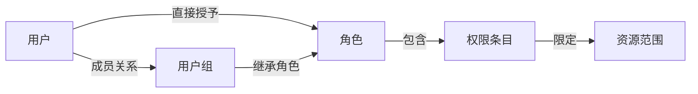

# 系统管理 · PRD

[设计方案](design.md) · [页面拆解](01-pages.md) · [功能拆解](02-features.md) · [用户故事](03-user-stories.md) · [开发任务](04-development-tasks.md) · [测试用例](05-unit-test-cases.md) · [交互原型](prototype.html) · [文档维护规则](../development-standard.md)

覆盖用户、用户组、角色与权限目录、LDAP/AD、登录会话、改密及操作审计。权限工作区按页面注册表派生名称、位置、顺序及旧名称搜索，接口权限编码与范围契约沿用服务端定义。

## 角色工作区与权限目录

### 权限管理工作区重构 · 2026-11-24

[重构设计](design.md#角色与权限管理工作区) · [可点击 HTML 原型](permission-workspace.html)

权限管理默认打开角色工作区。管理员用实际业务页面、现名、旧名、授权编码、接口及动作筛选权限，然后在同一界面指定范围、检查授权清单和预览保存。只读目录、用户组和预置角色保留现有授权限制。导航位置、展示名称与顺序由同一页面注册表派生。既有权限编码、审计、可委派能力和数据范围契约继续使用。

下文的 CRUD 矩阵描述历史实现，动作列表以新版设计为准。

**开发基线 · 2026-11-20 · 基线 `main@a18717e`（含 PR #106）**

**权限点勾选修订 · 2026-11-23 · 基线 `main@9e3753b`**

[页面拆解](01-pages.md#角色工作区与权限目录) · [管理员组与勾选原型](group-admin-prototype.html) · [权限目录原型](permission-catalog.html) · [功能拆解](02-features.md#角色工作区与权限目录) · [用户故事](03-user-stories.md#角色工作区与权限目录) · [开发任务](04-development-tasks.md#角色工作区与权限目录) · [测试用例](05-unit-test-cases.md#角色工作区与权限目录)

### 1. 产品决策

把现有「权限目录」入口展开为独立工作区。管理员按模块和工具集合查找功能，在增、删、改、查四列看到可用动作，点击单元格即可展开接口及授权条件。角色编辑复用同一份目录，勾选最小必要的接口权限点，明确数据范围，预览变更再保存。

| 层级 | 设计 | 示例 |
| --- | --- | --- |
| 权限模块 | 诊断控制台、运维知识库、资源管理、系统管理四个独立模块 | 诊断控制台 |
| 工具集合 | 按运维工作归并同类功能，支持批量勾选本集合中当前可见的可授权动作 | AI 诊断复核 |
| 功能点 | 业务对象或一项独立工作能力，每行都有增、删、改、查四列 | AI 复核结论 |
| 接口权限点 | 最小授权单元。接口方法、路由及经过服务端校验的动作共同确定权限 | 保存复核结论 · `diagnosis.review.save` |
| 数据范围 | 与一个权限点绑定的同一条授权，每次请求重新核验资源归属 | 测试、`test-east-01`、门店业务线、`payments-test` |

每个一级模块拥有稳定标识和独立入口。工具集合只在各自模块内组织业务功能。后续增加模块时，在目录注册表登记新的一级分类，角色配置没有跨模块隐式勾选。

**四列的业务含义**

| 列 | 归类标准 | 典型动作 |
| --- | --- | --- |
| 增 | 创建业务对象、关联或启动一次计算／同步任务 | 新建草稿、绑定用户组、发起 AI 复核 |
| 删 | 撤销关联、放弃、停用或撤回对象 | 撤销用户角色、撤回知识、停用来源 |
| 改 | 变更对象字段、状态、版本或凭据 | 保存复核、提交审核、发布、轮换凭据 |
| 查 | 查看列表、详情、汇总，或执行无状态变更的受控检查 | 查看证据、脱敏预览、LDAP 配置测试 |

一个格可以包含多个独立权限点。列头和集合名只用于导航与批量操作。某个功能缺少对应动作时显示「—」，提供原因并保持不可授权。例如 Finding 只有读取，审计事件系统写入，知识撤回保留版本。风险标签由目录维护，分类取决于业务效果，使用 POST 的预览可以属于「查」，测试连接仍单独标为敏感并限制目的地。

### 2. 权限目录与授权流程

| 界面 | 交互 | 管理员决策 |
| --- | --- | --- |
| 权限目录 | 保留「系统管理 → 权限管理 → 权限目录」入口。四个独立模块页签，模块内按工具集合分组。支持按权限名称、编码、接口路径搜索并筛选高风险动作 | 先找到业务按钮，再查看实际授权点 |
| 接口详情 | 展示权限点编码、方法、路由、分流条件、风险、数据范围和接口状态。单元格中独立展示每个可授权动作 | 判断同一接口的哪个动作需要开放 |
| 角色编辑 | 选择数据范围，按接口权限点勾选。支持按集合或当前筛选结果显式批量勾选。管理专属动作不可配置，高风险在授权清单和确认页标记 | 减少重复勾选，保留写权限控制 |
| 变更预览 | 展示新增、撤销、范围变化和高风险项。按用户直授和组继承预估影响，对账号去重。确认后展示审核或操作审计入口 | 看清本次改变了哪些接口、哪些环境和哪些用户 |
| 生效权限 | 用户详情沿用现有入口，列出同一权限的全部来源，可按账号定位审计 | 撤掉一个来源后，解释其他来源是否仍然授权 |

目录为空、无匹配、不可授权、数据范围解析失败和目录版本变化均有对应状态。仅展示已授予和待保存项时，不隐藏同一权限跨范围的其他已授权项。已知版本冲突阻止覆盖，并允许重新加载、核对差异和重新预览。生产扩大范围、知识发布等现有业务约束继续由已注册的动作处理器校验。原型的账号、资源范围及保存过程使用示例数据。

### 3. 授权与接口契约

**保留四类关系。** 用户关联角色、用户关联用户组、用户组关联角色、角色关联权限点列表。用户管理、LDAP 四阶段验证、单人及批量授权、操作审计保留各自现行入口和业务规则。超级管理员可直接授予系统管理员，也可为用户组关联该预置角色。访客继续使用预置角色。首期将现有账号管理、LDAP、权限维护、审计保留等管理专属边界作为额外校验。

**授权存储。** 一条授权包含 `roleId`、`permissionCode`、`scopeSelector`、`effect` 和版本。范围使用目录稳定标识，支持全局、按环境／实例／业务线／命名空间、仅本人等类型，每类能力只接受已声明的范围。研发和测试沿用现有环境级及实例级诊断范围。预发布与生产的诊断和知识目标应明确实例、业务线、命名空间。集群接入按实例校验，新增实例用服务端验证拟登记的目录归属。账号、角色、LDAP、审计策略使用平台全局范围。“仅本人”由会话决定，对凭据还要检查来源资格。

**请求校验。** 验证身份与会话 → 用已注册的方法、规范化路由和白名单动作识别权限点 → 从可信存储载入目标资源和现行范围 → 判断当前角色及范围 → 执行状态约束和业务闸门 → 记录审计。权限和范围在同一条授予上匹配，直接和组继承只对完整授予取并集。缺少匹配就拒绝，存量显式拒绝优先。列表和汇总直接按权限过滤，详情对不可见对象按模块策略返回 404；已知对象的动作无权返回 403。来源或目标范围无法解析时停止写入。内部报错返回通用信息与可关联的请求 ID。

**复用路由。** `POST /api/v1/wiki/candidates/{id}` 根据有效 `action` 确定编辑、预览、送审、驳回、放弃或发布。通过 `POST /api/v1/admin/access` 编辑组时，角色差异需要逐项校验授予与撤销。复合读取按权限投影 `roles`、`groups`、授权来源和审计保留配置。未注册路由、未知或歧义动作默认拒绝。注册表禁止重复编码或相同分流条件映射到不同权限，新增路由必须声明人类授权点、本人操作、服务身份或公开入口之一。

**跨范围与衍生数据。** 创建跨集合关联同时检查来源和目标；知识问答、推荐、引用、计数和反馈沿用对象和版本可见性。生产发布、范围扩大或首次发布到多个目标保留双人审核。关系变更、AI 结果写入、同步落库和发布提交前重查身份、权限、版本及范围。后台同步按计划所有者权限执行；上报采集走独立服务身份与实例绑定，成员无法通过角色获得上报凭据。登录、退出、本人改密和探活沿用固定规则。

**管理操作和审计。** 授权操作者只有具备该管理能力且在可委派的权限和范围内才可保存变更。预置角色、超级管理员保护和角色引用保护继续生效。批量授权保持现有逐项结果，对失败项不写关联。记录操作者、权限编码、路由模板、动作、目标范围、授权前后差异、结果与请求 ID。访问审计和到期清理沿用现有审计规则，审计记录的人工作废或删除无权限点。凭据、模型正文和原始证据不入审计。

### 4. 迁移与交付

1. **目录与对照。** 从 OpenAPI 和会话路由生成方法与路径清单，人工确认动作语义、复合响应字段和范围规则。优先交付目录浏览及接口详情。当前代码的现有能力仍按原入口工作。
2. **兼容与影子判定。** 按旧授权逐类转换并对照真实请求。访客历史诊断只映射旧有发现、列表、汇总与详情点；既有细分角色及显式拒绝按实测逐条迁移。Wiki、AI 和平台管理权限按历史身份实际允许范围对照。发现判定差异先核对，新增权限默认独立授权。
3. **分模块执行。** 先启用可验证的诊断查询，再启用知识写入与发布，最后启用平台高风险操作。保留独立恢复身份、策略版本和审计。回滚到上一份经过校验的授权快照，并保留在发布窗口内的撤权记录。
4. **验证指标。** 用代表性岗位走完“目录选点 → 范围 → 预览 → 验证”，记录管理操作数、任务完成时间和越权拒绝结果。后端维护未分类路由数、影子判定差异和跨范围拒绝审计覆盖。上线门槛为已纳入路由全部分类、已验证的旧授权无未确认扩大、关键越权回归全部通过。

#### 岗位示例

| 岗位 | 授权点示例 | 范围 |
| --- | --- | --- |
| 值班 SRE | 发现实例、读 Finding、读证据、发起复核和保存结论 | 分配到的测试或生产实例，生产明确业务线与命名空间 |
| 知识运营 | 搜索文档、新建和编辑草稿、送审 | 指定业务线及目标命名空间 |
| 知识审阅 | 读待审队列、候选、指定版本，驳回及发布 | 指定生产知识目标，发布时核验第二人 |
| 审计员 | 查询操作审计列表、读取详情和批次 | 平台全局的审计读取 |

#### 验收用例

| 场景 | 预期 |
| --- | --- |
| 仅授权 `knowledge.candidate.save`，调用同一个 POST 的 publish | 返回 403，候选状态及正式文档保持原状 |
| 测试有保存复核权限，生产只有读取权限 | 测试可保存，生产保存被拒绝，生产读取按范围生效 |
| 仅有角色读取，访问共用的 `GET /admin/access` | 返回有权字段，用户组数据不可见 |
| 仅有用户组编辑，直接提交带新增 RoleIDs 的表单 | 缺少组角色授予时拒绝相应变更 |
| 按空动作授权运行 AI 复核，提交未知 action | 请求被拒绝且不发起模型调用 |
| 生产知识草稿同一人送审和确认发布 | 业务闸门拒绝，第二位有权管理员可完成 |
| 组角色被撤销，但用户仍有直接角色 | 权限继续生效，来源说明只剩直接角色 |
| 问答开始后知识被撤回或权限丢失 | 响应前复查版本和授权，无泄露引用 |
| 只查询审计，调用修改保留策略 | 403，保留配置不变 |
| 新接口漏配权限分类或复用路由动作重叠 | 契约检查失败 |

#### 当前实现边界

- 版本化权限目录按现有四类功能归组。AI 服务顶栏入口使用管理员权限。模块标识分别为 `diagnosis`、`knowledge`、`resources`、`system`。前端从后端版本化目录取模块和功能点，新增分类和操作需同时接入业务处理器与测试。
- 角色保存支持新接口授权，同时兼容原有历史诊断范围。旧范围在读取时映射原先五类诊断能力，升级无需重建角色或改写 SQLite。新版 Web 和 API 应配套发布。
- 目录中的「现有管理身份」保留既有业务门槛。涉及环境和业务线维护、集群连接与凭据变更、账号与绑定维护、LDAP 激活及审计保留、远端 Wiki 来源注册等写操作按现行管理身份处理。管理员角色保持原有能力。其他点支持按声明的范围配置。
- 角色保存记录接口授权增减，并可定位操作审计。诊断及 Wiki 工作流仍使用各自的既有审计路径。已发布知识撤回、生产双人审核、后台 Wiki 任务所有者和指定模型的限制继续由对应业务处理器校验。
- Portal 使用[共享外框设计](../portal-ui/design.md#全站布局与共享工作区)。交互原型中的账号与授权结果为示例。

### 5. 接口权限清单

以下除标注「新增路由」外，方法和路径以当前仓库路由为依据。权限编码、业务分流和授权规则属于本次评审稿。未分配业务动作的列在原型中固定显示「—」。引用如下。

- [诊断查询 OpenAPI](https://github.com/abchw517/kube-aiops/blob/8f1cdc864442d1bc8b02d0fd07d4eb5339352a1e/api/openapi.yaml)
- [Portal 会话路由](https://github.com/abchw517/kube-aiops/blob/8f1cdc864442d1bc8b02d0fd07d4eb5339352a1e/api/internal/portal/routes.go)
- [系统管理动作](https://github.com/abchw517/kube-aiops/blob/8f1cdc864442d1bc8b02d0fd07d4eb5339352a1e/api/internal/permissions/platform_http.go)
- [知识库接口与上线验收](https://github.com/abchw517/kube-aiops/blob/8f1cdc864442d1bc8b02d0fd07d4eb5339352a1e/docx/operations-knowledge/api-contract.md)

#### 诊断控制台

| 工具集合／功能点 | 权限列与动作 | 接口与分流 | 权限编码 | 风险 |
| --- | --- | --- | --- | --- |
| 历史诊断／诊断结果 | 查 · 查询诊断列表 | `GET /api/v1/findings` | `diagnosis.finding.list` | 常规 |
| 历史诊断／诊断结果 | 查 · 读取诊断汇总 | `GET /api/v1/findings/summary` | `diagnosis.finding.summary` | 常规 |
| 历史诊断／诊断结果 | 查 · 读取单条诊断 | `GET /api/v1/findings/{id}` | `diagnosis.finding.read` | 常规 |
| 历史诊断／资源发现 | 查 · 查询可见实例 | `GET /api/v1/clusters` | `diagnosis.discovery.clusters` | 常规 |
| 历史诊断／资源发现 | 查 · 查询可见命名空间 | `GET /api/v1/clusters/{cluster}/namespaces` | `diagnosis.discovery.namespaces` | 常规 |
| 历史诊断／资源发现 | 查 · 读取资源详情 | `GET /api/v1/clusters/{cluster}/resources/{kind}/{namespace}/{name}` | `diagnosis.discovery.resource` | 常规 |
| 历史诊断／关联证据 | 查 · 读取关联证据 | `GET /api/v1/findings/{id}/correlation` | `diagnosis.evidence.read` | 常规 |
| AI 诊断复核／AI 复核结论 | 增 · 生成 AI 复核 | `POST /api/v1/admin/finding-analysis` · action=assess、enhance 或空值 | `diagnosis.review.run` | 敏感 |
| AI 诊断复核／AI 复核结论 | 增 · 追问与生成总结 | `POST /api/v1/admin/finding-analysis` · action=chat / finalize / summarize | `diagnosis.review.chat` | 敏感 |
| AI 诊断复核／AI 复核结论 | 改 · 保存复核结论 | `POST /api/v1/admin/finding-analysis` · action=save，验证当前复核版本 | `diagnosis.review.save` | 敏感 |
| AI 诊断复核／AI 复核结论 | 查 · 读取复核历史 | `GET /api/v1/admin/finding-analysis` | `diagnosis.review.read` | 常规 |
| AI 诊断复核／诊断关联知识 | 增 · 从复核创建案例草稿 | `POST /api/v1/wiki/finding` · action=draft，另校验知识草稿创建权限 | `diagnosis.related.draft` | 敏感 |
| AI 诊断复核／诊断关联知识 | 增 · 关联手册版本 | `POST /api/v1/wiki/finding` · action=link，另校验目标知识版本 | `diagnosis.related.link` | 敏感 |
| AI 诊断复核／诊断关联知识 | 查 · 查看相关知识 | `GET /api/v1/wiki/finding` · 按知识权限过滤候选及关联结果 | `diagnosis.related.read` | 常规 |

#### 运维知识库

| 工具集合／功能点 | 权限列与动作 | 接口与分流 | 权限编码 | 风险 |
| --- | --- | --- | --- | --- |
| 知识查询／知识文档与版本 | 查 · 检索知识文档 | `GET /api/v1/wiki/knowledge` | `knowledge.document.search` | 常规 |
| 知识查询／知识文档与版本 | 查 · 查看知识文档 | `GET /api/v1/wiki/knowledge/{id}` | `knowledge.document.read` | 常规 |
| 知识查询／知识文档与版本 | 查 · 查看指定版本 | `GET /api/v1/wiki/knowledge/{id}/revisions/{revision}` | `knowledge.document.version` | 常规 |
| 知识查询／AI 知识问答 | 增 · 发起知识问答 | `POST /api/v1/wiki/ask` · 同时验证各引用的读取权限 | `knowledge.qa.ask` | 敏感 |
| 知识查询／版本反馈 | 增 · 提交版本反馈 | `POST /api/v1/wiki/knowledge/{id}/feedback` · 另校验当前版本可读 | `knowledge.feedback.create` | 常规 |
| 知识查询／版本反馈 | 查 · 读取版本反馈 | `GET /api/v1/wiki/knowledge/{id}/feedback` | `knowledge.feedback.list` | 常规 |
| 知识编审／知识草稿 | 增 · 新建或修订草稿 | `POST /api/v1/wiki/candidates` | `knowledge.candidate.create` | 常规 |
| 知识编审／知识草稿 | 增 · 解析附件预览 | `POST /api/v1/wiki/imports/files` · 附件处理，转写草稿另需新增权限 | `knowledge.candidate.import` | 敏感 |
| 知识编审／知识草稿 | 删 · 放弃草稿 | `POST /api/v1/wiki/candidates/{id}` · action=discard，保留记录 | `knowledge.candidate.discard` | 常规 |
| 知识编审／知识草稿 | 改 · 编辑草稿 | `POST /api/v1/wiki/candidates/{id}` · action=save | `knowledge.candidate.save` | 常规 |
| 知识编审／知识草稿 | 查 · 读取候选清单 | `GET /api/v1/wiki/candidates` | `knowledge.candidate.list` | 常规 |
| 知识编审／知识草稿 | 查 · 读取草稿详情 | `GET /api/v1/wiki/candidates/{id}` | `knowledge.candidate.read` | 常规 |
| 知识编审／知识草稿 | 查 · 生成脱敏预览 | `POST /api/v1/wiki/candidates/{id}` · action=preview，无持久化变更 | `knowledge.candidate.preview` | 常规 |
| 知识编审／送审与发布 | 改 · 提交审核 | `POST /api/v1/wiki/candidates/{id}` · action=submit | `knowledge.workflow.submit` | 常规 |
| 知识编审／送审与发布 | 改 · 驳回候选 | `POST /api/v1/wiki/candidates/{id}` · action=reject | `knowledge.workflow.reject` | 敏感 |
| 知识编审／送审与发布 | 改 · 确认发布 | `POST /api/v1/wiki/candidates/{id}` · action=publish，生产或扩大范围复核另一位有权管理员 | `knowledge.workflow.publish` | 高风险 |
| 知识编审／知识治理 | 删 · 撤回生效知识 | `POST /api/v1/wiki/knowledge/{id}/governance` · action=withdraw，保留历史 | `knowledge.governance.withdraw` | 高风险 |
| 知识编审／知识治理 | 改 · 登记知识复核 | `POST /api/v1/wiki/knowledge/{id}/governance` · action=review | `knowledge.governance.review` | 敏感 |
| 知识编审／知识治理 | 查 · 查看治理队列 | `GET /api/v1/wiki/governance` | `knowledge.governance.list` | 常规 |
| 知识编审／知识治理 | 查 · 查看治理详情 | `GET /api/v1/wiki/knowledge/{id}/governance` | `knowledge.governance.read` | 常规 |
| 远端 Wiki／同步来源 | 增 · 注册来源 | `PUT /api/v1/wiki/sources/{id}` · 注册全新来源，存在时禁止借此能力改写 | `knowledge.source.register` | 高风险 |
| 远端 Wiki／同步来源 | 删 · 停用来源 | `DELETE /api/v1/wiki/sources/{id}` · 保留执行记录和知识版本 | `knowledge.source.disable` | 高风险 |
| 远端 Wiki／同步来源 | 查 · 测试来源连接 | `POST /api/v1/wiki/sources/{id}/check` · 只测试连接 | `knowledge.source.check` | 敏感 |
| 远端 Wiki／同步来源 | 查 · 查看来源配置 | `GET /api/v1/wiki/sources/{id}` · 返回脱敏配置 · 新增路由 | `knowledge.source.read` | 常规 |
| 远端 Wiki／本人 Wiki 凭据 | 增 · 新建本人绑定 | `PUT /api/v1/wiki/sources/{id}/credential` · 服务端确认此前未绑定 | `knowledge.credential.bind` | 敏感 |
| 远端 Wiki／本人 Wiki 凭据 | 删 · 解除本人绑定 | `DELETE /api/v1/wiki/sources/{id}/credential` · 仅本人 | `knowledge.credential.unbind` | 敏感 |
| 远端 Wiki／本人 Wiki 凭据 | 改 · 更换本人绑定 | `PUT /api/v1/wiki/sources/{id}/credential` · 服务端确认已有绑定 | `knowledge.credential.rotate` | 敏感 |
| 远端 Wiki／本人 Wiki 凭据 | 查 · 查看本人绑定状态 | `GET /api/v1/wiki/sources/{id}/credential` · 返回账号和配置状态 | `knowledge.credential.status` | 常规 |
| 远端 Wiki／同步任务 | 增 · 启动同步 | `POST /api/v1/wiki/sources/{id}/sync` · 使用执行人的来源绑定 | `knowledge.sync.run` | 敏感 |
| 远端 Wiki／同步任务 | 增 · 重试任务或失败页 | `POST /api/v1/wiki/sources/{id}/runs/{run}/retry` · 验证来源范围、运行归属及失败状态 | `knowledge.sync.retry` | 敏感 |
| 远端 Wiki／同步任务 | 查 · 查询执行列表 | `GET /api/v1/wiki/sources/{id}/runs` | `knowledge.sync.runs` | 常规 |
| 远端 Wiki／同步任务 | 查 · 查询执行详情 | `GET /api/v1/wiki/sources/{id}/runs/{run}` | `knowledge.sync.run-read` | 常规 |
| 远端 Wiki／同步计划 | 改 · 保存同步计划 | `PUT /api/v1/wiki/sources/{id}/schedule` · 开关及周期，执行时复验配置人权限 | `knowledge.schedule.save` | 敏感 |
| 远端 Wiki／同步计划 | 查 · 查看同步计划 | `GET /api/v1/wiki/sources/{id}/schedule` | `knowledge.schedule.read` | 常规 |

#### 资源管理

| 工具集合／功能点 | 权限列与动作 | 接口与分流 | 权限编码 | 风险 |
| --- | --- | --- | --- | --- |
| 资源目录／环境目录 | 增 · 添加环境 | `POST /api/v1/admin/environments` | `resources.environment.create` | 常规 |
| 资源目录／环境目录 | 删 · 删除环境 | `DELETE /api/v1/admin/environments` · 删除前检查引用 | `resources.environment.delete` | 高风险 |
| 资源目录／环境目录 | 改 · 修改环境 | `PUT /api/v1/admin/environments` | `resources.environment.update` | 敏感 |
| 资源目录／环境目录 | 查 · 查询环境 | `GET /api/v1/admin/environments` | `resources.environment.list` | 常规 |
| 资源目录／业务线目录 | 增 · 添加业务线 | `POST /api/v1/admin/business-lines` | `resources.business.create` | 常规 |
| 资源目录／业务线目录 | 删 · 删除业务线 | `DELETE /api/v1/admin/business-lines` · 删除前检查引用 | `resources.business.delete` | 高风险 |
| 资源目录／业务线目录 | 改 · 修改业务线 | `PUT /api/v1/admin/business-lines` | `resources.business.update` | 敏感 |
| 资源目录／业务线目录 | 查 · 查询业务线 | `GET /api/v1/admin/business-lines` | `resources.business.list` | 常规 |
| 集群管理／集群接入 | 增 · 登记新实例 | `POST /api/v1/admin/cluster-onboarding` · 无 action 且 test 不为 true，校验拟登记归属 | `resources.cluster.create` | 高风险 |
| 集群管理／集群接入 | 删 · 删除连接 | `DELETE /api/v1/admin/cluster-onboarding` · 按 id 解析现有实例 | `resources.cluster.disconnect` | 高风险 |
| 集群管理／集群接入 | 改 · 修改接入配置 | `PUT /api/v1/admin/cluster-onboarding` · test 不为 true，提交新凭据追加轮换权限 | `resources.cluster.update` | 高风险 |
| 集群管理／集群接入 | 改 · 重新采集校验 | `POST /api/v1/admin/cluster-onboarding` · query action=recheck | `resources.cluster.recheck` | 敏感 |
| 集群管理／集群接入 | 改 · 恢复本地连接 | `POST /api/v1/admin/cluster-onboarding` · query action=reconnect | `resources.cluster.reconnect` | 高风险 |
| 集群管理／集群接入 | 改 · 轮换接入凭据 | `POST /api/v1/admin/cluster-onboarding` · query action=rotate-token。PUT 提交新直连凭据也校验此点 | `resources.cluster.rotate` | 高风险 |
| 集群管理／集群接入 | 查 · 查看集群接入状态 | `GET /api/v1/admin/cluster-onboarding` | `resources.cluster.list` | 常规 |
| 集群管理／集群接入 | 查 · 测试直连配置 | `POST /api/v1/admin/cluster-onboarding` · query test=true，POST 和 PUT 均适用 | `resources.cluster.test` | 敏感 |
| 集群管理／命名空间归属 | 改 · 维护归属关系 | `PUT /api/v1/admin/namespace-business` · 逐项校验真实实例、命名空间及变更前后业务线 | `resources.ownership.replace` | 高风险 |
| 集群管理／命名空间归属 | 查 · 查看归属关系 | `GET /api/v1/admin/namespace-business` | `resources.ownership.list` | 常规 |

#### 系统管理

| 工具集合／功能点 | 权限列与动作 | 接口与分流 | 权限编码 | 风险 |
| --- | --- | --- | --- | --- |
| 身份与角色／用户账号 | 增 · 创建账号 | `POST /api/v1/admin/accounts` · action=create，创建管理员受身份约束 | `system.account.create` | 高风险 |
| 身份与角色／用户账号 | 删 · 删除受管账号 | `POST /api/v1/admin/accounts` · action=delete | `system.account.delete` | 高风险 |
| 身份与角色／用户账号 | 改 · 停用或启用账号 | `POST /api/v1/admin/accounts` · action=disable / enable | `system.account.state` | 高风险 |
| 身份与角色／用户账号 | 改 · 重置账号密码 | `POST /api/v1/admin/accounts` · action=reset | `system.account.reset` | 高风险 |
| 身份与角色／用户账号 | 查 · 查询用户和状态 | `GET /api/v1/admin/accounts` | `system.account.list` | 常规 |
| 身份与角色／角色配置 | 增 · 创建角色 | `POST /api/v1/admin/access` · action=role-save，且未提交角色 ID | `system.role.create` | 高风险 |
| 身份与角色／角色配置 | 删 · 删除自定义角色 | `POST /api/v1/admin/access` · action=role-delete，保留引用保护 | `system.role.delete` | 高风险 |
| 身份与角色／角色配置 | 改 · 修改角色授权 | `POST /api/v1/admin/access` · action=role-save，加载已有角色及版本 | `system.role.update` | 高风险 |
| 身份与角色／角色配置 | 查 · 查询角色定义 | `GET /api/v1/admin/access` · 独立控制 roles 投影 | `system.role.list` | 常规 |
| 身份与角色／用户组 | 增 · 创建用户组 | `POST /api/v1/admin/access` · action=group-save，且未提交组 ID | `system.group.create` | 高风险 |
| 身份与角色／用户组 | 删 · 删除用户组 | `POST /api/v1/admin/access` · action=group-delete，保留引用保护 | `system.group.delete` | 高风险 |
| 身份与角色／用户组 | 改 · 编辑用户组信息 | `POST /api/v1/admin/access` · action=group-save，加载已有组 | `system.group.update` | 敏感 |
| 身份与角色／用户组 | 查 · 查询用户组定义 | `GET /api/v1/admin/access` · 独立控制 groups 投影 | `system.group.list` | 常规 |
| 身份与角色／授权关联 | 增 · 授予用户直接角色 | `POST /api/v1/admin/accounts` · action=grant | `system.binding.user-role-grant` | 高风险 |
| 身份与角色／授权关联 | 增 · 将用户加入用户组 | `POST /api/v1/admin/accounts` · action=join | `system.binding.user-join` | 高风险 |
| 身份与角色／授权关联 | 增 · 为用户组新增角色 | `POST /api/v1/admin/access` · action=group-roles-add，或按 group-save 差异校验 | `system.binding.group-role-grant` | 高风险 |
| 身份与角色／授权关联 | 删 · 撤销用户直接角色 | `POST /api/v1/admin/accounts` · action=revoke | `system.binding.user-role-revoke` | 高风险 |
| 身份与角色／授权关联 | 删 · 将用户移出用户组 | `POST /api/v1/admin/accounts` · action=leave | `system.binding.user-leave` | 高风险 |
| 身份与角色／授权关联 | 删 · 撤销用户组角色 | `POST /api/v1/admin/access` · action=group-roles-remove，或按 group-save 差异校验 | `system.binding.group-role-revoke` | 高风险 |
| 身份与角色／授权关联 | 查 · 查询绑定与生效来源 | `GET /api/v1/admin/accounts` · 独立控制授权关系和来源字段的投影 | `system.binding.read` | 常规 |
| 身份与角色／LDAP 认证配置 | 改 · 保存 LDAP 配置 | `PUT /api/v1/admin/ldap` · 绑定当前验证结果 | `system.ldap.save` | 高风险 |
| 身份与角色／LDAP 认证配置 | 查 · 查看 LDAP 配置 | `GET /api/v1/admin/ldap` · 只返回配置及密码状态 | `system.ldap.read` | 敏感 |
| 身份与角色／LDAP 认证配置 | 查 · 测试 LDAP 配置 | `POST /api/v1/admin/ldap-test` · 独立检查测试权限 | `system.ldap.test` | 敏感 |
| 身份与角色／权限目录 | 查 · 查看权限目录 | `GET /api/v1/admin/permission-catalog` · 返回版本化目录 · 新增路由 | `system.catalog.read` | 常规 |
| 操作审计／审计记录 | 查 · 查询审计列表 | `GET /api/v1/admin/operations` · 列表和分页 | `system.audit.list` | 敏感 |
| 操作审计／审计记录 | 查 · 读取审计明细 | `GET /api/v1/admin/operations` · query record 或 batch | `system.audit.record` | 敏感 |
| 操作审计／审计保留策略 | 改 · 调整审计保留 | `PUT /api/v1/admin/operations` · 保留超级管理员限制 | `system.retention.update` | 高风险 |
| 操作审计／审计保留策略 | 查 · 读取保留设置 | `GET /api/v1/admin/operations` · 独立控制 retention 字段投影 | `system.retention.read` | 敏感 |

#### 兼容路由处理

历史角色和策略入口 `/api/v1/admin/users`、`/api/v1/admin/roles`、`/api/v1/admin/policy` 维持原有超级管理员门槛，迁移期不纳入可委派目录。旧知识直发入口，包括复核的旧 `confirm/publish` 分支、`POST /api/v1/wiki/knowledge/{id}/revisions` 和带发布标记的导入请求，沿用草稿必经门槛。原有文本预览 `POST /api/v1/wiki/imports` 迁移到附件／草稿预览流程后按现有兼容期处理。这些入口纳入契约分类检查。

### 5. 用户组关联「系统管理员」

#### 管理人、成员与角色

- 超级管理员可在新建及编辑用户组时关联或取消「系统管理员」。新建组默认未勾选此角色，现有组的角色需要由超级管理员主动调整。
- 普通系统管理员可以查看管理员组的角色和成员。管理员组的角色调整、成员加减、删除及其他能改变有效管理员身份的入口由超级管理员操作。现有直接授予和预置角色的维护规则继续沿用。
- 保留现有 LDAP 员工参与组授权的规则。本地账号继续使用现有固定角色。停用、目录停用或待改密账号按其当前状态处理。
- 「系统管理员」是全局管理角色。继承后的能力与同一个角色直接授予时一致，超级管理员身份和专属权限继续由既有机制决定。

#### 页面交互与生效

1. 在「关联角色」列表单独展示「系统管理员」并标注「全局管理」。已有组跟随原来的编辑表单，新建组直接显示该选项。
2. 选择或取消该角色时，表单下方显示影响摘要。已有组显示成员人数。保存前的确认步骤展示会获得或失去管理员权限的人数和仍有其他管理员来源的人数。空组显示当前 0 人，并说明后续加入的员工会继承管理员权限。
3. 点「保存用户组」后提交差异。管理员角色有变化时，进入同一对话框的确认步骤并展示核对摘要。无变化时沿用一次保存。
4. 生效权限按「直接授予 + 用户组继承」取并集。取消其中一个来源时，来自直授或其他组的同一角色仍有效。真正发生管理员身份变化的账号结束旧会话，重新登录后读取有效角色。普通权限的增减按下一次受保护请求生效。
5. 用户组保存成功可查看本次审计。在用户详情中显示「用户组名称 → 系统管理员」及其他仍有效的来源。

#### 后端要求

- 在用户组保存、批量加减角色、用户加入或退出组、批量成员调整和删除组时，统一计算变更前后管理员能力。管理人校验以服务端当前会话为准，不能靠 UI 禁用按钮替代。
- 在事务中校验管理员角色保存预览的组与成员版本。组成员或角色在确认前变化时返回冲突，刷新影响范围后重新确认。角色变更、会话版本变更和审计同事务提交。
- 审计记录操作者、组、角色增减、影响账号、保留来源及可定位的审计记录标识。批量路径沿用既有逐项结果；越权项不改变任何关系。

### 6. 权限点单选、批量选择与保存

管理员从「系统管理 → 权限管理」直接进入可勾选的角色草稿，从「角色列表」编辑已有自定义角色，也可从用户组的角色名称进入同一编辑器。旧策略页提供前往角色配置的入口。表单按「选择接口权限 → 选择授权范围 → 授权清单 → 核对角色变更」操作。预置角色与独立权限目录只读。接口目录请求失败时，保留角色表单和已保存清单，提供原地重试。

| 控件 | 行为 |
| --- | --- |
| 权限点右侧复选框 | 勾选或取消该动作。权限名称独立打开接口详情。保留现行管理身份约束的动作展示禁用状态与原因。 |
| 工具集合复选框 | 批量选择或取消该集合内**当前可见且可配置**的权限点。部分选中显示半选。 |
| 批量勾选当前结果 | 仅操作当前模块、工具集合及搜索／筛选结果中的可配置权限点。隐藏项和其他模块的选择保持原状态。界面分别显示当前结果已选数与总待添加数。 |
| 添加到授权清单 | 同时选中多种适用范围时，明确选择本次添加的范围类型，再填写所需数据范围。只处理该类型的勾选，筛选隐藏的同类已选项也计入本次。其他类型保留待添加。按「接口动作 + 范围」去重。 |
| 保存角色 | 仍有待添加选择时，提示先添加或清空。清单支持移除单条授权。点击「保存角色」预览增减和风险，点击「确认保存」提交，成功后对应角色授权生效。 |
| 已配置权限与详情 | 通过筛选查看草稿清单中的动作。详情列出各个范围，并用清单状态区分新增、已保存与待移除。 |

批量勾选覆盖当前结果中可配置的增、删、改、查。高风险动作参与显式批量选择，先在清单标注风险，保存时列出权限和范围增减供确认。生产与预发布继续要求实际实例、业务线及命名空间。平台全局和本人能力继续使用其类型约束。

## 认证、用户管理与审计

接口级权限目录和角色编辑见[权限目录 PRD](00-prd.md#角色工作区与权限目录)。本文件仍记录账号、认证、组关联及操作审计规则。

全平台权限迭代参见 [平台访问控制 PRD 评审稿](00-prd.md#平台访问控制兼容设计)。

平台权限演进参见 [全局权限设计评审稿](design.md#全平台授权与范围模型)。本版需求继续按已评审的权限规则执行。

**状态** 交互方案已确认 · **日期** 2026-11-20 · **交付口径** 沿用现有平台数据

### 变更纳入范围

以下状态按 2026-11-18 核对。原型用于演示已实现或待合并流程。

| PR | 需求变更 | 纳入方式 |
|---|---|---|
| [#90](https://github.com/abchw517/kube-aiops/pull/90) | LDAP 传输模式、分阶段诊断、测试凭据与保存反馈 | 已合并 |
| [#91](https://github.com/abchw517/kube-aiops/pull/91) | 风险分级审计保留与北京时间 | 已合并 |
| [#92](https://github.com/abchw517/kube-aiops/pull/92) | LDAP 配置与搜索密码默认直接保存到 SQLite | 已合并 |
| [#93](https://github.com/abchw517/kube-aiops/pull/93) | 用户详情状态、账号操作和关联关系布局 | 已合并 |
| [#94](https://github.com/abchw517/kube-aiops/pull/94) | 选中操作栏删除单个账号及会话撤销 | 已合并 |

### 1. 背景与目标

现有系统管理的授权配置复杂，用户管理缺少完整的账号生命周期。首版面向运维团队，目标是让管理员从用户列表完成授权，解释每项权限的来源，并在账号停用或角色被撤销时及时收回访问。

按全新系统设计。上线时初始化唯一超级管理员及两个预置角色。历史用户迁移、旧权限转换和升级后的重新授权流程均不纳入本期。首版面向公司内部运维团队。商业交付和许可证管理后置。

### 2. 用户与账号边界

| 身份 | 来源 | 权限与管理边界 |
|---|---|---|
| 超级管理员 | 系统初始化，唯一 | 具备普通系统管理员的能力，并负责管理本地管理员及拥有「系统管理员」角色的 LDAP 员工。可直接为 LDAP 员工授予或撤销全部平台角色。账号不可删除。遗忘密码时通过服务器专用脚本恢复。 |
| 普通系统管理员 | 由超级管理员创建本地账号，或由 LDAP 员工获得超级管理员直接授予或通过用户组继承的「系统管理员」角色 | 配置 LDAP，管理访客及普通 LDAP 员工，维护平台用户组和角色，查看全局诊断及操作审计，执行资源管理操作。仅可为普通 LDAP 员工直接授予或撤销自定义角色与「访客只读」。 |
| 本地访客 | 由系统管理员创建 | 关联固定的「访客只读」角色。查看研发、测试的集群与命名空间历史诊断。 |
| LDAP 员工 | 从公司目录认证，首次正式登录成功后自动登记 | 首次获得「访客只读」，后续可加入平台用户组或直接获得角色。被授予「系统管理员」后仍为 LDAP 账号，重新使用目录密码登录后具备普通管理员权限。 |

本地用户通过关联的预置角色获得权限，不加入用户组。「访客只读」和「系统管理员」的权限固定，且始终禁止删除。超级管理员可为用户组关联「系统管理员」，符合条件的 LDAP 成员通过该组继承角色。首版访客只能通过固定角色查看研发、测试历史诊断，不能通过自定义角色扩展范围。

### 3. 页面与管理流程

| 页面 | 页面能力 |
|---|---|
| 系统管理 → 认证配置 | 查看登录会话有效期，由本地超级管理员修改。展开 LDAP 连接配置查看独立的连接参数和四步验证区。URL 与 DN 各占一行，测试通过后可启用草稿。 |
| 系统管理 → 用户管理 | 查找本地和 LDAP 用户，查看状态，管理适用的账号操作，单人或批量分配用户组与直接角色，支持删除单个选中的账号。 |
| 用户管理 → 用户详情 | 查看账号来源与状态、用户组、直接角色和最终生效权限。每项权限列出全部来源，能指明直接角色以及每条「用户组 → 角色」路径。长 LDAP DN 自然换行，状态和账号操作在详情顶部对齐。关联关系按用户组和直接角色分行，多个标签可换行，分配入口在详情标题区，与「账号审计」同屏。 |
| 系统管理 → 权限管理 | 维护用户组和自定义角色。自定义角色支持逐接口动作勾选或按工具集合、当前筛选结果批量勾选，指定数据范围，加入清单并确认保存。组可批量关联或移除角色。日常成员分配从用户管理进入。详见[权限点授权设计](00-prd.md#6-权限点单选批量选择与保存)。 |
| 修改密码 | 仅向本地账号开放。使用临时密码登录且待改密时，进入必经改密步骤。日常入口和其他系统管理功能同级。 |
| 系统管理 → 操作审计 | 查看三档审计保留策略，按账号或目标、操作类型和风险等级查询记录，分页及查看同批次结果。详情以操作名称为标题，展示风险、结果、操作者、目标、时间和失败原因。普通系统管理员也可查看超级管理员创建或删除其他管理员的记录。 |

日常授权流程为找到员工、选择用户组或直接角色、提交、查看结果，再到用户详情核对实际可访问的环境、集群和命名空间及授权来源。

#### 3.1 已确认的交互调整

以 [系统管理全局原型](admin-workspace.html) 为交互基线。系统管理依次提供认证配置、用户管理、权限管理、操作审计与修改密码。

1. 搜索和筛选只命中一个账号时，就地打开详情并保留搜索焦点。未命中时隐藏无关详情和选择。授权入口放在详情标题区，关系页签提供关系核对。授权弹窗可搜索，标出已关联项，单人撤销只列当前关联。批量授权继续逐项返回结果。
2. 权限管理默认打开「角色配置」，与「用户组」并列。组列表的角色名称可就地打开同一个编辑器。现有独立策略编辑链接继续使用既有功能。现有角色 ID、用户组、直接角色及继承关系原样保留。
3. 同一环境、集群和业务线的多个命名空间可以一次加入。可直接「添加并预览」，也可把不同范围加入清单再预览。预览展示增减项和引用影响，确认才写入。切换上游范围清空下游选择。目录加载失败时有重试入口，禁止隐式提交整个集群。发现角色在打开后发生修改时拒绝覆盖现有角色。
4. 账号详情的「账号审计」按账号标识打开查询。授权结果的「查看本次审计」打开服务端确实保留的事件，批量则打开本次汇总。保留期关闭或记录已过期时显示相应状态。审计权限、保留期限和记录口径沿用现行规则。
5. LDAP 保留现行四步验证、失败重试与保存门槛。修改密码继续遵循本地账号及临时密码规则。Wiki 只读试点维持关闭，「权限配置」页面可说明平台能力的现行开放范围。

认证配置采用全站原型中的系统管理工作区布局。登录会话的权限与保存反馈按登录会话专项原型验收。认证配置改版范围为本页面。

### 4. 认证配置与账号生命周期

#### 4.1 LDAP 配置

修改目录地址、搜索范围或绑定账号后，以待启用配置测试。测试依次验证目录连通、绑定账号认证、能找到指定测试员工、该员工本人凭据可以完成认证。测试过程不创建正式会话、不新增用户、不分配角色。测试通过且管理员保存后才启用。待保存配置发生变更或五分钟验证凭据失效后重新测试。测试失败时继续使用原配置，提示失败阶段，并在当前表单保留测试员工账号和密码以便重试。验证成功后清空这两个字段。保存按钮旁显示测试要求、可保存状态或保存结果。

- `ldap://` 直接连接，须明确允许明文 LDAP。部署环境变量配置对应 `AUTH_LDAP_ALLOW_PLAIN=true`。原使用 StartTLS 的 `ldap://` 配置升级后需重新验证并保存，或改用 LDAPS。
- `ldaps://` 建立 TLS 并校验域名与证书链，私有 CA 可通过 `AUTH_LDAP_CA_FILE` 提供。目录连接提示区分 DNS、TCP、LDAPS 握手和证书校验。
- LDAP 配置和搜索密码写入 SQLite 并于重启后加载。默认无需密钥挂载，数据库及备份中的搜索密码可读，配置接口仅返回密码是否已配置。仍持有原密钥的加密配置可以继续读取。缺少原密钥时由本地管理员重填搜索密码、验证并保存。测试员工密码不入库。

#### 4.2 本地访客及管理员

- 创建本地访客时自动关联「访客只读」，发放临时密码。首次登录必须自行设置新密码，之后才可查看历史诊断。
- 系统管理员重置访客密码时，立即使所有旧会话失效。访客用临时密码重新登录并完成改密后恢复访问。
- 停用访客时阻止登录并收回已有访问，保留账号及关联角色。重新启用时恢复停用前的角色。系统管理员可永久删除本地访客。
- 超级管理员删除普通系统管理员时，使该账号的所有会话立即失效，并留下删除审计。
- 超级管理员忘记密码时，通过服务器专用脚本重置。重置立即让所有旧会话失效。超级管理员用临时密码登录并完成改密后才能进入系统管理。
- LDAP 员工在公司目录侧修改密码。

#### 4.3 LDAP 员工登记、停用与恢复

- LDAP 员工首次从正式登录页认证成功后，系统登记用户并关联「访客只读」。
- kube-aiops 内停用员工会立即使所有已有会话失效，并拒绝后续登录，即使目录账号仍有效。
- 公司目录可访问时，系统定期检查账号状态，在目录侧停用后 5 分钟内使该员工所有已有会话失效。
- LDAP 暂时不可访问时，已有会话继续到原定过期时间。会话到期后，需等目录恢复并重新认证。目录恢复后补查账号状态，确认停用即收回访问。
- 公司目录与 kube-aiops 的启用状态独立。目录恢复后，如果平台账号仍被停用，须由具备该账号管理权限的管理员手动启用。LDAP 管理员的授权、停用、启用和删除仅由超级管理员操作。员工恢复访问后沿用原有用户组和直接角色，按这些角色当前的权限生效。

#### 4.4 删除用户

- 在用户列表的选中操作栏右侧提供「删除用户」。仅选中一个可删除的账号时可操作。确认弹窗显示目标账号、会话和权限影响，初始焦点放在「取消」。
- 普通系统管理员可删除本地访客和普通 LDAP 员工。本地及 LDAP 管理员仅由超级管理员删除，超级管理员不可删除。
- 删除会移除平台账号及其授权关联，并使旧会话立即失效。LDAP 删除保留被删除的目录身份标记，阻止该身份再次登录后自动登记。公司目录账号由公司目录维护。
- 成功后刷新用户列表和统计，并记录高风险审计。取消或服务端拒绝时保留账号。

#### 4.5 登录会话有效期

SQLite 模式下，本地账号与 LDAP 账号共用全局登录有效期。有效期从登录成功签发会话时开始计算。默认 30 分钟，可设置为 5 至 480 分钟的整数。日常访问不会续期，到期后重新登录。

本地超级管理员可修改。普通系统管理员可查看有效期并继续管理 LDAP。无管理权限的用户无法查看该配置，首次登录待改密的账号须先完成改密。

登录会话和 LDAP 连接配置均默认折叠。登录会话标题栏始终显示已生效值。超级管理员展开后可编辑，保存成功时标题栏更新，并提示「已保存，新设置将在下次登录时生效。」保存失败时保留原生效值及输入，允许重试。两项配置分别保存。

策略保存到 SQLite，变更及高风险操作审计在同一事务提交。审计包括操作者、时间、新旧分钟值，遵循现有审计保留规则。设置提交后立即用于新签发的会话，已签发会话沿用原到期时间。退出、账号停用和改密等撤销规则继续生效。旧版文件配置模式沿用固定 30 分钟。

### 5. 授权模型与生效规则

平台用户组用于组织 LDAP 员工和批量授予角色，完全由系统管理员维护。环境、集群、业务线与命名空间的访问范围由角色内的权限项确定。LDAP 提供员工认证与目录账号状态检查。平台组成员由系统管理员分配，LDAP 目录组不会同步成员或自动关联平台用户组。

权限项只配置在角色上。用户组可关联多个数据角色，LDAP 员工可加入多个用户组，也可直接获得角色。直接角色与各组继承角色取并集，同一权限可有多个来源。撤掉一条来源时，如果其他来源仍授予该权限，则继续生效。数据角色的授予和撤销从当前会话的下一个请求起生效。

超级管理员向 LDAP 员工直接授予或撤销「系统管理员」时，系统同步更新目标账号的会话版本，使已有会话失效。员工须使用公司目录密码重新登录，按变更后的角色访问。被授予该角色的员工获得普通系统管理员权限，超级管理员专属操作仍由唯一超级管理员执行。

LDAP 员工还有其他直接或继承角色时，管理员可移除其默认角色。后续登录保留撤销结果。如果员工失去最后一个角色，原访问立即收回，下次成功登录自动恢复「访客只读」。

#### 5.1 可授权的动作与数据范围

首版自定义角色只提供「历史诊断查看」。环境是权限项的一部分。一个角色可组合多个不同环境和资源范围的权限。预置「访客只读」仅开放研发、测试的历史诊断，不包含资源管理和知识库访问。

| 环境与集群类型 | 自定义授权范围 |
|---|---|
| 研发、测试 | 支持整个环境、单个集群或指定命名空间。授权配置不选择业务线。 |
| 预发布、生产的共用集群 | 选择集群和业务线，再由管理员勾选该业务线的具体命名空间。普通用户只能查看明确授权的命名空间历史诊断。 |
| 预发布、生产的独立业务集群 | 集群归属单一业务线，仍须明确授权业务命名空间。 |
| 预发布、生产的集群级历史诊断 | 节点故障等不属于单个命名空间的诊断仅系统管理员可见。 |

共享命名空间关联多条业务线时，可经任一有效授权路径查看该命名空间的完整历史。示例中，命名空间从「云帆、架构」改归「有数、架构」后，云帆路径立即失效，架构的既有授权继续有效，有数需要管理员重新勾选。新归属的命名空间不会自动进入预发布或生产已有角色的授权范围。

#### 5.2 删除用户组与角色

「访客只读」和「系统管理员」即使没有任何账号关联，也禁止删除。自定义角色和用户组删除前检查现有引用。自定义角色仍被用户组关联或直接授予用户时，须先解除全部关联，再删除角色。用户组仍有成员或关联角色时，须先解除对应关联，再删除用户组。删除受阻时，向管理员显示需要解除的关联。

#### 5.3 批量变更

- 用户管理支持多选用户并批量加入或移出用户组、直接授予或撤销角色。超级管理员可为 LDAP 员工选择全部平台角色，包括「系统管理员」。普通系统管理员可为普通 LDAP 员工选择自定义角色和「访客只读」。
- 普通系统管理员可以查看 LDAP 管理员详情。该账号的选择、分配、停用、启用和删除入口由超级管理员使用。
- 权限管理支持为一个用户组一次添加或移除多个角色。管理员组及其成员由超级管理员维护，编辑器在保存管理员角色变更前展示影响。
- 逐项检查合法性。符合条件的项目成功，失败项列出目标及原因。比如批量加组时，本地账号被拒绝，符合条件的 LDAP 员工继续处理。
- 每项变更生效后，用户详情能解释最终权限是否变化，以及仍存在哪些授权来源。

### 6. 与资源管理的联动

资源管理操作仅系统管理员执行。取消集群跨环境迁移。在首次采集成功前，系统管理员可修正选错的环境。节点及状态先到，或首条真实 K8sGPT 诊断先到，都视为首采成功，成功后环境锁定。

资源管理提供环境、集群、集群类型、业务线和命名空间归属。历史诊断授权依据这些归属。业务线改派使相关授权路径重新判定，当前会话按最新归属校验。

### 7. 操作审计

- 记录所有产生系统状态或配置变更的操作，包括账号、用户组、角色、授权、LDAP 配置和资源管理变更。
- 记录登录成功与失败、目录侧停用触发的会话失效、服务器脚本重置超级管理员密码。
- 批量操作记录批次及各目标的成功、失败与失败原因。整批失败按批次记录的口径纳入评审。非批量且无实际变更的失败操作不写入操作审计，登录失败按认证事件独立记录。
- 直接授予或撤销「系统管理员」按高风险记录。批量操作可按目标账号追查逐项结果。
- 记录应能区分操作者或系统来源、操作类型、风险等级、目标、时间及结果。批量结果可按账号追查。密码和目录凭据不得出现在审计明文中。
- 首版内置低、中、高三级风险规则，按操作类型自动判定。成功或失败与风险等级分别记录。审计页支持按类型、风险等级和账号查找。
- 默认保留低风险 3 天、中风险 5 天、高风险 7 天。普通系统管理员可查看策略，超级管理员可为各级设置非负整数天数。设置为 0 显示「不保留」，从正数改为 0 时须确认要清理的风险等级。确认保存后立即删除对应等级的已有记录，该等级后续事件跳过审计入库与展示。恢复为正数后，从该等级的新事件开始保留。
- 正数保留期从事件发生时间起算。保存策略时清理超期记录，服务启动及每小时执行清理，查询排除超期记录。策略变更按高风险事件处理，适用保存后的高风险保留规则。用户管理独立保存的最近登录时间继续可查。
- 列表和详情均以北京时间显示实际发生时间，格式如 `2026年11月18日15:43:19`。窄屏可在表格内横向滚动，详情按钮保持完整。详情支持键盘关闭并返回触发位置。「查看同批次」切换到整个批次，清除原有的账号、类型和风险筛选。
- 查询、翻页、同批次查询或保存策略收到 401 时，页面提示重新登录。登录后返回原审计地址与筛选，未提交的策略须重新编辑和保存。收到 403 时显示无访问权限。 [操作审计交互原型](admin-workspace.html#audit)
- 审计表格底部始终显示当前筛选的总条数、当前页／总页数和上一页、下一页。默认 10 条／页，提供 20 和 50 条／页快捷选项，也可输入 1–100 的整数作为每页条数。更改筛选或每页条数时回到第 1 页。空结果显示共 0 条和第 1／1 页。

### 8. MVP 验收

| 场景 | 可观察的验收结果 |
|---|---|
| 全新部署 | 唯一超级管理员可登录并创建多个普通系统管理员。超级管理员不可删除。 |
| 本地访客创建及重置 | 临时密码会话先改密，随后只能查看研发、测试历史诊断。重置时其他设备的旧会话立即失效。 |
| LDAP 配置启用 | 测试覆盖四阶段。失败保持原配置。测试成功不会出现正式会话或用户记录。正式首次登录才登记并赋予默认角色。 |
| 删除用户 | 选中一个有权限删除的账号才能提交。确认后账号移出列表、旧会话失效，LDAP 身份不能再次自动登记。可查询删除审计。 |
| LDAP 连接和 SQLite 持久化 | 明文需明确启用，LDAPS 校验证书。验证失败可直接重试，成功后清空测试凭据；无外部密钥可保存，重启后仍生效。 |
| 审计保留与时间 | 超管可按等级修改保留天数。取消清零确认时保留原策略及记录。确认清零后，该类历史记录立即消失，后续事件按新策略处理。其他等级按原期限查询，用户最近登录时间独立保存。 |
| 操作审计查询与详情 | 按风险、类型和账号查询，翻页保留筛选。详情展示风险、结果、北京时间、原因及同批次入口。窄屏详情按钮完整。会话失效后重新登录并返回审计页。 |
| 身份限制 | 本地账号加组被拒绝。仅超级管理员可直接为 LDAP 员工授予或撤销「系统管理员」。普通系统管理员仅可为普通 LDAP 员工授予或撤销自定义角色及「访客只读」。用户组关联管理员角色的请求被拒绝。预置角色权限不可编辑。 |
| LDAP 管理员会话 | 超级管理员批量授予或撤销「系统管理员」后，受影响员工的旧会话失效。使用公司目录密码重新登录后，按变更后的角色访问。授予后的账号保留 LDAP 来源，系统管理权限按普通管理员执行。 |
| 预置角色删除保护 | 两个预置角色在零账号关联时仍不能通过页面或接口删除。 |
| 用户组来源与删除 | LDAP 目录组成员变化不会自动改变平台组成员。系统管理员可以分配平台组成员。角色或用户组有引用时无法删除，解除全部关联后，自定义角色或用户组可删除。 |
| 权限并集及即时撤销 | 同一权限的全部来源可见。撤掉其中一条时其他路径仍可用。撤掉最后一条时下一个受保护请求立即失去相应访问。 |
| LDAP 默认角色 | 仍有其他角色时，下次登录保留对默认角色的撤销。失去全部角色时，下次登录恢复「访客只读」。 |
| 授权范围 | 研发、测试按环境、集群、命名空间授权。预发布、生产普通用户只可看已明确授权的业务命名空间，管理员可看集群级诊断。 |
| 命名空间改派 | 移除的业务线授权路径立即失效，保留的路径仍可访问，新业务线须补选。 |
| LDAP 停用与故障 | 平台停用即时失效。目录可访问时停用在 5 分钟内失效。故障时保留原定会话到期时间，恢复后补查。 |
| 批量部分成功 | 符合条件的用户成功，失败用户有具体原因，可按账号在审计中查到。 |
| 管理员恢复及删除 | 脚本重置后旧会话立即失效，完成改密后恢复系统管理。删除普通管理员留下可查询审计。 |
| 集群环境修正 | 仅系统管理员可在首采成功前修正。真实节点或诊断任一先到后锁定环境。 |

### 9. 评审复核

以下边界待确认，正文中涉及的建议按评审稿处理。

1. 「修改密码」日常入口放在个人菜单还是保留系统管理入口。普通系统管理员首次建号与重置是否都沿用临时密码流程。
2. 整批失败是否也保留审计批次。
3. 操作类型的风险等级逐项映射。

## 平台访问控制兼容设计

本节记录授权模型、上线迁移与历史验收。页面布局、入口、授权按钮和动作分组以角色与权限管理工作区为准。

系统管理交互以 [已确认的系统管理 PRD](00-prd.md#31-已确认的交互调整) 为准。本文保留早期平台访问控制方案。当前动作目录、前端交互及接口授权以[权限目录 PRD](00-prd.md#角色工作区与权限目录)为准。

| 项目 | 约定 |
| --- | --- |
| 版本 | v1.0 评审稿 |
| 基线 | `main@ca40d7f`，本地 [全局权限设计](design.md#全平台授权与范围模型) |
| 用户 | 超级管理员、系统管理员、LDAP 值班人员、本地访客 |
| 目标 | 统一诊断、知识库、资源管理、系统管理及审计的权限判断 |
| 交付 | 独立的权限基础、兼容迁移、管理端改进，随后按范围试点开放知识读取 |

[页面](01-pages.md#平台访问控制兼容设计) · [交互原型](access-control.html) · [功能](02-features.md#平台访问控制兼容设计) · [用户故事](03-user-stories.md#平台访问控制兼容设计) · [开发任务](04-development-tasks.md#平台访问控制兼容设计) · [测试用例](05-unit-test-cases.md#平台访问控制兼容设计)

### 1. 问题与成功标准

现有角色的 `Scopes` 表示历史诊断范围。平台 LDAP 普通员工走诊断动作白名单，Wiki 有独立动作键，资源和系统管理存在管理员入口判断。需要将这些入口接入统一逻辑，让管理员能回答「这个人为什么能对这个对象做这项操作」，并在新增模块时复用相同授权语义。

- 升级后的旧账号、用户组、角色和既有允许范围保持等价，迁移报告对未确认项给出归因。
- 角色管理支持配置、预览和核对「动作 + 范围」。用户详情解释全部授权来源。
- 同一权限规则覆盖直接请求、列表、聚合、后台任务和模型上下文。授权变更不依赖用户刷新页面。
- 首轮验收至少覆盖六类身份场景：超级管理员、本地系统管理员、LDAP 系统管理员、LDAP 值班人员、本地访客和现有显式策略账号。

### 2. 范围与分期

| 阶段 | 交付承诺 | 边界 |
| --- | --- | --- |
| P0 等价迁移 | 权限目录、授权条目、后端统一裁决、角色及组管理、生效权限解释、兼容迁移和审计。 | 现有数据角色只获得其迁移前的历史诊断权限及选择器能力。已存在的显式策略独立保留原有边界。 |
| P1 Wiki 只读试点 | 向选定的 LDAP 平台组显式授予 Wiki 阅读，对已发布知识提供搜索、详情和诊断推荐。按命名空间授权。 | 默认不启用；确定试点组与目标后由管理员配置。问答、草稿、同步和生产发布沿用现有权限，阅读试点不附带这些动作。 |
| 后续独立评审 | 扩大证据读取、AI 复核及保存、知识维护和审核委派。 | 仍由现有管理员及明确有效的历史策略执行敏感操作。资源写入、系统管理和全局审计的委派另行评审。 |

保留现有本地和 LDAP 认证、管理员审批规则和业务流程。无租户层。LDAP 目录组不直接映射到平台组。内容适用性和 Kubernetes 集群内 RBAC 分别按各自规则判断。

### 3. 权限模型

- **用户**绑定可选的直接角色和多个平台用户组。**用户组**可绑定多个可继承角色。**角色**包含零或多条权限。用户和用户组不直接持有权限条目。
- 权限条目由 `capability、scopeKind、scopeId 或结构化锚点` 组成。目录定义模块、动作、允许的范围形状、可授予身份和阶段。使用资源目录中的稳定 ID 作为锚点，名称仅用于展示。
- 同一用户的直接角色和组角色取并集。并集以完整动作与范围为单位。多个命中路径全部保留。独立的动作和范围之间不做组合。
- 自定义角色可以为空，空角色不授予访问。LDAP 账号失去最后一个有效角色后的默认角色恢复规则沿用现行约定。角色是否为空与账号是否仍有关联角色分别处理。
- 删除有引用的组或角色返回冲突并列出有权查看的引用。内置角色始终不可删除或编辑。管理员角色只可直接授予。

### 4. 模块权限与资源范围

| 模块 | P0 裁决 | P1 或后续动作 |
| --- | --- | --- |
| 历史诊断 | 列表、详情和汇总用现有动作。研发、测试支持环境、实例、命名空间；预发布、生产必须指定实例、业务线与命名空间。集群级故障仅系统管理员。 | 保留已有粒度。 |
| 关联证据与 AI | 证据和资源投影仍需对应读能力及 Finding 读取。AI 复核和结论保存沿用当前管理员入口。 | 评审后可将 `findings:review` 与 `findings:conclusion:write` 分配给指定数据角色。 |
| 运维知识库 | 沿用当前 `wiki:read`、`wiki:publish`、`wiki:sync` 的现有主体和范围；诊断或候选工作流另查状态和版本。 | P1 仅开放明确实例及命名空间的 `wiki:read`。`wiki:ask`、`wiki:draft:write`、`wiki:link`、`wiki:withdraw` 为后续细分。 |
| 资源管理 | 连接、凭据、环境、业务线和命名空间归属写入保留管理员能力，以实际对象核验目标。选择器按有权读取的业务数据生成。 | 资源写入委派待评审。 |
| 账号与授权 | 普通管理员维护普通账号、组、角色和数据授权。管理其他管理员、授予或撤回管理员角色只由超级管理员操作。 | 不委派给数据角色。 |
| 审计与密码 | 全局审计由系统管理员查看；保留策略由超级管理员维护。本地账号自行改密按自身关系和既有规则执行，LDAP 在目录中改密。 | 保留现有策略。 |

- 生产和预发布只认可**当前有效**的命名空间与业务归属。共享命名空间的每条归属独立判定。移除一条后其路径立即失效，其他已授权的路径仍有效。新增归属不会自动生成新增授权。
- 范围从后端真实对象和资源目录解析。跨环境、实例不匹配、归属缺失时，普通数据权限按失败关闭处理。目录故障使用可重试错误，不能回退为宽范围。目录的人工修复入口仍按现有系统管理员权限使用。
- Wiki 共享阅读命中任意已批准可见目标即可。Finding 推荐还需对**当前目标**同时具备 Finding 和 Wiki 读权限，知识满足适用条件。修改多目标知识要对变更涉及的全部目标授权。生产发布及扩大共享范围须由另一位有权管理员审批。
- 列表、筛选项、计数、游标和汇总使用同一授权集合。版本直链、新旧 API、后台同步与 AI 上下文均执行权限和状态检查。模型返回前重验授权，撤权期间生成的受限回答不得下发。

### 5. 管理操作与失败处理

1. 管理员打开角色，选择权限和范围，预览新增与移除项、受影响用户及组。保存使用期望版本，生成审计批次。并发冲突保留编辑内容并提示重载；失效范围单独定位。
2. 用户详情显示角色来源和生效条目；模拟检查选择动作和实际对象，返回是否允许、全部命中路径或安全可公开的拒绝原因。模拟只读，不改变用户授权。
3. 批量授权逐项检查身份、角色可继承性和操作者权限，返回成功、跳过、失败。失败项保留原状态；重试同一有效关联时返回已存在。管理员账号状态和角色变更使用现有权限分级。
4. 数据角色修改、组成员变化和目录归属变动在下一次受保护请求生效；停用、改密和直接增减管理员角色继续按旧规则处理会话。保留现有失败变更不入操作审计的约定。记录成功变更和逐项批量结果。
5. API 最少区分未认证、无权进入功能、不存在或不可见对象、输入校验失败、版本冲突和依赖异常。不可见对象与不存在采用同等公开反馈，管理员模拟检查可获得更具体解释。

### 6. 迁移、上线与回退

- 增量迁移角色内容，保留用户、组、角色和内置角色 ID。旧 `Scopes` 一对多映射到当前实际诊断动作和必要选择器。对本地访客、LDAP、管理员及旧策略账号分别建基线，禁止跨授权通道合并身份或规则。
- 切换前备份 SQLite；在脱敏旧库跑迁移、回放代表性允许和拒绝样本，比对每个对象。可重复运行，迁移失败不切换。未识别的显式策略和范围进入差异报告，不自动扩大范围。
- 切换覆盖新旧接口、模型检索及后台任务。回退从已验证的兼容服务与备份开始，核对切换后新增的授权写入并有序回放。上线前由运维确认部署顺序、备份校验及演练结果。
- P1 先分配到少数 LDAP 组与明确的 Wiki 目标。验证搜索、版本直链、撤权和诊断推荐后逐组扩展。停止试点时撤销试点角色关联，检查当前会话与共享条目的可见范围。

### 7. 验收与评审

| 场景 | 验收断言 |
| --- | --- |
| 无动作范围串联 | 测试发布加生产读取时，生产发布始终拒绝。 |
| 并集与撤销 | 组和直接关联命中同一权限，移除一条仍可用，移除最后一条后下一请求拒绝。 |
| 管理身份保护 | 本地访客加入组、组关联管理员角色、普通管理员管理其他管理员均被拒绝；默认角色范围保持。 |
| 资源归属 | 生产命名空间可有多路业务授权；移除一条归属后仅对应路径失效。无权节点数据、筛选值和计数不出现。 |
| Wiki 试点 | LDAP 获授权后只读所选目标；分享、写入、问答和来源同步不会随 Wiki 读取自动开启。 |
| 迁移与回退 | 同一脱敏库迁移两次无重复；空角色、历史 ID、旧策略不扩权；复核有效差异和回退结果。 |

评审需确认 P0 现有行为基线及例外策略、P1 试点 LDAP 组和 Wiki 目标、生产管理员审批人。当前原型用固定账号与资源范围模拟典型路径。生产名单和真实数据用脱敏夹具验证后进入实施验收。

## AI 服务管理

发现模型失败时保留范围选择并提供重试。模型和必填范围齐备后才能保存。

**SM-P90**

管理员可在试点 Holmes 就绪后，直接在页面绑定已启用的 Zabbix、Alertmanager 或指定诊断范围，再新增或编辑模型连接草稿，从已部署 Holmes 发现模型，发布前校验档位。发布失败时保持现行版本。技能支持上传、手册转化、独立审核启用和停用。模型服务 URL、凭据变更及 Holmes Helm 发布由部署侧管理。原型的模拟失败、巡检开关及精细 token 用量不纳入本次交付。

[页面](01-pages.md#ai-服务管理) · [功能](02-features.md#ai-服务管理) · [验收](05-unit-test-cases.md#ai-服务管理)
