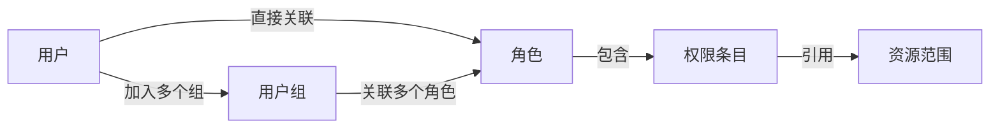
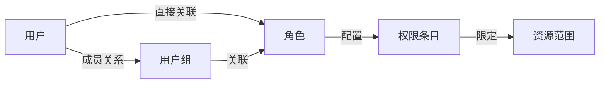

# 系统管理 · 设计方案

[PRD](00-prd.md) · [页面拆解](01-pages.md) · [功能拆解](02-features.md) · [用户故事](03-user-stories.md) · [开发任务](04-development-tasks.md) · [测试用例](05-unit-test-cases.md) · [交互原型](prototype.html) · [文档维护规则](../development-standard.md)

覆盖用户、用户组、角色与权限目录、LDAP/AD、登录会话、改密及操作审计。权限工作区按页面注册表派生名称、位置、顺序及旧名称搜索，接口权限编码与范围契约沿用服务端定义。

## 角色与权限管理工作区

实施版 · 2026-11-24 · 实现基线 PR #116

### 1. 现状与目标

截图为只读的「权限目录」。当前左栏、目录标题、工具集合、CRUD 矩阵和接口详情同时占据操作空间。管理员需要先理解目录结构，再回到角色配置，才能完成授予。目录数据虽然由后端返回，但 `catalog.json` 自己维护了模块和工具集合，Portal 菜单又在 `portal-navigation.ts` 和 `resource-routes.ts` 中单独定义。菜单迁移时两边可以产生不同结果。

实际例子是 `connector` 仍位于权限目录的「诊断控制台 → 诊断中心」，Portal 已将数据源管理放入「资源管理 → 平台目录」。目录的 `cluster` 仍名为「集群接入」，Portal 已使用「Kubernetes 集群管理」。

### 2. 四个视角

| 视角 | 优化决策 | 验收 |
| --- | --- | --- |
| 产品专家 | 「权限管理」默认打开角色。角色列表直接选择目标角色，主区编辑，侧栏显示待保存差异。只读权限目录作为同级辅助入口。 | 日常任务沿「选角色 → 选权限和范围 → 核对并保存」完成，无需在目录和角色页之间往返。 |
| 运维专家 | 权限按实际页面归组，全局搜索功能、动作、编码和路径。提供明确范围下的「仅勾选可见读取权限」和「勾选本页可授权项」。提交预览突出新增、撤销、风险、环境和影响对象。 | 未明确选择的写入权限保持未选。跨模块或筛选后，已选项保留。能够看出账号因直接角色或组继承而继续有权。 |
| 前端专家 | 主区域按业务动作逐行展示，用「读取、变更、创建、撤销」筛选替代常驻四列矩阵。接口细节按需展开。列表、范围和草稿摘要在宽屏并列，窄屏顺序排列。 | 支持键盘完成选角色、勾选和确认。接口编码可检索。表单错误在相应位置展示，保存按钮在范围缺失时不可用。 |
| 架构专家 | 导航和权限界面消费一份页面元数据目录。权限点以稳定页面 ID 关联展示位置，以权限编码和范围保存。菜单名称、分组和顺序自动投影到角色编辑、只读目录及变更预览。 | 模拟改名、跨模块移动和调整顺序时，所有展示位置同步，存量角色、授权编码、范围及 API 语义保持一致。 |

### 3. 目标页面与主路径

| 位置 | 设计 |
| --- | --- |
| 系统管理 → 权限管理 → 角色 | 默认选中最近查看的可访问角色。支持搜索角色和新建自定义角色。预置角色以实际能力和固定规则显示。每个权限点显示业务动作、所属页面和风险。 |
| 角色 → 编辑权限 | 先搜索或按页面定位，勾选多个动作后一次指定同类范围。混合平台级与资源级动作时分别处理，表单依权限点声明展示真实数据范围。已授权范围可独立移除，同一权限可配置多个范围。 |
| 角色 → 预览并保存 | 展示按权限编码和范围计算的差异。保存前展示敏感操作提示及可计算的影响对象，影响未知时标明待核实。失败保留草稿，冲突后基于最新授权重新预览。 |
| 系统管理 → 权限管理 → 用户组 | 沿用用户组及角色关联，在组详情快速定位关联角色和成员。权限编辑从关联角色打开，不重新建授权关系。 |
| 系统管理 → 权限管理 → 权限目录 | 使用同一展示模型，作为只读目录。管理员可从某项权限返回角色编辑时带入搜索条件，普通读取者仅能查看有权投影的内容。 |
| 用户管理 → 用户详情 | 沿用生效权限与来源说明。权限名和页面位置从同一页面元数据投影，来源与授权校验取自服务端。 |

产品追踪使用实际任务验证操作复杂度。验收任务是「给测试值班角色添加数据源读取权限」。目标是在同一工作区内完成查找、勾选、范围、预览和确认，页面跳转次数为零。批量操作按钮显示当前作用范围和可勾选数量，已勾选跨筛选保留。

### 4. 自动同步设计

#### 唯一展示来源

将 Portal 顶栏模块、栏目分组、页面标题和排序抽取到版本化的 `PageRegistry`。页面项使用稳定 `pageId`，包含 `parentId`、`label` 或翻译键、`order`、`route`、别名和导航可见规则。模块、分组本身也是可排序节点。现有菜单权限条件继续调用原能力判定。

后端权限目录仍负责 `permissionCode`、方法、路径、业务分流、风险、适用范围、状态和可委派性。通过一份 `permissionCode → primaryPageId` 的展示关联为授权定位。同页内的子功能可使用预留的功能节点。多处使用一个权限点时，设置一个主定位页面，附加「也用于」入口；授权清单、统计和保存载荷依旧按编码及范围去重。

**同步规则**。菜单调整只改 `PageRegistry` 的名称、父节点或顺序。菜单导航与权限目录用同一棵树计算面包屑、模块筛选、分组和排序。权限 UI 禁止另写模块名称或把 API 路径前缀当成模块归属。路由变更保留别名，旧授权自然随稳定 `pageId` 显示在新位置。

| 权限能力 | 稳定展示页面 ID（设计） | 当前菜单定位 | 兼容 |
| --- | --- | --- | --- |
| 数据源读取、写入、测试 | `resource.datasources` | 资源管理 → 平台目录 → 数据源管理 | 保留 `diagnosis.connector.*` |
| 集群接入相关能力 | `resource.clusters` | 资源管理 → 集群资源 → Kubernetes 集群管理 | 保留现有集群能力编码和旧路由别名 |
| Finding 列表与详情 | `diagnosis.findings` | 诊断控制台 → 诊断工作区 → 原有诊断结果 | 保留 `diagnosis.finding.*`，附加总览消费位置 |
| 根因分析与关联拓扑 | 各自稳定子页 ID | 诊断控制台 → 故障事件 → 对应详情能力 | 详情能力无需强行加为侧栏入口 |

菜单可见性和权限目录可读性是两个服务端能力视图。角色管理员可以为别人配置的功能，可能不在自己的业务侧栏中。投影只使用经过鉴权的目录结果和注册元数据，禁止用当前已渲染菜单筛掉可委派的授权点。隐藏功能、仅本人能力、受保护能力依实际目录声明处理；导航元数据不产生可委派权限。

#### 发布与异常

- Web 构建从同版注册表生成菜单和目录投影。目录契约保留授权版本；展示元数据版本单独核验，构建时检查页面 ID 唯一、父节点有效、无环、所有人类可授权项有定位或明确声明内部能力。
- 找不到关联时，将已授权条目显示为「未关联页面」，保留原始编码和范围。现有角色不会因页面定位缺失或目录投影不可用而丢失授权。新授权仍需现有后端确认能力与范围，目录契约失配时提示刷新复核。
- 草稿以 `permissionCode + normalizedScope` 为键。纯展示变更重新计算分组，不清除草稿，不触发权限增减。已知授权版本或可委派条件发生变化时重新验证草稿，禁止静默覆盖。
- 可继续复用当前管理接口、审计、身份、授权决策和 SQLite 数据结构。用户直授、用户入组、用户组关联角色、角色关联权限、显式拒绝优先、审批与 LDAP 都沿用现行规则。非目标是改变主体关系、权限粒度、API 路径或扩大角色范围。

### 5. 开发拆解与验收用例

| 阶段 | 开发任务 | 验收 |
| --- | --- | --- |
| A · 接入元数据 | 提取 Registry、建立编码到页面映射、加入契约检查 | 数据源和集群页面展示与菜单一致。修改同一个页面节点后，菜单、角色权限列表、只读目录和预览都同步。编码与授权载荷逐项一致。 |
| B · 重做角色工作区 | 角色列表、检索、勾选、范围和草稿统一呈现；复用现有授权提交和审计 | 测试只读授权、混合范围、撤销、跨筛选保留、重复添加、预置角色保护、敏感操作预览和保存失败恢复。 |
| C · 目录与组入口 | 目录复用目录投影和详情；保留组与用户生效权限入口 | 按旧名、当前名称、编码和接口可找到权限。查看者不会获得编辑能力；直接授权与组继承来源可辨。 |
| D · 联动与可用性 | 覆盖元数据异常、跨模块移位、键盘与窄屏 | 未映射存量授权仍可见；未知或不可委派项仍由既有后端拒绝；320px 无整页横向溢出。 |

原型使用示例角色与范围，载入当前仓库目录的权限编码。在「权限目录 → 验证菜单同步」可模拟在菜单注册表改名、跨模块移动和恢复，随后观察目录、角色列表及草稿预览。该操作只用于原型验证。实际开发须以元数据注册表为唯一展示来源。

## 全平台授权与范围模型

全平台权限迭代参见 [平台访问控制 PRD 评审稿](00-prd.md#平台访问控制兼容设计)。

| 项目 | 约定 |
| --- | --- |
| 版本 | v1.0 设计评审稿 |
| 实现基线 | GitHub `main@ca40d7f` |
| 范围 | 诊断控制台、运维知识库、资源管理、系统管理、操作审计 |
| 身份来源 | 现有本地账号与 LDAP。平台用户组由管理员维护。 |
| 当前阶段 | 设计评审，评审结论进入各模块 PRD 和开发拆解 |

[系统管理 PRD](00-prd.md#认证用户管理与审计) · [诊断控制台 PRD](../diagnosis-console/00-prd.md#诊断结果与详情) · [知识库 PRD](../operations-knowledge/00-prd.md#文档治理与诊断联动) · [资源管理 PRD](../resource-management/00-prd.md#采集归属与维护基线)

### 1. 设计决策

采用带资源范围的 RBAC。**用户组负责批量分配，角色负责组合可执行操作和授权范围，资源目录负责描述对象的真实归属。** 同一个角色可以包含多个模块的权限条目，每条权限独立声明自己的范围。平台后端根据当前用户、操作和真实对象完成裁决。

- 每个授权问题都具体到动作与范围。例如「可查看生产 B 集群的支付命名空间诊断」「可读测试 A 集群的共享手册」「可对该知识版本提交审核」。
- 保留现有用户和组关系。直接授予的角色与全部组继承的角色取并集。重复授权可展示多条路径；一条路径失效时，仅当其他路径也不匹配才失权。
- 保持系统管理、资源写入及全局审计的管理员边界。LDAP 员工按实际岗位显式获得数据角色；默认访客角色继续只读研发、测试历史诊断。扩展诊断证据、AI 和 Wiki 权限须显式授权。
- 最小管理单元为平台资源范围。使用现有平台用户组，整个平台使用统一权限模型。

**现行差距。** 平台角色目前存储的是 `Scopes`，有效权限按范围聚合，LDAP 普通员工的后端仅允许一组诊断动作。Wiki 已有独立的动作键与命名空间授权，部分系统与资源入口仍使用管理员判断。重构先统一权限条目与裁决，再分批切换接口和界面。权限变化对外由接口决定。 [平台角色](https://github.com/abchw517/kube-aiops/blob/ca40d7f/api/internal/permissions/platform_state.go) · [平台授权](https://github.com/abchw517/kube-aiops/blob/ca40d7f/api/internal/permissions/platform_authorization.go)

### 2. 关联模型和计算规则

| 对象 | 字段与约束 |
| --- | --- |
| 用户 | 稳定身份 ID、账号状态、直接角色 ID、用户组 ID。LDAP 用户按目录身份识别；同名本地和 LDAP 账号不合并。 |
| 用户组 | 组 ID、名称、说明、成员、角色关联。成员维护权与业务资源访问权独立。LDAP 目录组变动不会自动修改平台组。 |
| 角色 | 稳定角色 ID、可读名称、预置或自定义、可继承标记、权限条目列表。预置角色权限固定，系统管理员角色可由超级管理员直接授予或通过用户组关联。 |
| 权限条目 | `动作键 + 范围类型 + 范围锚点`。动作键来自系统权限目录；一条授权记录的动作和范围绑定在一起。 |
| 资源范围 | 使用环境、实例、命名空间、业务归属和来源的稳定标识。名称作为展示字段。可见范围和知识适用条件分别记录。 |

**有效权限是完整条目的并集。** 只在一条完整授权同时匹配动作和目标时允许。用户单独具有「测试 Wiki 发布」和「生产 Wiki 读取」，只能发布测试知识。生产读取的范围不会与测试发布的动作组合。跨模块操作承载的几个显式授权条件可以分别由不同角色满足，每个条件都要匹配自己的目标。

首版数据角色采用允许制，未命中即拒绝。账号停用、会话失效、目标状态违反流程、双人审核条件未满足属于独立前置条件，胜过任何角色授权。管理员也遵循业务状态和审核条件。

### 3. 授权范围

| 场景 | 可授权范围 | 决策依据 |
| --- | --- | --- |
| 研发、测试历史诊断 | 环境、单个实例或指定命名空间 | 保留现有粒度。研发和测试不以业务线作为授权条件。 |
| 预发布、生产历史诊断和证据 | 具体实例、业务线、一个或多个明确勾选的命名空间 | 共享和独立业务集群均限制到授权命名空间。集群级诊断继续仅系统管理员可读。 |
| Wiki 阅读、草稿、发布、撤回 | 明确的集群实例和命名空间；预发布、生产另校验现行业务归属 | 阅读共享手册时，命中至少一个批准目标即可。来自生产 Finding 的案例保持原始范围，通用经验单独脱敏成手册并批准分发目标。 |
| Wiki 同步 | 获准来源 ID、已配置的目标范围 | 执行时同时校验操作者、来源启用状态、目标范围与个人同步凭据。写入仅产生候选版本。 |
| 资源变更 | 由系统管理员执行，对目标环境、实例、业务线或命名空间记录变更 | 暂不委派资源修改。首次采集锁定环境后继续按既有规则处理。凭据只显示状态和轮换时间。 |
| 账号、角色、用户组、LDAP、审计 | 平台管理范围；专属操作绑定唯一超级管理员 | 业务数据范围不能授予平台管理能力。修改自身本地密码通过自身关系判定，LDAP 账号改密仍在目录侧执行。 |

范围在操作时由后端基于实例路由、对象和目录重算，客户端筛选参数只能缩小访问范围。命名空间移除某条业务归属后，该条授权路径失效，其余有效路径继续生效。预发布和生产新增归属需要明确授权。命名空间无法解析或已重建且身份无法确认时，不恢复旧权限；记录诊断并进入管理员治理。

### 4. 全平台权限目录

下表为**目标权限目录**。实现优先复用已有动作键，新键须登记。前端按模块展示业务名称，每种权限只显示允许的范围类型。

| 模块 | 用户能理解的权限 | 建议动作键或实现约束 |
| --- | --- | --- |
| 诊断控制台 | 查看诊断列表、详情和汇总 | 沿用 `findings:list/read/summary`；必要资源选项由对应授权数据派生。 |
| 诊断证据 | 查看关联事件、日志、指标、告警；查看资源投影 | 沿用 `correlations:read`、`resources:read`。访问前同时校验 Finding。来源按现有权限边界和脱敏规则取数，缺少授权的来源不传给 AI。 |
| AI 复核 | 发起复核、补充观察；保存人工结论 | 目标动作 `findings:review`、`findings:conclusion:write`。保存与复核分开，写入验证版本；首批保留现有管理员入口，待分层动作和数据范围验收后开放。 |
| 运维知识库 | 阅读、搜索；问答；关联 Finding；维护草稿；审核发布；撤回 | 沿用 `wiki:read`、`wiki:publish`。建议补充 `wiki:ask`、`wiki:link`、`wiki:draft:write`、`wiki:withdraw`。读权限本身不授予写入或模型调用权限。 |
| 知识来源 | 同步已有来源；注册、修改及停用来源 | 沿用 `wiki:sync`；来源管理由管理员执行。同步成功不代表可发布。 |
| 资源管理 | 集群接入、连接和轮换；环境和业务线；命名空间归属 | 系统管理员执行。业务范围内的选择器、诊断资源投影与资源写入接口分别授权。 |
| 系统管理 | 管理普通账号、组、角色和数据授权；维护 LDAP | 由普通系统管理员负责。管理其他管理员或调整系统管理员角色仅超级管理员执行。数据角色中不出现这些权限项。 |
| 操作审计 | 查看全局审计，维护保留策略 | 查看为系统管理员；保留策略由超级管理员维护。沿用现有审计保留规则，发布、撤回与高风险权限变更记录目标、版本、权限来源及批次。 |

#### 4.1 角色配置示例

| 角色 | 典型关联方式 | 权限示例 |
| --- | --- | --- |
| 访客只读（预置） | 本地访客固定；LDAP 首次登录默认角色 | 研发、测试历史诊断。 |
| 测试值班 | 平台组「测试值班」关联 | 测试诊断和证据读取；有独立授权时读测试知识、发起复核。 |
| 生产支付值班 | 平台组「生产支付值班」关联 | 仅指定生产集群及支付命名空间的诊断、证据和手册。 |
| 存储知识维护 | 平台组「存储平台组」关联 | 在指定范围读取、关联及维护存储知识草稿。 |
| 知识审核发布 | 向受任命的员工直接授予，或关联专用审核组 | 在明确范围内读取待审内容、审核和发布。首版生产仍按知识库 PRD 由另一位有权管理员审核。 |
| 系统管理员（预置） | 本地管理员固定；LDAP 管理员由超级管理员直接授予或通过用户组继承 | 保持现有全局运维及管理能力，内置清单随产品版本显式更新。 |
| 超级管理员 | 现有唯一初始化账号 | 具备管理员能力及现有专属账号和审计策略操作。账号特殊约束保持现状。 |

名称为角色示例，部署后由管理员按岗位和目标配置。首版无需新增一套平台用户组或自动同步 LDAP 组。生产审核人员是否可委派给非管理员，作为独立产品决策评审。

### 5. 跨模块操作如何判定

| 场景 | 必须同时满足 |
| --- | --- |
| 在 Finding 中推荐知识 | 有该 Finding 的读权限、有当前目标的 Wiki 读权限、该目标已获条目可见批准、条件适用、版本可推荐。 |
| 关联已有手册 | 能读所选 Finding 与手册版本、有对应目标的关联权限、复核版本已保存且仍是提交的有效版本，手册当前可关联。 |
| 从值班诊断沉淀案例 | 能读来源 Finding、能在原始范围写候选、来源复核版本有效。案例范围由服务端锁定。 |
| 在 Wiki 发起问答 | 有目标问答权限，候选逐条检查读权限、状态和范围；回答回传前重验。撤权使已生成但未返回的内容失效。 |
| 审核发布生产手册 | 能读待审版本，有变更涉及全部旧、新目标的发布权限，候选和基线仍有效。提交人与审核人不同。扩大共享范围同样双人审核。 |
| 撤回已发布知识 | 有受影响全部生效目标的撤回权限，版本匹配。提交后搜索、详情、推荐、问答和引用统一按状态生效。 |
| 变更命名空间业务归属 | 系统管理员按资源管理动作提交，校验目标及当前版本。授权裁决读取最新归属；既有用户会话无需重新登录即可失去已移除的路径。 |

批量数据查询使用同一授权集合生成列表、总数、筛选项、选项与分页。普通用户用直链请求不可见对象时使用不泄露目标存在性的响应。对有权查看且版本冲突的编辑操作返回冲突，由界面引导重新核对。审计和权限解释只有相应管理权限可见。

### 6. 管理端交互

| 页面 | 设计 |
| --- | --- |
| 用户管理 → 用户详情 | 保留「关联关系」和「生效权限」。前者展示角色及组；后者按模块、动作和范围列出全部来源。可用「模拟检查」选择动作与资源，展示允许或拒绝、命中路径与当前归属。 |
| 权限配置 → 角色 | 左侧按模块挑选权限，右侧逐行配置范围。添加生产权限时依次选实例、业务线、命名空间。保存前显示权限差异、直接用户数、关联组数与风险提示。预置角色只读。 |
| 权限配置 → 用户组 | 展示成员和角色。批量关联时核验身份和角色的可继承性；返回成功、跳过及失败原因。仍被引用的组和自定义角色须先解除关系。 |
| 模块页面 | 根据后端提供的当前动作权限展示入口。工作流禁用状态注明原因，例如「需另一名审核人」。后端对直链、API 和后台任务统一授权。 |
| 操作审计 | 从角色变更、组变更和高风险知识操作追查操作者、前后差异、目标、时间及批次。支持按主体、角色或资源定位变更。 |

权限变更从下一次受保护请求生效。普通数据角色变更不强制重登。停用账号、密码重置或直接增减管理员角色继续按现有规则使旧会话失效。若未来为高频查询缓存授权结果，缓存须随身份、授权关系和资源归属变化失效。

### 7. 演进顺序与验收

| 阶段 | 可交付结果 | 验收条件 |
| --- | --- | --- |
| A 等价迁移 | 引入动作加范围的权限条目，保留账号、组与角色 ID。将平台角色旧范围转换成现有历史诊断权限及其必要选择器，不附加证据、Wiki 或资源管理动作。 | 使用旧库重跑迁移无重复。用访客、LDAP、管理员和已有策略账号对照迁移前后的允许与拒绝。无法等价转换的策略生成待确认差异，避免跨身份或策略通道自动合并。 |
| B 统一核心模块 | 诊断、Wiki、资源和系统管理逐项接入统一后端裁决，建立动作和范围登记。维持现有权限矩阵，Wiki 数据角色在获得评审批准后显式开放。 | 预发布和生产节点级诊断无越权；同名资源跨实例隔离；来源同步不能发布；无权数据不会进入筛选、计数和 AI；管理员兼容原流程。 |
| C 扩展运维委派 | 评审非管理员 AI 复核和知识审核委派，完成授权影响预览与用户权限解释。资源写入是否委派单独评估。 | 测试「测试可写＋生产可读」、从两个组获得同一授权、撤其中一路与撤最后一路、归属变化、中途撤权以及生产双人审核。 |

发布前备份 SQLite 和权限快照，对照旧新裁决，报告变更数量、账号和范围。切换读写路由须覆盖全部平台入口，旧接口兼容仍使用新授权；回退使用已验证的快照或兼容版本，核对切换后的授权写入和审计。测试至少覆盖后端直接访问、界面动作、分页计数、批量操作和后台任务。

**评审需要拍板的三项**：Wiki 数据角色开放到哪些 LDAP 值班组；是否向普通值班人员委派 AI 复核与保存；生产发布的审核资格是否继续限定为管理员。首版设计默认沿用现行限制，评审通过后再更新各模块 PRD、页面、功能、用户故事、开发任务和用例。

## 角色配置评审

历史评审关注点与授权兼容约定。当前角色界面以前面的工作区设计为准。

| 项目 | 说明 |
| --- | --- |
| 版本 | v0.2 设计待确认 |
| 基线 | 当前「系统管理 → 权限配置」页面与平台全局权限方案 |
| 本轮交付 | 本设计和 [可点击 HTML 原型](role-configuration.html) |
| 后续 | 确认设计后再修订 PRD、开发文档和测试用例 |

### 1. 入口与功能边界

建议在「系统管理」中，于「权限配置」右侧增加同级的 **角色配置**。以截图中的导航为基线，顺序为「认证配置、用户管理、权限配置、角色配置、操作审计、修改密码」。角色配置负责定义角色；权限配置和用户管理继续负责现有授权关系。角色 ID、引用及已生效权限只有一份。

| 现有区域 | 保留的功能结构 | 本轮界面建议 |
| --- | --- | --- |
| 认证配置 | LDAP 配置、测试、保存和原有管理范围。沿用当前登录及目录账号处理流程。 | 复用现有入口。 |
| 用户管理 | 查找、筛选、查看详情、创建及维护适用账号、停用与启用、密码操作、删除及账号保护。 | 复用现有页面。生效权限详情可使用同一权限动作和范围名称，保留来源及入口。 |
| 用户授权 | 用户管理的单人及批量直接授予角色、移除角色、加入及移出用户组；权限配置维护组到角色的关系。 | 权限配置保留「角色／用户组」。角色列表提供权限摘要、引用和查看；编辑链接跳转到角色配置。用户组继续关联既有角色。 |
| 操作审计 | 保留原审计入口、筛选、分页、详情、失败口径和保留策略。 | 角色配置的创建、修改和删除作为既有角色操作进入原审计。沿用操作者、目标、结果和现有风险分级。 |
| 角色配置（新增） | 定义权限目录中可授予的动作及范围，查看角色引用。 | 集中创建、编辑和删除自定义角色；预置角色只读。 |

现有角色页的「新建角色」可继续作为跳转入口。旧角色编辑的直链根据同一角色 ID 打开新位置，返回后恢复原列表筛选。角色配置中的「查看引用」返回现有用户或用户组的授权视图，链接本身不修改任何授权。

### 2. 数据关系和授权语义

- 用户可有多个直接角色，也可属于多个平台用户组；用户组可关联多个可继承角色。LDAP 目录组仍由现有认证行为处理，继续由平台管理员维护平台用户组。
- **权限只配置在角色上。每项权限是完整的「动作 + 范围」。** 直接和继承角色的完整条目取并集，多条来源均可查看。一个角色的测试写权限与另一个角色的生产读权限不会组合为生产写权限。
- 预置「访客只读」继续提供研发、测试历史诊断。预置「系统管理员」继续由现有规则直接授予，禁止加入用户组、编辑或删除。本地账号类型、LDAP 默认角色和超级管理员保护沿用现行规则。
- 撤掉一条角色路径后，其他仍匹配的路径继续生效。角色内容保存沿用现有后端生效及会话语义。删除有引用的自定义角色先从现有用户授权或用户组页面解除引用。

### 3. 角色配置页

| 区域 | 设计 |
| --- | --- |
| 角色列表 | 显示名称、预置或自定义、权限条目、引用数和操作；搜索按角色名匹配。系统管理员显示「全局管理」，访客显示已有两项权限。 |
| 编辑面板 | 第一部分为角色名称。第二部分为权限清单，每条单独选择模块、动作和范围。点击「添加权限」后进入待保存清单，可移除。修改现有条目采用移除并添加。 |
| 范围选择 | 研发及测试的历史诊断可选整个环境、单实例或指定命名空间。预发布及生产只列出可用实例和实际归属，先选择业务线，再选择具体命名空间。变更上游后清空失效选项。 |
| 保存前预览 | 列出新增和移除的权限、直接引用及组引用数。引用数是关联数，界面明确其含义。取消不产生变更；保存失败保留输入；角色被并发更新时提示重新载入并核对。 |
| 只读及空态 | 预置角色可查看权限条目和引用，保存或删除入口不可用。无匹配时可清除筛选。暂未开放的能力显示在权限目录，编辑器只提供已开放动作。 |

### 4. 兼容平台能力的规则

| 能力 | 本轮设计边界 | 角色配置如何表达 |
| --- | --- | --- |
| 历史诊断 | 首次切换只做等价迁移，角色 ID、既有读范围及关联全数保留。 | 用一项「历史诊断查看 + 原有范围」表达每份旧范围。后台将该动作映射为现有列表、汇总、详情与必要选择器能力。 |
| 运维知识库 | 保留当前管理员和旧显式授权的能力。**Wiki 只读试点须由管理员明确开放给指定组**，默认关闭。 | 试点开放时可给自定义角色添加「Wiki 阅读 + 指定实例／命名空间」。生产或预发布仍校验业务归属。无需更改用户授权流程。 |
| Wiki 发布、同步及 AI 复核 | 沿用当前角色、管理条件及审核流程。后续委派单独评审。 | 可在权限目录读到能力说明。发布、来源同步及 AI 委派不放入首批可授予动作。Wiki 阅读不附带它们。 |
| 资源管理、系统管理和审计 | 管理权限继续按现行系统管理员或超级管理员边界执行。 | 在系统管理员角色详情解释现有能力；自定义角色编辑器不提供对应管理动作。 |

Wiki 资源范围表示平台授权；文档公布的可见目标及适用条件仍由 Wiki 决定。只有两处规则都满足，知识才可以返回或被推荐。生产归属变更后按真实目录再次判定。旧角色存在无法映射的范围，留在迁移差异报告供人工核对，禁止自动扩大权限。

### 5. 原型评审路径

1. 打开「权限配置」，查看截图对应的角色和用户组结构；点击「角色配置」确认新入口位置。
2. 在「角色配置」查看预置角色，编辑「生产值班观察」，为支付或云帆命名空间增加诊断权限，核对变更预览。
3. 在「权限配置 → 用户组」核对引用，在「用户管理」查看示例用户的直接角色、组角色和生效权限。
4. 打开「权限目录」查看 Wiki 试点、AI、资源管理与审计的开放边界。原型中的 Wiki 示例开关只模拟评审场景。

请确认新增同级页和现有权限配置的入口分工、生产范围交互及 Wiki 只读试点的展示方式。以确认结果为准编写正式需求和开发验收。

## 系统管理流程评审

历史评审关注点与授权兼容约定。当前角色界面以前面的工作区设计为准。

**v0.3 评审稿** · [系统管理全局交互原型](workflow-review.html)

### 信息架构

采用截图所示的系统管理同级入口：认证配置、用户管理、权限配置、操作审计、修改密码。角色配置放在「权限配置」下并设为默认子页，与「用户组」并列。这个版本调整了 v0.2 的导航方案，角色定义使用一个编辑入口，既有角色、用户和用户组继续共享同一份数据。历史权限直链可直接定位到角色配置或用户组。

| 页面 | 高频操作和调整 | 保留的功能结构 |
| --- | --- | --- |
| 认证配置 | 同屏填写、测试、查看四阶段结果和保存。失败后保留本次测试输入，重试无需重填。 | 沿用现有 LDAP 字段、测试、保存门槛及目录账号规则。 |
| 用户管理 | 搜索后仅剩一个用户时自动显示详情。把「分配或撤销」放在详情标题区，查看生效权限的同时就能授权。 | 继续支持账号状态、创建、删除、单人及批量授权、组与直接角色、来源解释。 |
| 权限配置／角色配置 | 从列表原地打开编辑器。选择动作和范围，一次勾选多个命名空间。单条范围用「添加并预览」；配置多个范围可分次加入清单，再统一预览和保存。预置角色一键查看。 | 角色 ID、预置角色、引用保护及现有读权限保持兼容。 |
| 权限配置／用户组 | 在原有组列表编辑组及关联角色。点击角色名称可在原位查看、编辑角色；返回仍在组列表。 | 成员继续从用户管理分配。系统管理员角色只允许直接授予。 |
| 操作审计 | 从账号详情直接按账号定位审计；授权结果可打开本次已记录的审计或同批次结果。 | 保留查询、分页、详情、保留策略、风险等级及现行记录口径。 |
| 修改密码 | 保留单表单流程，重试和不一致反馈在表单内。 | LDAP 仍在目录侧改密，本地临时密码仍先改密再使用。 |

### 高频路径的评审标准

| 场景 | 之前的操作 | 原型操作 |
| --- | --- | --- |
| 单人授权 | 打开用户详情，切换「关联关系」，再进入授权。 | 定位到用户后直接点「分配或撤销」，减少一次页签切换。弹窗默认添加用户组，可切换直接角色或撤销；选项可搜索、已关联项有提示。 |
| 给角色授予同一业务的多个命名空间 | 逐个选择命名空间、逐次加入权限清单。 | 环境、实例和业务线选一次，勾选多个命名空间后一次加入并预览；一次确认保存。 |
| 追查刚完成的授权 | 打开审计，重输目标账号或查批次。 | 从结果点「查看本次审计」。已有记录直接打开详情；需要时进入原有同批次查询。 |
| 核对预置或存量角色 | 在授权和角色维护入口之间切换。 | 在角色列表直接查看预置权限。在组页通过角色名原地打开相同编辑器。 |

以上对比从同一状态开始。例如同一集群、同一业务线的三个命名空间，加入清单的操作由 3 次减为 1 次。点击「添加并预览」后先核对权限增减、直接关联用户、关联用户组和去重后的涉及账号，再确认保存。删除与管理员角色变更沿用现有确认规则。

### 授权与兼容规则

- 用户直授角色、用户加入用户组、组关联角色和角色关联权限列表沿用。按完整的「动作 + 范围」计算有效权限，直接与继承仅合并完整条目并保留全部来源。
- 研发和测试诊断可选环境、实例或命名空间。预发布、生产沿用实例、业务线及明确命名空间的范围。切换上游条件清理无效选择。
- 默认使用等价迁移后的历史诊断动作。权限目录可以看到 Wiki 只读试点及现有 AI、资源、系统管理边界。原型可模拟具体实例和命名空间的 Wiki 读取，正式开放对象待评审。发布、问答与同步各自独立授权。
- 正式实施安排在本轮评审通过后。正式 PRD、开发文档和测试用例以本轮确认后的交互为准。

原型使用本地模拟数据，可切换身份验证现有边界。推荐路径：「用户管理 → 搜索李伟 → 分配或撤销 → 查看本次审计」，再到「权限配置 → 编辑云帆生产诊断」体验多选范围。

## AI 服务管理

Portal 顶栏的「AI 服务」包括模型配置和技能工作区。Portal 分别读取试点 Holmes 就绪状态和数据范围绑定。管理员选择监控数据源或输入诊断范围，校验模型后把精确范围写入 SQLite。HTTP 服务地址与凭据由部署提供，旧的部署绑定继续参与范围匹配。管理员可发现 Holmes 当前注册的别名，保存按范围生效的 fast-model、accurate-model 或暂停草稿，并在校验通过后发布。发布版本保存于 SQLite，只有新请求读取已经提交的生效值。原始 Helm 模型定义和 API Key 由部署侧维护。

范围绑定弹窗按数据范围和 Holmes 模型组织。范围详情与下拉选项分开显示，长名称和 ID 适配窄屏。

技能可从 Markdown 上传，也可从 Wiki 当前已发布的排障手册转化。提交和启用由不同管理员操作。运行时仅对精确范围和关键词匹配的已启用技能取最多三项。手册转换内容需按当前访问者重新确认文档版本和可读权限。技能作为只读排障参考随请求传给 Holmes。无用户会话的后台任务跳过手册来源技能。

[需求](00-prd.md#ai-服务管理) · [页面](01-pages.md#ai-服务管理) · [验收](05-unit-test-cases.md#ai-服务管理)

[AI 服务配置与技能交互原型](ai-service-workspace.html)
