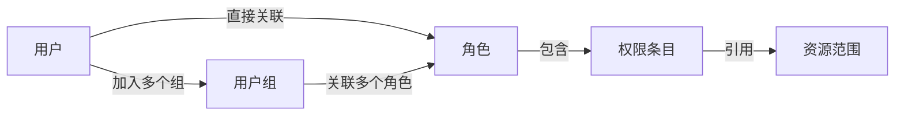

# kube-aiops 平台全局权限设计

| 项目 | 约定 |
| --- | --- |
| 版本 | v1.0 设计评审稿 |
| 实现基线 | GitHub `main@ca40d7f` |
| 范围 | 诊断控制台、运维知识库、资源管理、系统管理、操作审计 |
| 身份来源 | 现有本地账号与 LDAP。平台用户组由管理员维护。 |
| 当前阶段 | 设计评审，评审结论进入各模块 PRD 和开发拆解 |

[系统管理 PRD](00-prd.md) · [诊断控制台 PRD](../diagnosis-console/00-prd.md) · [知识库 PRD](../operations-knowledge/00-prd.md) · [资源管理 PRD](../resource-management/00-prd.md)

## 1. 设计决策

采用带资源范围的 RBAC。**用户组负责批量分配，角色负责组合可执行操作和授权范围，资源目录负责描述对象的真实归属。** 同一个角色可以包含多个模块的权限条目，每条权限独立声明自己的范围。平台后端根据当前用户、操作和真实对象完成裁决。

- 每个授权问题都具体到动作与范围。例如「可查看生产 B 集群的支付命名空间诊断」「可读测试 A 集群的共享手册」「可对该知识版本提交审核」。
- 保留现有用户和组关系。直接授予的角色与全部组继承的角色取并集。重复授权可展示多条路径；一条路径失效时，仅当其他路径也不匹配才失权。
- 保持系统管理、资源写入及全局审计的管理员边界。LDAP 员工按实际岗位显式获得数据角色；默认访客角色继续只读研发、测试历史诊断。扩展诊断证据、AI 和 Wiki 权限须显式授权。
- 最小管理单元为平台资源范围。使用现有平台用户组，整个平台使用统一权限模型。

**现行差距。** 平台角色目前存储的是 `Scopes`，有效权限按范围聚合，LDAP 普通员工的后端仅允许一组诊断动作。Wiki 已有独立的动作键与命名空间授权，部分系统与资源入口仍使用管理员判断。重构先统一权限条目与裁决，再分批切换接口和界面。权限变化对外由接口决定。 [平台角色](https://github.com/abchw517/kube-aiops/blob/ca40d7f/api/internal/permissions/platform_state.go) · [平台授权](https://github.com/abchw517/kube-aiops/blob/ca40d7f/api/internal/permissions/platform_authorization.go)

## 2. 关联模型和计算规则

| 对象 | 字段与约束 |
| --- | --- |
| 用户 | 稳定身份 ID、账号状态、直接角色 ID、用户组 ID。LDAP 用户按目录身份识别；同名本地和 LDAP 账号不合并。 |
| 用户组 | 组 ID、名称、说明、成员、角色关联。成员维护权与业务资源访问权独立。LDAP 目录组变动不会自动修改平台组。 |
| 角色 | 稳定角色 ID、可读名称、预置或自定义、可继承标记、权限条目列表。预置角色权限固定，系统管理员角色只支持直接授予。 |
| 权限条目 | `动作键 + 范围类型 + 范围锚点`。动作键来自系统权限目录；一条授权记录的动作和范围绑定在一起。 |
| 资源范围 | 使用环境、实例、命名空间、业务归属和来源的稳定标识。名称作为展示字段。可见范围和知识适用条件分别记录。 |

**有效权限是完整条目的并集。** 只在一条完整授权同时匹配动作和目标时允许。用户单独具有「测试 Wiki 发布」和「生产 Wiki 读取」，只能发布测试知识。生产读取的范围不会与测试发布的动作组合。跨模块操作承载的几个显式授权条件可以分别由不同角色满足，每个条件都要匹配自己的目标。

首版数据角色采用允许制，未命中即拒绝。账号停用、会话失效、目标状态违反流程、双人审核条件未满足属于独立前置条件，胜过任何角色授权。管理员也遵循业务状态和审核条件。

## 3. 授权范围

| 场景 | 可授权范围 | 决策依据 |
| --- | --- | --- |
| 研发、测试历史诊断 | 环境、单个实例或指定命名空间 | 保留现有粒度。研发和测试不以业务线作为授权条件。 |
| 预发布、生产历史诊断和证据 | 具体实例、业务线、一个或多个明确勾选的命名空间 | 共享和独立业务集群均限制到授权命名空间。集群级诊断继续仅系统管理员可读。 |
| Wiki 阅读、草稿、发布、撤回 | 明确的集群实例和命名空间；预发布、生产另校验现行业务归属 | 阅读共享手册时，命中至少一个批准目标即可。来自生产 Finding 的案例保持原始范围，通用经验单独脱敏成手册并批准分发目标。 |
| Wiki 同步 | 获准来源 ID、已配置的目标范围 | 执行时同时校验操作者、来源启用状态、目标范围与个人同步凭据。写入仅产生候选版本。 |
| 资源变更 | 由系统管理员执行，对目标环境、实例、业务线或命名空间记录变更 | 暂不委派资源修改。首次采集锁定环境后继续按既有规则处理。凭据只显示状态和轮换时间。 |
| 账号、角色、用户组、LDAP、审计 | 平台管理范围；专属操作绑定唯一超级管理员 | 业务数据范围不能授予平台管理能力。修改自身本地密码通过自身关系判定，LDAP 账号改密仍在目录侧执行。 |

范围在操作时由后端基于实例路由、对象和目录重算，客户端筛选参数只能缩小访问范围。命名空间移除某条业务归属后，该条授权路径失效，其余有效路径继续生效。预发布和生产新增归属需要明确授权。命名空间无法解析或已重建且身份无法确认时，不恢复旧权限；记录诊断并进入管理员治理。

## 4. 全平台权限目录

下表为**目标权限目录**。实现优先复用已有动作键，新键须登记。前端按模块展示业务名称，每种权限只显示允许的范围类型。

| 模块 | 用户能理解的权限 | 建议动作键或实现约束 |
| --- | --- | --- |
| 诊断控制台 | 查看诊断列表、详情和汇总 | 沿用 `findings:list/read/summary`；必要资源选项由对应授权数据派生。 |
| 诊断证据 | 查看关联事件、日志、指标、告警；查看资源投影 | 沿用 `correlations:read`、`resources:read`。访问前同时校验 Finding。来源按现有权限边界和脱敏规则取数，缺少授权的来源不传给 AI。 |
| AI 复核 | 发起复核、补充观察；保存人工结论 | 目标动作 `findings:review`、`findings:conclusion:write`。保存与复核分开，写入验证版本；首批保留现有管理员入口，待分层动作和数据范围验收后开放。 |
| 运维知识库 | 阅读、搜索；问答；关联 Finding；维护草稿；审核发布；撤回 | 沿用 `wiki:read`、`wiki:publish`。建议补充 `wiki:ask`、`wiki:link`、`wiki:draft:write`、`wiki:withdraw`。读权限本身不授予写入或模型调用权限。 |
| 知识来源 | 同步已有来源；注册、修改及停用来源 | 沿用 `wiki:sync`；来源管理由管理员执行。同步成功不代表可发布。 |
| 资源管理 | 集群接入、连接和轮换；环境和业务线；命名空间归属 | 系统管理员执行。业务范围内的选择器、诊断资源投影与资源写入接口分别授权。 |
| 系统管理 | 管理普通账号、组、角色和数据授权；维护 LDAP | 由普通系统管理员负责。管理其他管理员或调整系统管理员角色仅超级管理员执行。数据角色中不出现这些权限项。 |
| 操作审计 | 查看全局审计，维护保留策略 | 查看为系统管理员；保留策略由超级管理员维护。沿用现有审计保留规则，发布、撤回与高风险权限变更记录目标、版本、权限来源及批次。 |

### 4.1 角色配置示例

| 角色 | 典型关联方式 | 权限示例 |
| --- | --- | --- |
| 访客只读（预置） | 本地访客固定；LDAP 首次登录默认角色 | 研发、测试历史诊断。 |
| 测试值班 | 平台组「测试值班」关联 | 测试诊断和证据读取；有独立授权时读测试知识、发起复核。 |
| 生产支付值班 | 平台组「生产支付值班」关联 | 仅指定生产集群及支付命名空间的诊断、证据和手册。 |
| 存储知识维护 | 平台组「存储平台组」关联 | 在指定范围读取、关联及维护存储知识草稿。 |
| 知识审核发布 | 向受任命的员工直接授予，或关联专用审核组 | 在明确范围内读取待审内容、审核和发布。首版生产仍按知识库 PRD 由另一位有权管理员审核。 |
| 系统管理员（预置） | 本地管理员固定；LDAP 管理员按当前系统管理 PRD 由超级管理员直接授予 | 保持现有全局运维及管理能力，内置清单随产品版本显式更新。 |
| 超级管理员 | 现有唯一初始化账号 | 具备管理员能力及现有专属账号和审计策略操作。账号特殊约束保持现状。 |

名称为角色示例，部署后由管理员按岗位和目标配置。首版无需新增一套平台用户组或自动同步 LDAP 组。生产审核人员是否可委派给非管理员，作为独立产品决策评审。

## 5. 跨模块操作如何判定

| 场景 | 必须同时满足 |
| --- | --- |
| 在 Finding 中推荐知识 | 有该 Finding 的读权限、有当前目标的 Wiki 读权限、该目标已获条目可见批准、条件适用、版本可推荐。 |
| 关联已有手册 | 能读所选 Finding 与手册版本、有对应目标的关联权限、复核版本已保存且仍是提交的有效版本，手册当前可关联。 |
| 从值班诊断沉淀案例 | 能读来源 Finding、能在原始范围写候选、来源复核版本有效。案例范围由服务端锁定。 |
| 在 Wiki 发起问答 | 有目标问答权限，候选逐条检查读权限、状态和范围；回答回传前重验。撤权使已生成但未返回的内容失效。 |
| 审核发布生产手册 | 能读待审版本，有变更涉及全部旧、新目标的发布权限，候选和基线仍有效。提交人与审核人不同。扩大共享范围同样双人审核。 |
| 撤回已发布知识 | 有受影响全部生效目标的撤回权限，版本匹配。提交后搜索、详情、推荐、问答和引用统一按状态生效。 |
| 变更命名空间业务归属 | 系统管理员按资源管理动作提交，校验目标及当前版本。授权裁决读取最新归属；既有用户会话无需重新登录即可失去已移除的路径。 |

批量数据查询使用同一授权集合生成列表、总数、筛选项、选项与分页。普通用户用直链请求不可见对象时使用不泄露目标存在性的响应。对有权查看且版本冲突的编辑操作返回冲突，由界面引导重新核对。审计和权限解释只有相应管理权限可见。

## 6. 管理端交互

| 页面 | 设计 |
| --- | --- |
| 用户管理 → 用户详情 | 保留「关联关系」和「生效权限」。前者展示角色及组；后者按模块、动作和范围列出全部来源。可用「模拟检查」选择动作与资源，展示允许或拒绝、命中路径与当前归属。 |
| 权限配置 → 角色 | 左侧按模块挑选权限，右侧逐行配置范围。添加生产权限时依次选实例、业务线、命名空间。保存前显示权限差异、直接用户数、关联组数与风险提示。预置角色只读。 |
| 权限配置 → 用户组 | 展示成员和角色。批量关联时核验身份和角色的可继承性；返回成功、跳过及失败原因。仍被引用的组和自定义角色须先解除关系。 |
| 模块页面 | 根据后端提供的当前动作权限展示入口。工作流禁用状态注明原因，例如「需另一名审核人」。后端对直链、API 和后台任务统一授权。 |
| 操作审计 | 从角色变更、组变更和高风险知识操作追查操作者、前后差异、目标、时间及批次。支持按主体、角色或资源定位变更。 |

权限变更从下一次受保护请求生效。普通数据角色变更不强制重登。停用账号、密码重置或直接增减管理员角色继续按现有规则使旧会话失效。若未来为高频查询缓存授权结果，缓存须随身份、授权关系和资源归属变化失效。

## 7. 演进顺序与验收

| 阶段 | 可交付结果 | 验收条件 |
| --- | --- | --- |
| A 等价迁移 | 引入动作加范围的权限条目，保留账号、组与角色 ID。将平台角色旧范围转换成现有历史诊断权限及其必要选择器，不附加证据、Wiki 或资源管理动作。 | 使用旧库重跑迁移无重复。用访客、LDAP、管理员和已有策略账号对照迁移前后的允许与拒绝。无法等价转换的策略生成待确认差异，避免跨身份或策略通道自动合并。 |
| B 统一核心模块 | 诊断、Wiki、资源和系统管理逐项接入统一后端裁决，建立动作和范围登记。维持现有权限矩阵，Wiki 数据角色在获得评审批准后显式开放。 | 预发布和生产节点级诊断无越权；同名资源跨实例隔离；来源同步不能发布；无权数据不会进入筛选、计数和 AI；管理员兼容原流程。 |
| C 扩展运维委派 | 评审非管理员 AI 复核和知识审核委派，完成授权影响预览与用户权限解释。资源写入是否委派单独评估。 | 测试「测试可写＋生产可读」、从两个组获得同一授权、撤其中一路与撤最后一路、归属变化、中途撤权以及生产双人审核。 |

发布前备份 SQLite 和权限快照，对照旧新裁决，报告变更数量、账号和范围。切换读写路由须覆盖全部平台入口，旧接口兼容仍使用新授权；回退使用已验证的快照或兼容版本，核对切换后的授权写入和审计。测试至少覆盖后端直接访问、界面动作、分页计数、批量操作和后台任务。

**评审需要拍板的三项**：Wiki 数据角色开放到哪些 LDAP 值班组；是否向普通值班人员委派 AI 复核与保存；生产发布的审核资格是否继续限定为管理员。首版设计默认沿用现行限制，评审通过后再更新各模块 PRD、页面、功能、用户故事、开发任务和用例。
