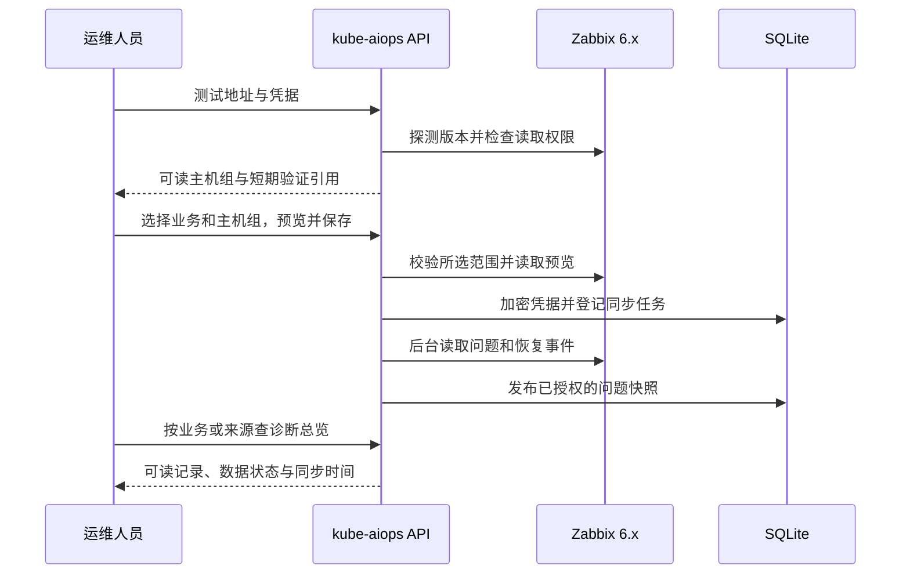

# kube-aiops Zabbix 数据源接入与诊断汇总

评审基准为 2026-11-24 更新的可点击原型。

[Zabbix 数据源接入原型](https://chatgpt.com/library?file_id=libfile_1aff377020c88191b2e1a0643230b5c6&account_id=personal)

## 1. 设计方案

接入人员在「资源管理 → 平台目录 → 数据源管理」填写 Zabbix 地址与只读凭据。连接测试完成后，在同一窗口选择环境、业务和主机组，预览 Zabbix 活跃问题并保存。后台完成首次同步后，值班人员在「诊断控制台 → 诊断总览」查看 Zabbix、故障事件与 K8sGPT Finding。



| 设计面 | 实施规则 |
| --- | --- |
| Zabbix 版本 | 自动识别 6.0、6.2、6.4。API Token 和账号会话均走 JSON-RPC `auth`。账号使用 `user.login`，每轮读取后注销临时会话。 |
| 地址 | 接受站点根路径或 API 地址，补齐 `/api_jsonrpc.php`。后端将 `DIAGNOSTIC_ZABBIX_ENDPOINTS` 的配置项按同一规则规范化后精确匹配，验证 TLS，拒绝重定向。 |
| 凭据 | 连接测试只保留与当前登录身份绑定的短期验证引用，默认 5 分钟。同一用户对同一目标的后续测试会取代旧引用。正式凭据使用 AES-GCM 加密，密文绑定源 ID 与 API 地址。密钥文件与 SQLite 同目录并独立管理，复用现有持久化目录。 |
| 范围 | 一个数据源归属一个环境和一个业务。以主机组 ID 发现当前监控主机，按主机 ID 去重。授权检查采用环境和业务的精确组合。 |
| 主机与集群 | 普通主机直接显示在环境／业务下。需要关联集群时，在 Zabbix 主机上设置 `kube-aiops.cluster-id` 标签，值为平台集群实例 ID。后端检查该实例属于同一环境和业务。无匹配或存在多个有效绑定时按独立主机展示。 |
| 快照 | 保存配置后由后台任务进行首次正式同步，预览作为单独查询。SQLite 租约协调同步任务，配置版本用于拒绝过期任务写回。每次成功或者失败后安排下一轮，默认约 60 秒。 |
| 恢复与去重 | 已发生的问题以规范化 Zabbix API 地址和 `eventid` 去重。选定环境与业务后只归并授权范围内的数据。`problem.get` 读取可见问题，`event.get` 补主机和恢复证据。确认恢复的已观测问题保留最近 24 小时。默认排除维护抑制和可识别的症状问题。 |
| 严重度 | Zabbix 4–5 对应严重，2–3 对应警告，0–1 对应信息。详情保留上游级别、确认状态、标签、开始及恢复时间。 |
| 容量 | 单配置 1–50 个主机组。单次上游读取设 500 条上限，达到上限时显式报错。总览最多汇总 2,000 条 Zabbix 记录，超出后提示覆盖不完整。 |

### 同步状态和统计口径

| 状态 | 数据源管理 | 诊断总览 |
| --- | --- | --- |
| 已保存／首次同步中 | 显示等待或进行中，等待可用快照 | Zabbix 单来源显示指标「—」 |
| 成功且没有活跃问题 | 显示 0 条，并记录成功时间 | 当前选择范围显示真实 0 |
| 首次同步失败 | 显示失败并可重试 | Zabbix 单来源显示暂不可用 |
| 成功后暂时失败 | 显示上次成功时间和过期提示 | 展示已确认覆盖范围内的最近成功结果 |
| 已确认授权撤销 | 标明采集权限不可用 | 隐藏已撤销范围内的问题 |
| 暂停 | 可恢复采集 | 数据源退出汇总，恢复后等待新快照 |

### 发布和运维

已有部署可以在发布清单的 `api` 容器中追加以下环境变量。优先在现有列表追加地址，保留其他数据源。

```yaml
- name: DIAGNOSTIC_ZABBIX_ENDPOINTS
  value: "https://zabbix.example.com/api_jsonrpc.php,https://monitor.example.com/zabbix/api_jsonrpc.php"
```

应用发布清单后检查 `kubectl -n kube-aiops-system rollout status deployment/kube-aiops-api --timeout=180s`。确认连接后，在 Portal 继续选择采集范围。

- 在 API 容器配置 `DIAGNOSTIC_ZABBIX_ENDPOINTS`。允许填 HTTPS 站点根地址或完整 API 地址。多个地址用逗号分隔，匹配仍限定到各自的主机、端口和路径。使用发布清单或 Helm values 持久化配置，由 API Pod 在启动时读取。
- 地址格式无效时返回 `ZABBIX_ENDPOINT`。平台未配置允许地址时返回 `ZABBIX_ENDPOINTS_UNCONFIGURED`。地址未获准时返回 `ZABBIX_ENDPOINT_NOT_ALLOWED`。三种情形都发生在请求 Zabbix 之前。
- 使用 Zabbix 专用只读账号。需要 `host.get`、`hostgroup.get`、`problem.get`、`event.get` 的访问权限。账号密码模式同时使用 `user.login`、`user.logout`。Token 的可见范围取决于其所属账号。
- 将 SQLite 和同目录的 `.zabbix-credentials.key` 文件一并纳入备份和恢复。文件名使用 SQLite 文件路径加该后缀。每个使用独立 SQLite 的部署维护自己的加密密钥。
- 通过数据源管理配置暂停、恢复、手动同步和先验证后轮换凭据。旧 Zabbix 资产数据源与云资产接入使用既有 API 与数据表。
- 初始落地在受控业务试点环境核对 Zabbix 页面与 Portal 的主机范围、问题数、恢复时间和级别映射。

[Zabbix 6.0 API](https://www.zabbix.com/documentation/6.0/en/manual/api) · [问题查询](https://www.zabbix.com/documentation/6.0/en/manual/api/reference/problem/get) · [事件查询](https://www.zabbix.com/documentation/6.0/en/manual/api/reference/event/get)

## 2. PRD

**目标用户**包括管理接入的运维管理员、按环境与业务值班的运维用户、读取诊断数据的开发或排障人员。

| 需求 | 说明 | 验收 |
| --- | --- | --- |
| PRD-01 凭据接入 | 支持 API Token 或账号密码。平台自动探测版本并给出连接检查结果。 | 两种认证均可完成连接；错误地址、证书错误、无权限和超时可区分。 |
| PRD-02 范围与预览 | 搜索主机组、保留勾选、即时显示去重的主机数与活跃问题数。 | 重叠主机只计一次；健康的零问题可保存。 |
| PRD-03 保存与同步 | 保存后后台采集，管理页提供同步、重试、暂停与恢复。 | 预览阶段总览无新记录；首次正式同步成功后才纳入当前统计。 |
| PRD-04 凭据与范围变更 | 支持先验证后更换凭据、调整主机组。 | 错误凭据保持原配置，旧版本或旧租约产生的结果被拒绝。 |
| PRD-05 多来源总览 | 按来源、环境、业务、集群、级别、恢复状态筛选，并在行内查看问题详情。 | Zabbix 记录与故障和 Finding 同屏可查；近期恢复不计入当前活跃数。 |
| PRD-06 权限与失败展示 | 按环境及业务限定读取和写入。区分真实 0、过期快照与不可用数据。 | 跨业务用户不能读取数据及计数；确认权限撤销后隐藏相关数据。 |

范围包含只读问题同步和诊断呈现。Zabbix 上游的确认、关闭问题与修复动作仍通过 Zabbix 自身工作流处理。

## 3. 页面拆解

| 页面／区域 | 交互和信息 | 对应需求 |
| --- | --- | --- |
| 数据源管理 | Zabbix 数据源卡片展示环境、业务、采集主机组、认证方式、问题数、最近成功时间。 | PRD-01、03 |
| 接入窗口 · 连接 | 输入站点地址，选择 API Token 或账号密码，执行连接测试。成功后清除输入中的凭据值。 | PRD-01 |
| 接入窗口 · 采集范围 | 选择环境、业务，搜索和勾选主机组，查看主机与问题预览。 | PRD-02 |
| 采集管理 | 查看近期同步状态、重试、暂停／恢复，调整主机组与凭据轮换。 | PRD-03、04 |
| 角色授权 | 勾选数据源查询、维护或测试权限，使用「Zabbix 主机范围」添加对应环境和业务。 | PRD-06 |
| 诊断总览 | 来源选项含 Zabbix。通过统一筛选联动统计、最近诊断、级别分布和首次发生趋势。 | PRD-05、06 |
| Zabbix 问题详情 | 总览行展开后可看原始级别、确认状态、标签、持续时间，以及受控的原始问题链接。 | PRD-05 |

## 4. 功能拆解

| 模块 | 接口与实现 |
| --- | --- |
| 验证连接 | `POST /api/v1/diagnostics/zabbix/test`。返回版本、可读主机组和短期验证引用。 |
| 环境／业务目录 | `GET /api/v1/diagnostics/zabbix/scopes`。返回当前用户具备维护权限的环境及业务组合。 |
| 范围与问题预览 | `POST /api/v1/diagnostics/zabbix/preview`。通过验证引用或受权的数据源读取选中主机组。 |
| 数据源维护 | `GET/POST /api/v1/diagnostics/zabbix/sources`，`PATCH /api/v1/diagnostics/zabbix/sources/{sourceId}`。配置修改使用 `If-Match` 检查版本。 |
| 同步调度 | `POST /api/v1/diagnostics/zabbix/sources/{sourceId}/sync` 进入后台调度。默认每分钟重新检查。 |
| 诊断数据 | `GET /api/v1/diagnostics/zabbix/problems`，按环境、业务及恢复状态返回经权限裁剪的问题与来源健康状态。 |
| 授权与审计 | 复用 `diagnosis.connector.read/write/test`。主机授权只匹配环境、业务。保存变更和手动触发同步记录不含凭据的审计事件。 |

## 5. 用户故事

| 编号 | 用户故事 | 可验收结果 |
| --- | --- | --- |
| US-01 | 作为接入管理员，我希望从页面使用只读账号或 Token 接入 Zabbix。 | 测试通过后在同一窗口看到可读主机组。 |
| US-02 | 作为值班人员，我希望在诊断总览识别 Windows、磁盘、证书和中间件问题。 | 独立主机问题能按环境或业务筛选，并可打开 Zabbix 原始事件。 |
| US-03 | 作为数据源管理员，我希望区分无告警、尚未同步、数据过期和权限异常。 | 四类状态的数据显示和操作入口符合状态表。 |
| US-04 | 作为接入维护人员，我希望在不暴露现有凭据的情况下验证并替换凭据。 | 编辑窗口的密码和 Token 初始为空；验证失败前后仍使用原来的已保存配置。 |
| US-05 | 作为业务运维人员，我希望只查看自己的设备与告警。 | 角色仅拥有另一业务时，直接调用源 API 也不能读到现业务的数据。 |
| US-06 | 作为排障人员，我希望识别 Zabbix 级别、确认状态和恢复时间。 | 统一级别与原始级别同时可追溯，已恢复问题可按状态查看。 |

## 6. 开发任务

| 任务 | 代码位置 | 对应需求 |
| --- | --- | --- |
| DEV-01 Zabbix 6.x 只读适配器 | `api/internal/diagnosis/assetmeta/zabbix_problems.go` | PRD-01、02 |
| DEV-02 凭据、目录与主机授权 | `api/internal/portal/zabbix.go`、`api/internal/permissions/interface_grants.go` | PRD-01、04、06 |
| DEV-03 SQLite 快照与租约调度 | `api/internal/diagnosis/incident/zabbix_store.go` | PRD-03、04、06 |
| DEV-04 API 契约与受权查询 | `api/internal/diagnosis/incident/zabbix.go`、`api/openapi.yaml` | PRD-01 至 06 |
| DEV-05 接入、预览、运维管理页 | `web/src/views/diagnosis/zabbix-sources.ts` | PRD-01 至 04 |
| DEV-06 汇总、详情和状态口径 | `web/src/views/diagnosis/unified-overview.ts` | PRD-05、06 |
| DEV-07 角色面板主机范围 | `web/src/views/permissions/platform-admin.ts` | PRD-06 |
| DEV-08 端到端试点 | 可读取的企业 Zabbix 6.x 实例和试点业务 | 现场验收，涉及真实环境网络、授权与数据规模 |

## 7. 测试用例

| 编号 | 操作／条件 | 预期 | 方式 |
| --- | --- | --- | --- |
| TC-01 | 使用 Zabbix 6.0、6.2、6.4 的模拟响应执行连接测试 | JSON-RPC 认证格式正确，账号模式会话释放 | Go 自动 |
| TC-02 | 测试白名单外地址或包含用户信息、查询参数的地址 | 目标被拒绝，凭据未发送 | Go 自动 |
| TC-03 | 选有重叠主机的多个主机组 | 主机 ID 去重，事件详情仅呈现已授权的主机 | Go 自动与页面试点 |
| TC-04 | 验证成功后预览并保存 | 数据源等待首次正式同步，总览未出现预览记录 | Go 自动 |
| TC-05 | 首次同步超时，再以正常空结果重试 | 首次无快照，重试后成功并显示 0 | Go 自动 |
| TC-06 | 成功后超时，随后有部分主机被移出可读范围 | 首次超时保留原快照；已确认移出的主机从快照剔除 | Go 自动 |
| TC-07 | 上游撤销主机组读取权限 | 标记权限不可用，不展示该组旧数据 | Go 自动 |
| TC-08 | 回填同一问题的恢复事件 | 默认当前列表去除该事件，含最近恢复后带恢复时间出现 | Go 自动 |
| TC-09 | 越权用户查询列表、保存或改范围 | 数据库的快照、计数及元数据不会在响应显示 | Go 自动 |
| TC-10 | 在两次任务领取之间并发修改配置 | 同一来源由一个租约持有者处理，旧版本更新失败 | Go 自动与并发试点 |
| TC-11 | 修改连接失败后尝试轮换，随后使用正确凭据 | 旧配置仍可用；新凭据仅在范围验证成功后生效 | 页面试点 |
| TC-12 | 三类来源同时存在，切换级别、趋势窗口、环境与业务 | 指标、趋势与最近列表采用相同记录范围 | Web 自动与页面试点 |
| TC-13 | 设置有效与无效的 `kube-aiops.cluster-id` 标签 | 有效绑定参与对应集群筛选；无效绑定继续作为独立主机记录 | Go 自动与页面试点 |
| TC-14 | 停用后恢复数据源 | 停用时退出汇总，恢复后重新同步再展示 | Go 自动与页面试点 |
| TC-15 | SQLite 和密钥备份后重建 API Pod，分别测试两种认证 | 已保存凭据解密可用，后台恢复采集 | 企业环境试点 |


### 本地验证记录

Go 全量测试与构建、OpenAPI 契约和客户端生成一致性检查、Web 类型检查与单元测试、Chromium 端到端测试均已通过。浏览器回归覆盖原有资产接入，以及 Zabbix Token 接入、范围预览、保存和诊断总览。账号密码、恢复事件、首次同步失败、授权撤销和凭据持久化均使用本地测试夹具验证。企业 Zabbix 现场验收对应 TC-15 和 DEV-08。
